<a id="trang-bìa"></a>

<div align="center">

**HỌC VIỆN CÔNG NGHỆ BƯU CHÍNH VIỄN THÔNG**

**KHOA CÔNG NGHỆ THÔNG TIN 1**

oOo

# BÀI TẬP LỚN

## MÔN PHÁT TRIỂN HỆ THỐNG TMĐT

### XÂY DỰNG WEBSITE THƯƠNG MẠI ĐIỆN TỬ BÁN MỸ PHẨM `COSME-SHOP`

oOo

</div>

| Thông tin | Nội dung |
| --- | --- |
| Lớp | [CẦN BỔ SUNG LỚP] |
| Số thứ tự nhóm | [CẦN BỔ SUNG SỐ NHÓM] |
| GVHD | TS. Lê Văn Vịnh |

**SVTH (Danh sách sinh viên gồm họ và tên, mã SV, nhóm trưởng in đậm):**

| STT | Mã SV | Họ và tên | Ghi chú |
| --- | --- | --- | --- |
| 1 | [CẦN BỔ SUNG MÃ SV] | [CẦN BỔ SUNG HỌ VÀ TÊN] | **Nhóm trưởng** |
| 2 | [CẦN BỔ SUNG MÃ SV] | [CẦN BỔ SUNG HỌ VÀ TÊN] | |
| 3 | [CẦN BỔ SUNG MÃ SV] | [CẦN BỔ SUNG HỌ VÀ TÊN] | |
| 4 | [CẦN BỔ SUNG MÃ SV] | [CẦN BỔ SUNG HỌ VÀ TÊN] | |
| 5 | [CẦN BỔ SUNG MÃ SV] | [CẦN BỔ SUNG HỌ VÀ TÊN] | |

<div align="center">

**HÀ NỘI, [CẦN BỔ SUNG THÁNG], [CẦN BỔ SUNG NĂM]**

</div>

---

# MỤC LỤC

- [Trang bìa](#trang-bìa)
- [Chương I. Mô tả, khảo sát và xác định yêu cầu bài toán](#chương-i-mô-tả-khảo-sát-và-xác-định-yêu-cầu-bài-toán)
  - [1.1. Mô tả bài toán](#11-mô-tả-bài-toán)
  - [1.2. Khảo sát, xác định yêu cầu bài toán](#12-khảo-sát-xác-định-yêu-cầu-bài-toán)
  - [1.3. Phạm vi và quy trình nghiệp vụ tổng quát](#13-phạm-vi-và-quy-trình-nghiệp-vụ-tổng-quát)
- [Chương II. Kiến thức áp dụng](#chương-ii-kiến-thức-áp-dụng)
  - [2.1. Phân tích và thiết kế hệ thống](#21-phân-tích-và-thiết-kế-hệ-thống)
  - [2.2. Quản trị hệ thống](#22-quản-trị-hệ-thống)
  - [2.3. Cơ sở dữ liệu](#23-cơ-sở-dữ-liệu)
  - [2.4. Ngôn ngữ lập trình và công nghệ](#24-ngôn-ngữ-lập-trình-và-công-nghệ)
- [Chương III. Phân tích thiết kế hệ thống](#chương-iii-phân-tích-thiết-kế-hệ-thống)
  - [3.1. Phân tích thiết kế cơ sở dữ liệu](#31-phân-tích-thiết-kế-cơ-sở-dữ-liệu)
  - [3.2. Phân tích thiết kế chức năng](#32-phân-tích-thiết-kế-chức-năng)
  - [3.3. Các chức năng chưa làm được](#33-các-chức-năng-chưa-làm-được)
- [Chương IV. Cài đặt và hướng dẫn sử dụng](#chương-iv-cài-đặt-và-hướng-dẫn-sử-dụng)
  - [4.1. Cài đặt cơ sở dữ liệu](#41-cài-đặt-cơ-sở-dữ-liệu)
  - [4.2. Cài đặt giả lập môi trường server hosting](#42-cài-đặt-giả-lập-môi-trường-server-hosting)
  - [4.3. Giao diện User](#43-giao-diện-user)
  - [4.4. Giao diện Admin](#44-giao-diện-admin)
- [Kết luận](#kết-luận)
- [Hướng phát triển](#hướng-phát-triển)
- [Tài liệu tham khảo](#tài-liệu-tham-khảo)
- [Phân công công việc](#phân-công-công-việc)
- [Phụ lục](#phụ-lục-thông-tin-còn-thiếu-và-nội-dung-chưa-được-kiểm-chứng)

**Danh mục hình:**

| Số hình | Tên hình | Trang |
| --- | --- | --- |
| Hình 1.1 | Quy trình nghiệp vụ tổng quát của hệ thống | Chương I |
| Hình 1.2 | Ma trận phân quyền theo vai trò | Chương I |
| Hình 3.1 | Sơ đồ ERD của cơ sở dữ liệu `cosme_shop` | Chương III |
| Hình 3.2 | Chỉ mục riêng của bảng `product_images` | Chương III |
| Hình 3.3 | Biểu đồ phân cấp chức năng BFD | Chương III |
| Hình 3.4 | DFD mức ngữ cảnh | Chương III |
| Hình 3.5 | DFD mức phân rã cấp đầu tiên | Chương III |
| Hình 3.6 | Sơ đồ trạng thái của đơn hàng | Chương III |
| Hình 3.7 | Lưu đồ xử lý đặt hàng | Chương III |
| Hình 3.8 | Biểu đồ trình tự thanh toán SePay | Chương III |
| Hình 4.1 | Kiến trúc môi trường chạy của hệ thống | Chương IV |
| Hình 4.2 – 4.17 | Giao diện phía khách hàng (16 màn hình) | Chương IV |
| Hình 4.18 – 4.29 | Giao diện phía quản trị (12 hình) | Chương IV |

---

# CHƯƠNG I. MÔ TẢ, KHẢO SÁT VÀ XÁC ĐỊNH YÊU CẦU BÀI TOÁN

## 1.1. Mô tả bài toán

### 1.1.1. Bối cảnh và đơn vị kinh doanh

Hệ thống `cosme-shop` là website thương mại điện tử chuyên bán **mỹ phẩm và sản phẩm chăm sóc da**. Đề tài được thực hiện theo mô hình cửa hàng trực tuyến một nhà bán lẻ chuyên ngành, tên gọi giao diện là **Cosme Shop** — dịch nghĩa "cửa hàng mỹ phẩm".

Khác với website bán hàng tổng hợp, ngành mỹ phẩm có ba đặc thù ảnh hưởng trực tiếp đến cách thiết kế hệ thống:

- **Khách mua theo đặc tính da, không theo thương hiệu.** Khách hàng thường đến với một vấn đề cụ thể như mụn, thâm, da khô hoặc da nhạy cảm, chứ không đến với một nhãn hiệu cố định. Vì vậy mỗi sản phẩm trong hệ thống phải mang thông tin loại da phù hợp, vấn đề da giải quyết, thành phần nổi bật và thành phần gây dị ứng.
- **Sản phẩm có nhiều biến thể.** Cùng một mã sản phẩm có thể có nhiều màu sắc, nhiều dung tích, mỗi biến thể khác nhau về giá và tồn kho. Khách phải chọn cụ thể biến thể trước khi mua.
- **Mua theo quy trình nhiều bước.** Mỹ phẩm thường mua theo cả bộ, và khách cần thời gian cân nhắc. Giỏ hàng phải tồn tại lâu, xuyên suốt từ lúc xem sản phẩm đến lúc quyết định thanh toán.

### 1.1.2. Sản phẩm bán và khách hàng mục tiêu

**Sản phẩm bán:** các nhóm chính gồm chăm sóc da (làm sạch, toner, serum, kem dưỡng, mặt nạ), chống nắng, trang điểm (son, kem nền, phấn), chăm sóc mắt, chăm sóc môi và chăm sóc cơ thể. Mỗi sản phẩm thuộc một danh mục và một thương hiệu, có giá bán bằng đồng Việt Nam, và có thể có nhiều ảnh cùng nhiều biến thể.

**Ba nhóm khách hàng mục tiêu:**

| Nhóm | Mô tả | Nhu cầu chính |
| --- | --- | --- |
| Khách (không đăng nhập) | Người mới tìm hiểu, chưa có tài khoản | Xem sản phẩm, tìm kiếm theo nhu cầu da, so sánh giá, đăng ký tài khoản |
| Khách hàng (đã đăng nhập) | Người đã mua hoặc có ý định mua | Đặt hàng, thanh toán, theo dõi đơn, lưu sản phẩm yêu thích, cập nhật hồ sơ |
| Quản trị viên | Nhân viên vận hành cửa hàng | Khai báo sản phẩm, xử lý đơn, quản lý danh mục và khuyến mãi, theo dõi doanh thu |

### 1.1.3. Vấn đề cần giải quyết

Trước khi xây dựng hệ thống, nhóm đề xuất giải quyết bốn vấn đề cụ thể:

1. **Khách không tìm được sản phẩm phù hợp với loại da của mình.** Giải pháp: mỗi sản phẩm mang bộ thuộc tính JSONB gồm loại da, vấn đề da, thành phần nổi bật và thành phần không chứa; bộ lọc cho phép lọc đồng thời theo nhiều tiêu chí với ngữ nghĩa "hoặc".
2. **Quy trình đặt hàng mỹ phẩm thường bị bỏ dở giữa chừng.** Giải pháp: giỏ hàng lưu ở phía trình duyệt với cùng một khoá lưu trữ cho cả khách chưa đăng nhập và khách đã đăng nhập, nên khách có thể chọn sản phẩm trước rồi đăng nhập sau mà không mất giỏ.
3. **Nguy cơ mất tiền khi thanh toán trực tuyến.** Giải pháp: xác thực webhook HMAC-SHA256, cơ chế xử lý idempotent với chỉ mục UNIQUE ở tầng cơ sở dữ liệu, và cơ chế đối soát thủ công bổ trợ.
4. **Khó truy vết lịch sử giao dịch khi giá sản phẩm thay đổi.** Giải pháp: cơ chế snapshot dữ liệu giao dịch — mỗi dòng đơn hàng lưu riêng tên, giá, ảnh và biến thể tại thời điểm mua.

### 1.1.4. Mục tiêu xây dựng website

Mục tiêu của đề tài là xây dựng một website thương mại điện tử bán mỹ phẩm hoàn chỉnh, gồm ba phần thống nhất:

- **Khu vực công khai:** giới thiệu sản phẩm, danh mục, thương hiệu; tra cứu, tìm kiếm và lọc sản phẩm theo nhiều tiêu chí; xem chi tiết sản phẩm và sản phẩm tương tự.
- **Khu vực khách hàng:** đăng ký, đăng nhập; quản lý giỏ hàng; đặt hàng với hai hình thức thanh toán (COD và SePay VietQR); theo dõi trạng thái đơn theo timeline; hủy đơn; quản lý danh sách yêu thích; cập nhật hồ sơ cá nhân.
- **Khu vực quản trị:** quản lý sản phẩm kèm biến thể và ảnh; quản lý danh mục, thương hiệu và mã giảm giá; xem và xử lý đơn hàng; quản lý tài khoản người dùng; xem báo cáo thống kê.

### 1.1.5. Phạm vi triển khai

Để các chương sau có cùng giới hạn, nhóm chốt phạm vi như sau:

| Nội dung | Trong phạm vi | Ngoài phạm vi |
| --- | --- | --- |
| Sản phẩm | Danh mục, thương hiệu, biến thể, nhiều ảnh, xóa mềm | Bài viết tin tức, banner quảng bá |
| Đơn hàng | COD, SePay VietQR, trạng thái đơn, timeline, hủy đơn | Phí vận chuyển, hãng vận chuyển thật |
| Thanh toán | Webhook SePay, xác thực HMAC, đối soát thủ công | Nhiều cổng thanh toán, thanh toán trả góp |
| Tư vấn | Bộ lọc theo loại da và vấn đề da, sản phẩm tương tự | Trợ lý routine bằng trí tuệ nhân tạo, chatbot |
| Đánh giá | Cột điểm đánh giá sẵn có trong dữ liệu | Chức năng viết đánh giá và bình luận |
| Quản trị | Sản phẩm, ảnh, danh mục, thương hiệu, mã giảm giá, đơn hàng, tài khoản, thống kê | Quản lý menu, quản lý nội dung tĩnh |

## 1.2. Khảo sát, xác định yêu cầu bài toán

### 1.2.1. Đặc điểm hoạt động bán hàng và quy trình nghiệp vụ

Mô hình bán hàng của đề tài là cửa hàng mỹ phẩm trực tuyến, trong đó toàn bộ hoạt động giới thiệu, tra cứu và giao dịch diễn ra trên website, còn quản trị viên vận hành dữ liệu sản phẩm và xử lý đơn. Khách hàng không cần gặp trực tiếp nhân viên bán hàng ở bất kỳ bước nào trước khi thanh toán; mối quan hệ giữa khách và cửa hàng được thiết lập hoàn toàn bằng tài khoản đăng ký trên hệ thống.

Đặc điểm quan trọng nhất của ngành mỹ phẩm là nhu cầu mua phụ thuộc vào đặc tính da chứ không phụ thuộc vào thương hiệu. Khách hàng thường đến với một vấn đề cụ thể như mụn, thâm hay da khô, và cần tự tra cứu danh mục sản phẩm theo bộ lọc loại da và vấn đề da để so sánh giữa nhiều lựa chọn. Vì vậy quy trình bán hàng được thiết kế theo hướng tự phục vụ: khách tự lọc, tự so sánh và tự thêm vào giỏ trước khi quyết định thanh toán, thay vì phải qua tư vấn trực tiếp. Sản phẩm có nhiều biến thể (màu sắc, dung tích) với giá và tồn kho khác nhau cũng buộc khách phải chọn biến thể cụ thể ngay tại bước chọn sản phẩm.

Về phía cửa hàng, quản trị viên đóng vai trò trực tiếp trong toàn bộ vòng đời đơn hàng sau khi khách xác nhận: duyệt đơn, đóng gói, bàn giao vận chuyển và đánh dấu giao thành công. Quy trình nghiệp vụ tổng quát của hệ thống được thể hiện ở hình 1.1.

> **Ghi chú về phương pháp khảo sát:** Nhóm chưa thực hiện khảo sát định lượng với người tiêu dùng, nên báo cáo không đưa ra số liệu khảo sát. Các yêu cầu chức năng tại mục 1.2.3 được xác định bằng cách đối chiếu trực tiếp với mã nguồn đã triển khai của dự án, và đây là cơ sở xác định phạm vi cho toàn bộ các chương còn lại.

**Hình 1.1. Quy trình nghiệp vụ tổng quát của hệ thống.**

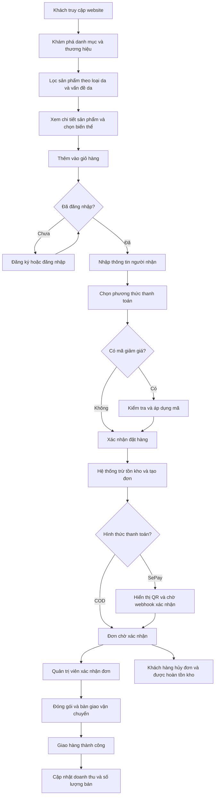

**Giải thích hình 1.1.** Quy trình nghiệp vụ được chia thành bốn pha rõ rệt: khám phá sản phẩm, lựa chọn và gom sản phẩm vào giỏ, thanh toán, và xử lý đơn hàng. Điểm đáng chú ý là nhánh hủy đơn chỉ mở ra khi đơn còn ở trạng thái "Chờ xác nhận" hoặc "Đã xác nhận"; đơn đã đóng gói hoặc đang giao không thể hủy.

### 1.2.2. Các đối tượng sử dụng và quyền hạn

**Hình 1.2. Ma trận phân quyền theo vai trò.**

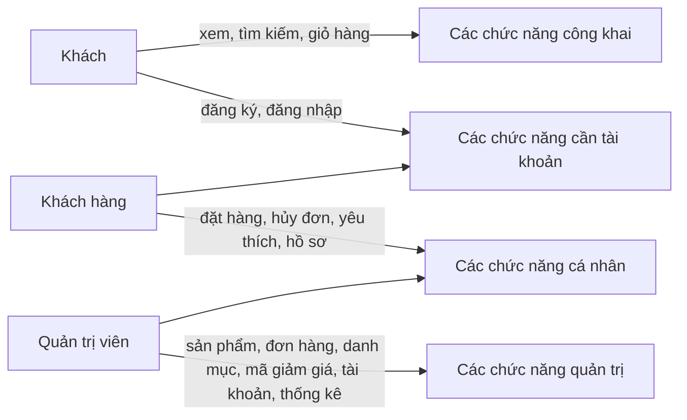

**Giải thích hình 1.2.** Hình thể hiện ba vai trò sử dụng và bốn nhóm chức năng theo mức độ yêu cầu tài khoản. Nhóm "các chức năng công khai" gồm những thao tác không cần đăng nhập như xem, tìm kiếm và thao tác giỏ hàng; nhóm "các chức năng cần tài khoản" gồm đăng ký và đăng nhập, là điều kiện để sang nhóm "các chức năng cá nhân". Khách hàng kế thừa toàn bộ nhóm chức năng công khai và bổ sung các chức năng cá nhân như đặt hàng, hủy đơn, quản lý danh sách yêu thích và cập nhật hồ sơ. Quản trị viên không chỉ dùng nhóm chức năng cá nhân mà còn nắm toàn bộ nhóm chức năng quản trị, bao gồm cả quyền xem và xử lý mọi đơn hàng của khách. Việc phân quyền này được kiểm tra ở tầng máy chủ, không chỉ ở giao diện — chi tiết ở mục 2.2.2.

**Bảng 1.1. Quyền hạn chi tiết của từng đối tượng sử dụng.**

| Nhóm chức năng | Khách | Khách hàng | Quản trị viên |
| --- | :---: | :---: | :---: |
| Xem trang chủ, danh mục, thương hiệu | ✔ | ✔ | ✔ |
| Xem danh sách sản phẩm, tìm kiếm, lọc | ✔ | ✔ | ✔ |
| Xem chi tiết sản phẩm, sản phẩm tương tự | ✔ | ✔ | ✔ |
| Thêm vào giỏ hàng, sửa số lượng | ✔ | ✔ | ✔ |
| Đăng ký, đăng nhập | ✔ | ✔ | ✔ |
| Xem trang câu hỏi thường gặp | ✔ | ✔ | ✔ |
| Đặt hàng | ✘ | ✔ | ✔ |
| Áp dụng mã giảm giá khi thanh toán | ✘ | ✔ | ✔ |
| Xem danh sách và chi tiết đơn hàng của mình | ✘ | ✔ | ✔ |
| Hủy đơn hàng | ✘ | ✔ | ✔ |
| Quản lý danh sách yêu thích | ✘ | ✔ | ✔ |
| Cập nhật hồ sơ, đổi mật khẩu | ✘ | ✔ | ✔ |
| Xem và quản lý toàn bộ đơn hàng | ✘ | ✘ | ✔ |
| Thêm, sửa, ngừng bán sản phẩm | ✘ | ✘ | ✔ |
| Quản lý biến thể và ảnh sản phẩm | ✘ | ✘ | ✔ |
| Quản lý danh mục và thương hiệu | ✘ | ✘ | ✔ |
| Quản lý mã giảm giá | ✘ | ✘ | ✔ |
| Khóa và mở khóa tài khoản người dùng | ✘ | ✘ | ✔ |
| Xem báo cáo thống kê | ✘ | ✘ | ✔ |
| Đối soát giao dịch thanh toán | ✘ | ✘ | ✔ |

### 1.2.3. Bảng yêu cầu chức năng

Mã yêu cầu `YCxx` dùng ổn định để đối chiếu giữa Chương I và đặc tả chức năng ở Chương III. Mức ưu tiên: **Cao** = bắt buộc cho nghiệp vụ cốt lõi; **Trung bình** = quan trọng nhưng có thể làm sau; **Thấp** = nâng cao trải nghiệm.

| Mã yêu cầu | Vai trò | Tên chức năng | Mô tả | Mức ưu tiên | Tình trạng |
| --- | --- | --- | --- | --- | --- |
| YC01 | Khách | Đăng ký tài khoản | Tạo tài khoản bằng email, mật khẩu và họ tên; kiểm tra email trùng và độ dài mật khẩu | Cao | Đã xác minh |
| YC02 | Khách | Xem danh sách sản phẩm | Xem sản phẩm theo danh mục và thương hiệu, có phân trang | Cao | Đã xác minh |
| YC03 | Khách | Tìm kiếm và lọc sản phẩm | Tìm theo tên; lọc theo khoảng giá, loại da, vấn đề da; sắp xếp theo giá, mới về, bán chạy | Cao | Đã xác minh |
| YC04 | Khách | Xem chi tiết sản phẩm | Xem đầy đủ thông tin, ảnh, biến thể, thành phần và sản phẩm tương tự | Cao | Đã xác minh |
| YC05 | Khách | Quản lý giỏ hàng | Thêm, sửa số lượng, xóa dòng giỏ; giới hạn số lượng 1–99; đồng bộ giá và tồn kho từ máy chủ | Cao | Đã xác minh |
| YC06 | Khách | Xem trang chủ và giới thiệu | Giới thiệu danh mục nổi bật, sản phẩm nổi bật, thương hiệu uy tín | Trung bình | Đã xác minh |
| YC07 | Khách | Đăng nhập và đăng xuất | Xác thực bằng email và mật khẩu; cấp token có thời hạn; từ chối tài khoản bị khóa | Cao | Đã xác minh |
| YC08 | Khách hàng | Đặt hàng | Kiểm tra tồn kho, chọn biến thể, tính tiền, tạo đơn và chi tiết đơn trong một giao dịch | Cao | Đã xác minh |
| YC09 | Khách hàng | Kiểm tra và áp dụng mã giảm giá | Kiểm tra điều kiện mã, tính số tiền giảm phía máy chủ, áp dụng khi đặt hàng | Cao | Đã xác minh |
| YC10 | Khách hàng | Xem đơn hàng của tôi | Xem danh sách và chi tiết đơn kèm timeline trạng thái; chỉ xem được đơn của mình | Cao | Đã xác minh |
| YC11 | Quản trị viên | Quản lý đơn hàng | Xem toàn bộ đơn, lọc theo trạng thái, tìm kiếm theo mã đơn hoặc tên khách | Cao | Đã xác minh |
| YC12 | Khách hàng | Hủy đơn hàng | Hủy đơn còn ở trạng thái chờ xác nhận hoặc đã xác nhận, hoàn lại tồn kho | Cao | Đã xác minh |
| YC13 | Khách hàng | Quản lý danh sách yêu thích | Thêm, xóa và xem sản phẩm yêu thích; không thêm trùng | Trung bình | Đã xác minh |
| YC14 | Khách hàng | Cập nhật hồ sơ và đổi mật khẩu | Sửa tên, điện thoại, địa chỉ; đổi mật khẩu có xác nhận mật khẩu cũ | Trung bình | Đã xác minh |
| YC15 | Quản trị viên | Quản lý sản phẩm | Thêm, sửa, ngừng bán sản phẩm; khai báo biến thể; tính lại tồn kho tổng hợp | Cao | Đã xác minh |
| YC16 | Quản trị viên | Quản lý ảnh sản phẩm | Tải lên nhiều ảnh, đặt ảnh chính, sắp xếp thứ tự thư viện ảnh | Cao | Đã xác minh |
| YC17 | Quản trị viên | Quản lý danh mục | Thêm, sửa, ngừng sử dụng danh mục sản phẩm | Trung bình | Đã xác minh |
| YC18 | Quản trị viên | Quản lý thương hiệu | Thêm, sửa, ngừng sử dụng thương hiệu sản phẩm | Trung bình | Đã xác minh |
| YC19 | Quản trị viên | Cập nhật trạng thái đơn hàng | Chuyển trạng thái theo máy trạng thái, ghi chú, sinh mã vận đơn, cập nhật trạng thái thanh toán COD | Cao | Đã xác minh |
| YC20 | Quản trị viên | Quản lý tài khoản người dùng | Xem danh sách tài khoản, khóa và mở khóa tài khoản | Trung bình | Đã xác minh |
| YC21 | Quản trị viên | Xem báo cáo thống kê | Doanh thu đã thu và chưa thu, đơn theo trạng thái, doanh thu theo ngày, sản phẩm bán chạy, cảnh báo tồn kho thấp | Trung bình | Đã xác minh |
| YC22 | Khách hàng | Thanh toán trực tuyến SePay | Sinh mã QR VietQR, nhận webhook xác nhận, kiểm tra số tiền và tài khoản nhận | Cao | Đã xác minh |
| YC23 | Quản trị viên | Đối soát giao dịch thanh toán | Quét giao dịch cổng thanh toán và đánh dấu các đơn còn chưa thanh toán | Thấp | Có triển khai nhưng chưa kiểm tra chạy |
| YC24 | Khách | Xem câu hỏi thường gặp | Xem các câu hỏi và câu trả lời theo nhóm | Thấp | Đã xác minh |

### 1.2.4. Yêu cầu phi chức năng

| Mã | Yêu cầu phi chức năng | Mô tả và tiêu chí kiểm chứng |
| --- | --- | --- |
| YC25 | Dễ sử dụng | Giao diện tiếng Việt, hiển thị đầy đủ trên màn hình máy tính, thao tác đặt hàng không quá bốn bước |
| YC26 | Phân quyền | Mọi chức năng quản trị kiểm tra vai trò ở tầng máy chủ, không chỉ ẩn nút trên giao diện; giao diện và máy chủ dùng chung một nguồn quy tắc |
| YC27 | Bảo vệ thông tin | Mật khẩu băm bcrypt cost 12; không bao giờ trả về trường mật khẩu; token có thời hạn 1 ngày; chữ ký webhook xác thực bằng HMAC-SHA256 |
| YC28 | Toàn vẹn dữ liệu tài chính | Dùng kiểu `NUMERIC` cho tiền tệ; chỉ mục UNIQUE chống gán trùng giao dịch; snapshot giá tại thời điểm mua |
| YC29 | Chống bán vượt tồn kho | Khoá dòng dữ liệu khi kiểm tra và trừ tồn kho; rollback toàn bộ giao dịch khi có bất kỳ lỗi nào |
| YC30 | Khả năng chạy trong môi trường dự án | Chạy được trên máy sạch với Python 3.13 và Node.js 20+; cấu hình qua tệp `.env`; cấu trúc bảng tạo bằng migration; dữ liệu mẫu nạp bằng một lệnh |
| YC31 | Khả năng mở rộng | Cấu trúc bảng cho phép bổ sung bảng đánh giá, phí vận chuyển, nội dung bài viết mà không phải thiết kế lại; quản lý ảnh tách khỏi cơ sở dữ liệu qua dịch vụ đám mây |
| YC32 | Dễ bảo trì | Chuẩn mã hóa thống nhất giữa máy chủ và giao diện về tên bảng, tên trường, mã trạng thái; có bộ kiểm thử tự động cho các nghiệp vụ cốt lõi |

## 1.3. Phạm vi và quy trình nghiệp vụ tổng quát

### 1.3.1. Các chức năng nhóm đã triển khai

Tổng hợp từ mã nguồn, nhóm đã triển khai 24 yêu cầu chức năng nêu trong mục 1.2.3, tương ứng với:

- **Nhóm khách:** trang chủ, danh sách sản phẩm, chi tiết sản phẩm, tìm kiếm và lọc, đăng ký, đăng nhập, giỏ hàng, câu hỏi thường gặp, liên kết mạng xã hội.
- **Nhóm khách hàng:** xác nhận đặt hàng, thanh toán QR SePay, danh sách đơn hàng, chi tiết đơn hàng và timeline, hủy đơn, danh sách yêu thích, hồ sơ cá nhân.
- **Nhóm quản trị:** tổng quan thống kê, quản lý sản phẩm, quản lý ảnh sản phẩm, quản lý đơn hàng và cập nhật trạng thái, quản lý mã giảm giá, quản lý danh mục, quản lý thương hiệu, quản lý người dùng, đối soát giao dịch thanh toán.

### 1.3.2. Giới hạn của phiên bản hiện tại

| Hạn mục | Nội dung |
| --- | --- |
| Phí vận chuyển | Chưa triển khai; mọi đơn hàng được giao miễn phí, tổng tiền bằng tổng tiền hàng trừ số tiền giảm |
| Đánh giá sản phẩm | Trường điểm đánh giá có trong cấu trúc dữ liệu nhưng chưa có chức năng viết và hiển thị đánh giá |
| Tư vấn bằng trí tuệ nhân tạo | Chưa có dịch vụ trợ lý routine và chatbot; bộ lọc theo loại da và vấn đề da đã hoạt động độc lập |
| Quản lý nội dung | Banner và menu được định nghĩa tĩnh trong mã nguồn giao diện, không có màn hình quản trị |
| Bài tin | Chưa có mô hình dữ liệu và giao diện cho bài viết, tin tức |
| Đối soát tự động | Tác vụ đối soát thanh toán tồn tại trong mã nguồn nhưng chưa có lịch chạy tự động |
| Đồng bộ giỏ hàng đa thiết bị | Giỏ hàng lưu cục bộ trong trình duyệt, chưa lưu phía máy chủ |
| Vận chuyển | Mã vận đơn được sinh tự động khi chuyển trạng thái, chưa tích hợp đơn vị vận chuyển |

### 1.3.3. Diễn giải quy trình từ tìm sản phẩm đến xử lý đơn hàng

**Bước 1 — Tìm sản phẩm.** Khách vào trang chủ, chọn danh mục hoặc dùng bộ lọc theo loại da và vấn đề da, hoặc tìm theo từ khóa. Hệ thống trả về danh sách sản phẩm còn bán kèm thông tin lọc và phân trang.

**Bước 2 — Xem chi tiết và chọn biến thể.** Khách mở trang chi tiết sản phẩm, xem thành phần và thông tin dành cho từng loại da, chọn biến thể nếu có, và xem các sản phẩm tương tự được gợi ý theo cùng danh mục và vấn đề da.

**Bước 3 — Thêm vào giỏ hàng.** Hệ thống lưu dòng giỏ với khoá `product_id` + `variant_id`, giới hạn số lượng 1–99, cộng dồn nếu trùng dòng. Khi mở trang giỏ, giá và tồn kho được đồng bộ lại từ máy chủ, không làm thay đổi số lượng khách đã chọn.

**Bước 4 — Thanh toán.** Nếu chưa đăng nhập, khách được chuyển tới trang đăng nhập và giỏ hàng vẫn được giữ nguyên. Tại trang thanh toán, khách nhập thông tin người nhận, nhập mã giảm giá nếu có, chọn COD hoặc SePay, rồi xác nhận đặt hàng.

**Bước 5 — Kiểm tra và tạo đơn.** Hệ thống kiểm tra từng dòng giỏ: sản phẩm còn bán, biến thể hợp lệ, còn đủ tồn kho. Sau đó trừ tồn kho, chụp snapshot giá và tên, tính tổng tiền, tạo đơn với mã `ORD` + ngày + 4 số ngẫu nhiên, tạo chi tiết đơn và ghi lịch sử trạng thái "Chờ xác nhận". Mọi thao tác nằm trong một giao dịch, lỗi bất kỳ thì toàn bộ được hoàn tác.

**Bước 6 — Thanh toán (nếu chọn SePay).** Hệ thống sinh mã QR VietQR với số tiền và nội dung chuyển khoản chứa mã đơn. Khách quét mã và chuyển khoản. Cổng thanh toán gửi webhook về hệ thống; sau khi xác thực chữ ký và kiểm tra số tiền, tài khoản nhận, trạng thái đơn, hệ thống đánh dấu đơn đã thanh toán. Giao diện tự thăm dò trạng thái mỗi 4 giây.

**Bước 7 — Xử lý đơn.** Quản trị viên xác nhận đơn, ghi chú nếu cần, chuyển sang "Đang đóng gói", rồi "Đang giao hàng" — hệ thống tự sinh mã vận đơn — và cuối cùng "Đã giao hàng". Với đơn COD, bước cuối tự đánh dấu đã thanh toán và cộng số lượng bán cho sản phẩm. Khách theo dõi toàn bộ tiến trình trên timeline trạng thái.

**Bước 8 — Hủy đơn (điều kiện).** Nếu đơn còn ở "Chờ xác nhận" hoặc "Đã xác nhận", khách có thể hủy; hệ thống chuyển trạng thái sang "Đã hủy" và hoàn tồn kho đúng bằng số lượng đã mua, tính theo biến thể nếu có.

# CHƯƠNG II. KIẾN THỨC ÁP DỤNG

Chương này trình bày các kiến thức cần thiết để đọc và hiểu thiết kế hệ thống ở Chương III. Mỗi công nghệ được nêu theo vai trò cụ thể của nó trong dự án, không mô tả chung chung.

## 2.1. Phân tích và thiết kế hệ thống

### 2.1.1. Biểu đồ phân cấp chức năng (BFD)

**Khái niệm:** BFD (Business Function Diagram — biểu đồ phân cấp chức năng) là sơ đồ biểu diễn cấu trúc chức năng của hệ thống theo quan hệ phân cấp, từ chức năng tổng quát đến các chức năng con cụ thể.

**Các thành phần:** BFD chỉ có một loại phần tử — các hộp chức năng. Khác với DFD, BFD không biểu diễn dòng dữ liệu, không có tác nhân và không có kho dữ liệu. Đường nối giữa các hộp biểu thị quan hệ "cha – con": hộp bên trên là chức năng bao hàm, các hộp bên dưới là các chức năng con cụ thể hóa nó.

**Cách đọc:** Đọc từ gốc xuống. Mỗi cấp phân rã một chức năng tổng quát thành các chức năng nhỏ hơn cho tới khi đạt mức chi tiết vừa đủ để ánh xạ tới một nhóm chức năng cụ thể trong hệ thống. Ví dụ trong báo cáo này, gốc là "Website bán mỹ phẩm trực tuyến cosme-shop", cấp hai là ba vai trò, cấp ba là các chức năng nghiệp vụ.

**Mục đích áp dụng:** BFD giúp nhóm thành viên thống nhất về phạm vi hệ thống trước khi thiết kế chi tiết; phục vụ việc phân công phần mềm giữa các thành viên; và là cơ sở để kiểm tra tính đầy đủ của bảng yêu cầu ở mục 1.2.3. Trong báo cáo này, BFD được vẽ bằng cú pháp `flowchart TB` của Mermaid.

### 2.1.2. Biểu đồ luồng dữ liệu (DFD)

**Khái niệm:** DFD (Data Flow Diagram — biểu đồ luồng dữ liệu) mô tả cách dữ liệu di chuyển và được biến đổi trong hệ thống. DFD trả lời câu hỏi "dữ liệu đi đâu, đến từ đâu, được xử lý thế nào", chứ không mô tả cấu trúc dữ liệu lưu trữ.

**Các thành phần:**

| Thành phần | Ý nghĩa | Ký hiệu quy ước trong báo cáo này |
| --- | --- | --- |
| Tác nhân ngoài (External Entity) | Chủ thể bên ngoài hệ thống gửi dữ liệu vào hoặc nhận dữ liệu ra | Hình chữ nhật `KH["Khách hàng"]` |
| Tiến trình (Process) | Hoạt động biến đổi dữ liệu đầu vào thành dữ liệu đầu ra | Hình tròn đôi `P1(("1.0 Tra cứu sản phẩm"))` |
| Kho dữ liệu (Data Store) | Nơi lưu trữ dữ liệu trong hệ thống | Hình trụ `D1[("D1. Sản phẩm")]` |
| Luồng dữ liệu (Data Flow) | Dòng dữ liệu truyền giữa các thành phần | Mũi tên có nhãn `KH --\|Từ khóa tìm kiếm\| P1` |

**Mức ngữ cảnh và mức phân rã:** DFD được xây dựng theo nguyên tắc phân rã từng bước. Mức ngữ cảnh biểu diễn toàn hệ thống như một tiến trình duy nhất đánh số `0`, cùng các tác nhân ngoài và các luồng qua ranh giới hệ thống. Mức phân rã cấp đầu tiên thay tiến trình `0` bằng các tiến trình nghiệp vụ thành phần, bổ sung kho dữ liệu và các luồng nội bộ.

**Nguyên tắc cân bằng:** Các luồng dữ liệu qua ranh giới hệ thống ở mức phân rã phải cân bằng với mức ngữ cảnh — mỗi luồng ở mức trên phải có dữ liệu tương đương ở mức dưới. Một luồng gộp có thể được tách thành nhiều luồng cụ thể hơn nếu nội dung dữ liệu vẫn tương đương, và ngược lại.

**Mục đích áp dụng:** DFD giúp xác định đầy đủ các kho dữ liệu cần có, phát hiện trường hợp một tiến trình vừa nhận vừa không có nơi lưu dữ liệu, và làm cơ sở đối chiếu với sơ đồ ERD ở mục 3.1.2. Trong báo cáo này, DFD được vẽ bằng cú pháp `flowchart` của Mermaid kèm bảng quy ước ký hiệu, vì Mermaid không có kiểu biểu đồ DFD chuyên dụng.

## 2.2. Quản trị hệ thống

Quản trị hệ thống trong dự án này tập trung vào bốn nội dung: xác thực người dùng, phân quyền theo vai trò, quản lý tài khoản và cấu hình môi trường chạy.

### 2.2.1. Xác thực người dùng

Hệ thống dùng **JSON Web Token (JWT)** với thuật toán ký `HS256`. Khi đăng nhập thành công, máy chủ ký một token chứa định danh người dùng trong trường `sub` và thời điểm hết hạn, trả về cho giao diện lưu trữ. Mỗi yêu cầu sau đó gửi kèm token trong tiêu đề `Authorization: Bearer <token>`; máy chủ giải mã, kiểm tra chữ ký và thời hạn, rồi nạp người dùng từ cơ sở dữ liệu.

Token có thời hạn **1 ngày** (biến `ACCESS_TOKEN_EXPIRE_SECONDS=86400`) và không có cơ chế làm mới. Khi token hết hạn, các yêu cầu kèm token trả về HTTP 401 với mã lỗi `TOKEN_EXPIRED`.

Mật khẩu được băm bằng thuật toán **bcrypt** với cost factor 12 thông qua thư viện `passlib`, lưu vào trường `password_hash`. Mật khẩu bản rõ không bao giờ được lưu và cũng không bao giờ được trả về trong phản hồi API.

### 2.2.2. Phân quyền theo vai trò

Hệ thống có hai giá trị vai trò lưu trong trường `users.role`: `user` (khách hàng) và `admin` (quản trị viên); người chưa đăng nhập không có bản ghi trong `users` và được xử lý như vị trí khách. Phân quyền được thực hiện bằng cơ chế dependency của FastAPI, khai báo tập trung trong `backend/app/api/deps.py`:

| Dependency | Cơ chế kiểm tra | Kết quả khi không đạt |
| --- | --- | --- |
| `get_current_user` | Kiểm tra có token, token hợp lệ, người dùng tồn tại, tài khoản không bị khóa | HTTP 401 `TOKEN_EXPIRED` hoặc HTTP 403 `ACCOUNT_LOCKED` |
| `get_current_admin` | Kiểm tra `role = "admin"` của người dùng hiện tại | HTTP 403 `FORBIDDEN` |
| `get_optional_user` | Trả về người dùng nếu có token hợp lệ, ngược lại trả `null` | Không lỗi |

Điểm đáng lưu ý về mặt thiết kế: phân quyền được **kiểm tra ở tầng máy chủ trên mọi endpoint quản trị**, không chỉ ẩn nút trên giao diện. Giao diện có thêm lớp bảo vệ điều hướng (`ProtectedRoute`, `AdminRoute`) nhưng chỉ để cải thiện trải nghiệm, không phải cơ chế bảo vệ chính.

### 2.2.3. Quản lý tài khoản

Quản lý tài khoản được thực hiện theo mô hình **xóa mềm**: cờ `is_active` quyết định tài khoản còn hoạt động hay không. Quản trị viên khóa tài khoản bằng cách tắt cờ này thay vì xóa bản ghi, nhờ vậy toàn bộ đơn hàng và lịch sử của người dùng vẫn được giữ nguyên và truy vết được.

Người dùng tự quản lý thông tin qua các chức năng cập nhật hồ sơ và đổi mật khẩu. Khi đổi mật khẩu, hệ thống yêu cầu mật khẩu cũ chính xác, từ chối mật khẩu mới trùng mật khẩu cũ, và băm lại mật khẩu mới trước khi ghi.

### 2.2.4. Cấu hình môi trường chạy

Toàn bộ thông số nhạy cảm và thông số cấu hình được đặt trong các tệp `.env`, đọc bằng `pydantic-settings`. Tệp `.env.example` là bản mẫu được cung cấp sẵn; tệp `.env` thật được liệt kê trong `.gitignore` nên không bao giờ được đưa lên kho mã nguồn.

| Nhóm biến | Ví dụ | Vai trò |
| --- | --- | --- |
| Cơ sở dữ liệu | `DATABASE_URL` | Chuỗi kết nối PostgreSQL qua driver `asyncpg` |
| Xác thực | `JWT_SECRET_KEY`, `JWT_ALGORITHM`, `ACCESS_TOKEN_EXPIRE_SECONDS` | Ký token và đặt thời hạn |
| CORS | `CORS_ORIGINS` | Danh sách origin được phép gọi API |
| Thanh toán | `SEPAY_BANK_ACCOUNT`, `SEPAY_BANK_NAME`, `SEPAY_WEBHOOK_SECRET`, `SEPAY_PAYMENT_CODE_PREFIX` | Sinh QR và xác thực webhook |
| Ảnh | `CLOUDINARY_CLOUD_NAME`, `CLOUDINARY_API_KEY`, `CLOUDINARY_API_SECRET` | Tải ảnh sản phẩm lên dịch vụ đám mây |
| Tự động | `AUTO_MIGRATE` | Tự chạy migration khi khởi động ứng dụng |

### 2.2.5. Kiểm tra cấu hình lúc khởi động

Một đặc điểm đáng chú ý của dự án là cơ chế **kiểm tra cấu hình lúc khởi động** (fail-fast). Trước khi phục vụ yêu cầu, ứng dụng kiểm tra cấu hình thanh toán: độ dài tiền tố và hậu tố mã thanh toán, tổng độ dài mã không vượt quá 32 ký tự, và tiền tố nội dung chuyển khoản bắt buộc với một số ngân hàng. Nếu cấu hình sai, ứng dụng **từ chối khởi động** thay vì chạy với cấu hình lỗi.

Lý do rất rõ ràng: cấu hình sai chỉ lộ ra khi có giao dịch thật, khi đó tiền khách chuyển không được cổng thanh toán đẩy về hệ thống và khách phải chờ thủ công — một tổn thất tài chính thầm lặng. Kiểm tra sớm biến lỗi cấu hình thành lỗi khởi động rõ ràng.

## 2.3. Cơ sở dữ liệu

### 2.3.1. Hệ quản trị cơ sở dữ liệu

Hệ thống sử dụng **PostgreSQL 17** — hệ quản trị cơ sở dữ liệu quan hệ mã nguồn mở. Trong môi trường phát triển, dự án dùng dịch vụ Neon (PostgreSQL trên đám mây) với kết nối dạng pooled connection.

Các lý do lựa chọn PostgreSQL cho dự án:

- Hỗ trợ đầy đủ kiểu `JSONB` với toán tử chứa `@>`, phù hợp với các trường metadata dạng mảng của ngành mỹ phẩm (`skin_types`, `concerns`, `key_ingredients`, `free_from`).
- Hỗ trợ kiểu `NUMERIC` chính xác tuyệt đối, không có lỗi làm tròn như kiểu số thực — điều bắt buộc với dữ liệu tiền tệ.
- Hỗ trợ **chỉ mục partial unique** (`CREATE UNIQUE INDEX ... WHERE ...`), nền tảng kỹ thuật của cơ chế chống gán trùng giao dịch thanh toán.
- Hỗ trợ khóa ngoại với hành vi `ON DELETE CASCADE` cho các bảng con.
- Tương thích đầy đủ với driver `asyncpg` cho lập trình bất đồng bộ.

### 2.3.2. Mô hình dữ liệu

Hệ thống sử dụng **mô hình quan hệ** với các thực thể chính: người dùng, danh mục, thương hiệu, sản phẩm, ảnh sản phẩm, đơn hàng, chi tiết đơn hàng, lịch sử trạng thái, danh sách yêu thích, mã giảm giá và nhật ký thanh toán.

Các khái niệm quan trọng cần nắm để hiểu thiết kế:

- **Khóa chính (Primary Key):** mọi bảng có cột `id` kiểu `SERIAL` sinh tự động, là định danh duy nhất của bản ghi.
- **Khóa ngoại (Foreign Key):** cột tham chiếu tới bản ghi ở bảng khác, thể hiện quan hệ. Ví dụ `orders.user_id` tham chiếu `users.id`.
- **Quan hệ 1–N:** một bản ghi cha có nhiều bản ghi con. Ví dụ một người dùng có nhiều đơn hàng.
- **Ràng buộc toàn vẹn (Constraint):** quy tắc do cơ sở dữ liệu bảo đảm, không thể bị vi phạm bởi ứng dụng. Ví dụ `UNIQUE`, `CHECK`, `NOT NULL`.
- **Chỉ mục (Index):** cấu trúc phụ trợ tăng tốc truy vấn, đồng thời có thể dùng để bảo đảm tính duy nhất.
- **Xóa mềm (Soft Delete):** đánh dấu bản ghi không còn hiệu lực bằng cờ `is_active` thay vì xóa vật lý, giữ nguyên tính toàn vẹn tham chiếu.
- **Snapshot:** sao chép giá trị dữ liệu vào bản ghi giao dịch tại thời điểm ghi, để lịch sử không bị thay đổi khi dữ liệu gốc thay đổi.

### 2.3.3. Ánh xạ với dữ liệu sản phẩm, khách hàng và đơn hàng

Ba nhóm nghiệp vụ trung tâm liên kết với nhau theo cấu trúc sau:

- **Dữ liệu sản phẩm:** `categories` và `brands` là danh mục tham chiếu; `products` chứa thuộc tính thương mại và metadata JSONB; `product_images` lưu nhiều ảnh của một sản phẩm với đúng một ảnh chính.
- **Dữ liệu khách hàng:** `users` lưu tài khoản và hồ sơ; `wishlists` liên kết người dùng với sản phẩm yêu thích.
- **Dữ liệu đơn hàng:** `orders` lưu đầu đơn và thông tin giao hàng, thanh toán; `order_items` lưu dòng chi tiết với dữ liệu snapshot; `order_status_history` lưu timeline trạng thái; `payment_webhook_logs` lưu nhật ký giao dịch thanh toán.

Mối liên hệ giữa ba nhóm: một đơn hàng thuộc về một người dùng, chứa nhiều dòng chi tiết trỏ tới các sản phẩm, và có nhiều bản ghi lịch sử trạng thái. `coupons` tham gia vào đơn hàng qua cơ chế snapshot (`orders.discount_code`), không dùng khóa ngoại.

## 2.4. Ngôn ngữ lập trình và công nghệ

### 2.4.1. Ngôn ngữ lập trình

| Ngôn ngữ | Phiên bản | Vai trò trong dự án |
| --- | --- | --- |
| Python | 3.13 | Toàn bộ máy chủ: xử lý nghiệp vụ, truy vấn cơ sở dữ liệu, xác thực, tích hợp thanh toán và lưu trữ ảnh |
| TypeScript | ~6.0 | Toàn bộ giao diện, với chế độ `strict` giúp phát hiện lỗi kiểu dữ liệu khi biên dịch |
| SQL | PostgreSQL | Định nghĩa schema, truy vấn thống kê tổng hợp, và các câu lệnh `UPDATE` nguyên tử chống tranh chấp |
| Bash, Batch | — | Kịch bản khởi động đồng thời `run-all.sh` và `run-all.bat` |

### 2.4.2. Framework và thư viện phía máy chủ

| Thành phần | Phiên bản | Vai trò cụ thể |
| --- | --- | --- |
| FastAPI | 0.141.1 | Khung web, tự sinh tài liệu OpenAPI tại `/docs`, hỗ trợ dependency injection cho cơ chế phân quyền |
| Uvicorn | 0.53.0 | Máy chủ ASGI chạy ứng dụng FastAPI, chế độ `--reload` cho phát triển |
| SQLAlchemy | 2.0.54 | Ánh xạ đối tượng quan hệ, hỗ trợ bất đồng bộ hoàn toàn |
| asyncpg | 0.31.0 | Driver PostgreSQL bất đồng bộ |
| Alembic | 1.20.0 | Quản lý phiên bản cấu trúc cơ sở dữ liệu |
| Pydantic | 2.13.5 | Kiểm tra dữ liệu đầu vào và định nghĩa cấu trúc phản hồi API |
| pydantic-settings | 2.15.0 | Đọc và kiểm tra cấu hình từ tệp `.env` |
| python-jose | 3.5.0 | Ký và giải mã token JWT |
| passlib + bcrypt | 1.7.4 / 4.0.1 | Băm mật khẩu |
| httpx | 0.28.1 | Gọi API của cổng thanh toán trong tác vụ đối soát, và làm công cụ kiểm thử |
| cloudinary | 1.46.2 | Tải ảnh sản phẩm lên dịch vụ đám mây |
| python-multipart | 0.0.32 | Xử lý tệp tải lên dạng form-data |

### 2.4.3. Framework và thư viện phía giao diện

| Thành phần | Phiên bản | Vai trò cụ thể |
| --- | --- | --- |
| React | 18.3.1 | Thư viện xây dựng giao diện dựa trên thành phần |
| React Router | 6.30.1 | Định tuyến phía giao diện, kèm các lớp bảo vệ tuyến theo vai trò |
| Ant Design | 5.25.4 | Thư viện giao diện sẵn có: bảng, biểu mẫu, hộp thoại, thông báo; có bản tiếng Việt |
| TanStack Query | 5.80.2 | Quản lý trạng thái dữ liệu phía máy chủ: lưu đệm, thăm dò lại, vô hiệu hóa truy vấn |
| Zustand | 5.0.5 | Quản lý trạng thái phía giao diện: giỏ hàng và phiên đăng nhập, có tính năng lưu cục bộ |
| Axios | 1.10.0 | Gửi yêu cầu HTTP, kèm interceptor gắn token và xử lý lỗi tập trung |
| Vite | 8.3.0 | Máy chủ phát triển với tải lại nóng và đóng gói bản phát hành |
| Day.js | 1.11.23 | Định dạng ngày tháng |
| ESLint + TypeScript ESLint | 10.x | Kiểm tra chất lượng mã nguồn giao diện |

### 2.4.4. Công cụ và dịch vụ hỗ trợ

| Công cụ | Vai trò |
| --- | --- |
| Git | Quản lý phiên bản mã nguồn |
| Pytest + pytest-asyncio + httpx | Bộ kiểm thử tự động phía máy chủ, gồm 15 tệp kiểm thử bao phủ các nghiệp vụ cốt lõi |
| Neon | Cung cấp cơ sở dữ liệu PostgreSQL trên đám mây |
| Cloudinary | Lưu trữ và phân phối ảnh sản phẩm, sinh các biến thể kích thước theo yêu cầu |
| SePay / VietQR | Cổng thanh toán trực tuyến, sinh mã QR theo mẫu VietQR và gửi webhook xác nhận |

### 2.4.5. Các quyết định kỹ thuật chính

| Quyết định | Lý do |
| --- | --- |
| Lập trình bất đồng bộ toàn bộ phía máy chủ | Tăng hiệu năng khi phải chờ cơ sở dữ liệu và cổng thanh toán |
| Giỏ hàng lưu ở phía giao diện | Khách chưa đăng nhập cũng dùng được giỏ; giảm tải máy chủ |
| Giá và tên sản phẩm được snapshot vào đơn hàng | Lịch sử đơn hàng không bị ảnh hưởng khi giá sản phẩm thay đổi |
| Chống trùng giao dịch thực hiện ở tầng cơ sở dữ liệu | Kiểm tra ở tầng ứng dụng có điều kiện tranh chấp khi hai tiến trình chạy song song |
| Mã trạng thái lưu bằng tiếng Anh, nhãn hiển thị bằng tiếng Việt | Mã là định danh kỹ thuật ổn định, không phụ thuộc ngôn ngữ hiển thị |
| Kiểm tra cấu hình thanh toán lúc khởi động | Tránh mất tiền do cấu hình sai mà không có thông báo lỗi |
| Tách cấu hình khỏi mã nguồn qua tệp `.env` | Dùng chung mã nguồn cho nhiều môi trường mà không sửa mã |

# CHƯƠNG III. PHÂN TÍCH THIẾT KẾ HỆ THỐNG

Chương này trình bày thiết kế chi tiết của hệ thống `cosme-shop` dựa trên mã nguồn đã triển khai: cấu trúc dữ liệu (cơ sở dữ liệu quan hệ), phân rã chức năng (BFD), biểu đồ luồng dữ liệu (DFD) và đặc tả hành vi của từng chức năng chính. Mọi tên bảng, tên trường, trạng thái đơn hàng và quy tắc nghiệp vụ nêu trong chương đều được đối chiếu với mã nguồn thực tế tại thư mục `backend/` và `frontend/`.

> **Quy ước ghi nhãn tình trạng trong chương:**
>
> | Nhãn | Ý nghĩa |
> | --- | --- |
> | *đã xác minh* | Đọc trực tiếp từ mã nguồn hoặc chạy thử trên môi trường phát triển, hành vi quan sát được |
> | *có triển khai nhưng chưa kiểm tra chạy* | Có mã nguồn nhưng chưa có bằng chứng chạy thành công trong phiên khảo sát |
> | *đề xuất* | Chưa có trong hệ thống, đưa ra như khuyến nghị hoặc nằm ở mục 3.3 |

## 3.1. Phân tích thiết kế cơ sở dữ liệu

### 3.1.1. Các thực thể và quan hệ

Hệ thống lưu trữ dữ liệu trên PostgreSQL 17 với 11 bảng nghiệp vụ, tất cả nằm trong schema `public`. Trước khi mô tả chi tiết từng bảng, bảng dưới đây tổng hợp các thực thể dữ liệu và ý nghĩa quan hệ giữa chúng.

| Mã | Thực thể (bảng) | Ý nghĩa nghiệp vụ |
| --- | --- | --- |
| E01 | `users` | Tài khoản đăng nhập và hồ sơ khách hàng/quản trị viên |
| E02 | `categories` | Danh mục sản phẩm (Skincare, Makeup, Sunscreen…) |
| E03 | `brands` | Thương hiệu sản phẩm (The Ordinary, La Roche-Posay…) |
| E04 | `products` | Sản phẩm bán, kèm metadata JSONB phục vụ bộ lọc |
| E05 | `product_images` | Ảnh sản phẩm lưu trên Cloudinary, nhiều ảnh mỗi sản phẩm |
| E06 | `orders` | Đơn hàng, chứa thông tin giao hàng, thanh toán và tổng tiền |
| E07 | `order_items` | Dòng chi tiết đơn hàng, lưu snapshot giá tại thời điểm mua |
| E08 | `order_status_history` | Lịch sử chuyển trạng thái đơn hàng (timeline) |
| E09 | `wishlists` | Sản phẩm yêu thích của khách hàng |
| E10 | `coupons` | Mã giảm giá theo phần trăm hoặc số tiền cố định |
| E11 | `payment_webhook_logs` | Nhật ký webhook thanh toán, dùng chống xử lý trùng và đối soát |

Quan hệ giữa các thực thể được tóm tắt như sau:

- **Người dùng – Đơn hàng:** một người dùng (`users`) đặt nhiều đơn (`orders`) qua khóa ngoại `orders.user_id`. Đây là quan hệ 1–N.
- **Người dùng – Yêu thích:** một người dùng lưu nhiều sản phẩm yêu thích (`wishlists`), ràng buộc duy nhất trên cặp `(user_id, product_id)` để một sản phẩm không bị thêm trùng.
- **Người dùng – Lịch sử trạng thái:** `order_status_history.created_by` trỏ về `users.id`, cho biết ai đã thực hiện thao tác đổi trạng thái (khách hàng hủy đơn hoặc quản trị viên xác nhận).
- **Đơn hàng – Chi tiết đơn:** một đơn (`orders`) gồm nhiều dòng (`order_items`), xóa đơn thì dòng chi tiết bị xóa theo (`ON DELETE CASCADE`).
- **Đơn hàng – Lịch sử trạng thái:** một đơn có nhiều bản ghi lịch sử, phục vụ hiển thị timeline trạng thái.
- **Danh mục – Sản phẩm:** một danh mục chứa nhiều sản phẩm (`products.category_id`).
- **Thương hiệu – Sản phẩm:** một thương hiệu chứa nhiều sản phẩm (`products.brand_id`).
- **Sản phẩm – Ảnh:** một sản phẩm có nhiều ảnh (`product_images.product_id`), xóa sản phẩm thì ảnh bị xóa theo.
- **Sản phẩm – Dòng đơn hàng:** `order_items.product_id` giữ tham chiếu tới sản phẩm, nhưng các trường hiển thị (`product_name`, `product_price`, `product_image`, `variant_info`) được **snapshot** tại thời điểm mua nên lịch sử đơn hàng không bị ảnh hưởng khi sản phẩm được sửa hoặc ngừng bán.
- **Mã giảm giá – Đơn hàng:** `coupons` không có khóa ngoại tới đơn hàng. Khi tạo đơn, `orders.discount_code` và `orders.discount_amount` lưu snapshot, nên việc quản trị viên xóa mã giảm giá không làm thay đổi lịch sử đơn cũ.
- **Webhook thanh toán – Đơn hàng:** `payment_webhook_logs` cố tình **không** có khóa ngoại tới `orders`, để các giao dịch lỗi (không khớp đơn, sai số tiền, đơn đã hủy) vẫn được lưu lại phục vụ đối soát.

### 3.1.2. Sơ đồ quan hệ thực thể (ERD)

**Hình 3.1. Sơ đồ ERD của cơ sở dữ liệu `cosme_shop`.**

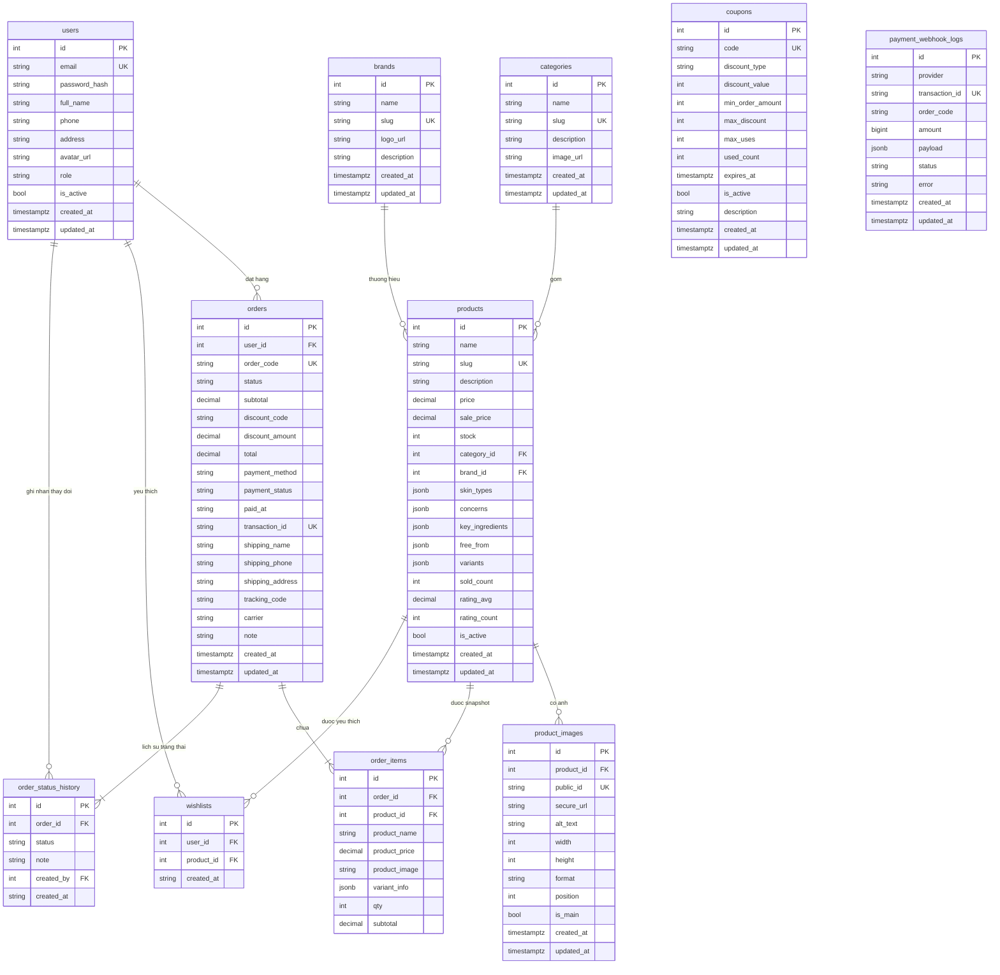

**Giải thích hình 3.1.** Sơ đồ thể hiện 11 thực thể và các quan hệ chính. Ba quan hệ 1–N trục tâm là `users` → `orders`, `categories`/`brands` → `products` và `orders` → `order_items`. Đặc biệt lưu ý: `order_items` giữ đồng thời khóa ngoại `product_id` (để còn truy vết sản phẩm) và các trường snapshot (`product_name`, `product_price`, `product_image`, `variant_info`) — đây là cơ chế tách biệt dữ liệu giao dịch khỏi dữ liệu danh mục, được giải thích kỹ ở mục 3.1.4. Ba bảng `coupons`, `payment_webhook_logs` và `wishlists` được thể hiện quan hệ với `users`/`products` ở phần trên; riêng `coupons` và `payment_webhook_logs` không có đường kẻ quan hệ vì không khai báo khóa ngoại trong schema.

### 3.1.3. Đặc tả các bảng dữ liệu

#### 3.1.3.1. Bảng `users`

**Mục đích:** lưu tài khoản đăng nhập và hồ sơ người dùng, dùng chung cho khách hàng và quản trị viên, phân biệt bằng trường `role`.

| Tên trường | Kiểu dữ liệu | Khóa hoặc ràng buộc | Cho phép rỗng | Ý nghĩa |
| --- | --- | --- | --- | --- |
| `id` | `SERIAL` | PK | Không | Định danh tài khoản |
| `email` | `VARCHAR(255)` | UNIQUE, INDEX | Không | Email dùng để đăng nhập, duy nhất trong hệ thống |
| `password_hash` | `VARCHAR(255)` | — | Không | Mật khẩu đã băm bằng bcrypt cost 12, không bao giờ trả về client |
| `full_name` | `VARCHAR(255)` | — | Không | Họ tên hiển thị trên đơn hàng và hồ sơ |
| `phone` | `VARCHAR(20)` | — | Có | Số điện thoại liên hạc |
| `address` | `TEXT` | — | Có | Địa chỉ mặc định dùng làm gợi ý khi thanh toán |
| `avatar_url` | `VARCHAR(500)` | — | Có | Ảnh đại diện |
| `role` | `VARCHAR(20)` | Giá trị `user` hoặc `admin` | Không | Quyền của tài khoản |
| `is_active` | `BOOLEAN` | Mặc định `true` | Không | Cờ khóa tài khoản (xóa mềm), quản trị viên tắt để khóa |
| `created_at` | `TIMESTAMPTZ` | Mặc định `now()` | Không | Thời điểm tạo tài khoản |
| `updated_at` | `TIMESTAMPTZ` | Mặc định `now()`, cập nhật tự động | Không | Thời điểm cập nhật gần nhất |

#### 3.1.3.2. Bảng `categories`

**Mục đích:** nhóm sản phẩm theo nhóm nhu cầu, dùng để lọc và điều hướng trên giao diện.

| Tên trường | Kiểu dữ liệu | Khóa hoặc ràng buộc | Cho phép rỗng | Ý nghĩa |
| --- | --- | --- | --- | --- |
| `id` | `SERIAL` | PK | Không | Định danh danh mục |
| `name` | `VARCHAR(255)` | — | Không | Tên danh mục hiển thị |
| `slug` | `VARCHAR(255)` | UNIQUE | Không | Định danh URL, sinh tự động từ tên |
| `description` | `TEXT` | — | Có | Mô tả danh mục |
| `image_url` | `VARCHAR(500)` | — | Có | Ảnh đại diện danh mục |
| `created_at` | `TIMESTAMPTZ` | Mặc định `now()` | Không | Thời điểm tạo |
| `updated_at` | `TIMESTAMPTZ` | Mặc định `now()` | Không | Thời điểm cập nhật |

#### 3.1.3.3. Bảng `brands`

**Mục đích:** lưu thương hiệu sản phẩm, phục vụ bộ lọc và dải thương hiệu ở trang chủ.

| Tên trường | Kiểu dữ liệu | Khóa hoặc ràng buộc | Cho phép rỗng | Ý nghĩa |
| --- | --- | --- | --- | --- |
| `id` | `SERIAL` | PK | Không | Định danh thương hiệu |
| `name` | `VARCHAR(255)` | — | Không | Tên thương hiệu |
| `slug` | `VARCHAR(255)` | UNIQUE | Không | Định danh URL |
| `logo_url` | `VARCHAR(500)` | — | Có | Logo thương hiệu |
| `description` | `TEXT` | — | Có | Mô tả thương hiệu |
| `created_at` | `TIMESTAMPTZ` | Mặc định `now()` | Không | Thời điểm tạo |
| `updated_at` | `TIMESTAMPTZ` | Mặc định `now()` | Không | Thời điểm cập nhật |

#### 3.1.3.4. Bảng `products`

**Mục đích:** lưu thông tin sản phẩm bán. Đây là bảng phức tạp nhất: ngoài thuộc tính thương mại cơ bản, sản phẩm còn mang các mảng JSONB mô tả đặc thù ngành mỹ phẩm (loại da phù hợp, vấn đề da, thành phần nổi bật, thành phần gây dị ứng) phục vụ bộ lọc và tư vấn.

| Tên trường | Kiểu dữ liệu | Khóa hoặc ràng buộc | Cho phép rỗng | Ý nghĩa |
| --- | --- | --- | --- | --- |
| `id` | `SERIAL` | PK | Không | Định danh sản phẩm |
| `name` | `VARCHAR(255)` | — | Không | Tên sản phẩm |
| `slug` | `VARCHAR(255)` | UNIQUE | Không | Định danh URL, sinh tự động từ tên |
| `description` | `TEXT` | — | Có | Mô tả chi tiết sản phẩm |
| `price` | `NUMERIC(12,0)` | — | Không | Giá bán gốc, đơn vị VNĐ |
| `sale_price` | `NUMERIC(12,0)` | — | Có | Giá khuyến mãi; để trống nghĩa là không có giá KM |
| `stock` | `INTEGER` | `>= 0` | Không | Tồn kho; với sản phẩm có biến thể, đây là **giá trị dẫn xuất** = tổng tồn kho các biến thể |
| `category_id` | `INTEGER` | FK → `categories.id` | Không | Danh mục sản phẩm |
| `brand_id` | `INTEGER` | FK → `brands.id` | Không | Thương hiệu sản phẩm |
| `skin_types` | `JSONB` | — | Có | Mảng loại da phù hợp: `oily`, `dry`, `combination`, `sensitive`, `normal` |
| `concerns` | `JSONB` | — | Có | Mảng vấn đề da: `acne`, `dark_spots`, `wrinkles`, `dullness`, `dehydration`, `redness`, `pores`, `aging` |
| `key_ingredients` | `JSONB` | — | Có | Mảng thành phần nổi bật: `vitamin_c`, `niacinamide`, `hyaluronic_acid`… |
| `free_from` | `JSONB` | — | Có | Mảng thành phần không chứa, dùng để loại sản phẩm gây dị ứng |
| `variants` | `JSONB` | — | Có | Mảng biến thể `{id, name, price, stock, image_url}`; `NULL` nghĩa là sản phẩm không có biến thể |
| `sold_count` | `INTEGER` | Mặc định `0` | Không | Số lượng đã bán, tăng khi đơn chuyển `delivered` |
| `rating_avg` | `NUMERIC(3,2)` | Mặc định `0` | Không | Điểm đánh giá trung bình |
| `rating_count` | `INTEGER` | Mặc định `0` | Không | Số lượt đánh giá |
| `is_active` | `BOOLEAN` | Mặc định `true` | Không | Cờ còn bán; xóa sản phẩm tức là đặt `false` (xóa mềm) |
| `created_at` | `TIMESTAMPTZ` | Mặc định `now()` | Không | Thời điểm tạo |
| `updated_at` | `TIMESTAMPTZ` | Mặc định `now()` | Không | Thời điểm cập nhật |

#### 3.1.3.5. Bảng `product_images`

**Mục đích:** lưu ảnh sản phẩm. Mỗi sản phẩm có nhiều ảnh, trong đó đúng một ảnh được đánh dấu là ảnh chính (`is_main`). Ảnh được lưu trên dịch vụ đám mây Cloudinary, bảng lưu khoá quản lý tài nguyên (`public_id`) và URL bảo mật (`secure_url`).

| Tên trường | Kiểu dữ liệu | Khóa hoặc ràng buộc | Cho phép rỗng | Ý nghĩa |
| --- | --- | --- | --- | --- |
| `id` | `SERIAL` | PK | Không | Định danh ảnh |
| `product_id` | `INTEGER` | FK → `products.id`, ON DELETE CASCADE, INDEX | Không | Sản phẩm sở hữu ảnh |
| `public_id` | `VARCHAR(255)` | UNIQUE | Không | Khoá quản lý tài nguyên trên Cloudinary |
| `secure_url` | `VARCHAR(500)` | — | Không | URL https chuẩn hiển thị |
| `alt_text` | `VARCHAR(255)` | — | Có | Mô tả ảnh, phục vụ SEO và trợ năng |
| `width` | `INTEGER` | — | Có | Chiều rộng ảnh lấy từ Cloudinary |
| `height` | `INTEGER` | — | Có | Chiều cao ảnh |
| `format` | `VARCHAR(20)` | — | Có | Định dạng: `jpg`, `png`, `webp` |
| `position` | `INTEGER` | Mặc định `0` | Không | Thứ tự hiển thị trong thư viện ảnh |
| `is_main` | `BOOLEAN` | Partial UNIQUE: tối đa 1 ảnh chính mỗi sản phẩm | Không | Đánh dấu ảnh chính |
| `created_at` | `TIMESTAMPTZ` | Mặc định `now()` | Không | Thời điểm tải lên |
| `updated_at` | `TIMESTAMPTZ` | Mặc định `now()` | Không | Thời điểm cập nhật |

**Hình 3.2. Chỉ mục riêng của bảng `product_images`.**

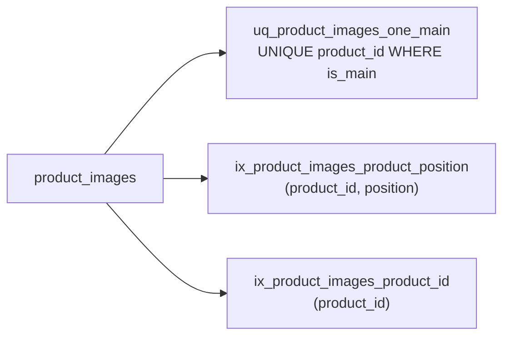

**Giải thích hình 3.2.** Chỉ mục partial unique `uq_product_images_one_main` được khai báo trực tiếp trong model SQLAlchemy (`postgresql_where=text("is_main")`), nhờ đó ràng buộc "mỗi sản phẩm chỉ có một ảnh chính" được **bảo đảm ở tầng cơ sở dữ liệu**, chặn được tình huống hai request upload song song cùng đánh dấu ảnh chính. Chỉ mục composite `(product_id, position)` phục vụ câu truy vấn sắp xếp gallery ảnh. *Tình trạng: đã xác minh trong mã nguồn model và migration.*

#### 3.1.3.6. Bảng `orders`

**Mục đích:** lưu đơn hàng. Bảng này gom ba nhóm thông tin: tiến trình xử lý (trạng thái), thông tin thanh toán và thông tin giao hàng.

| Tên trường | Kiểu dữ liệu | Khóa hoặc ràng buộc | Cho phép rỗng | Ý nghĩa |
| --- | --- | --- | --- | --- |
| `id` | `SERIAL` | PK | Không | Định danh đơn hàng |
| `user_id` | `INTEGER` | FK → `users.id` | Không | Khách hàng đặt hàng |
| `order_code` | `VARCHAR(32)` | UNIQUE | Không | Mã đơn, đồng thời là mã thanh toán SePay, dạng `ORD` + `YYYYMMDD` + 4 chữ số |
| `status` | `VARCHAR(20)` | Giá trị trong bảng trạng thái ở mục 3.2.5 | Không | Trạng thái xử lý đơn |
| `subtotal` | `NUMERIC(12,0)` | `>= 0` | Không | Tổng tiền hàng trước giảm giá |
| `discount_code` | `VARCHAR(32)` | — | Có | Mã giảm giá đã dùng (snapshot) |
| `discount_amount` | `NUMERIC(12,0)` | `>= 0` | Không | Số tiền đã giảm (snapshot) |
| `total` | `NUMERIC(12,0)` | `= subtotal - discount_amount` | Không | Tổng phải trả; chưa có phí vận chuyển |
| `payment_method` | `VARCHAR(10)` | `cod` hoặc `sepay` | Không | Hình thức thanh toán |
| `payment_status` | `VARCHAR(10)` | `unpaid` hoặc `paid` | Không | Trạng thái thanh toán |
| `paid_at` | `VARCHAR(64)` | — | Có | Thời điểm ghi nhận thanh toán, lưu dạng chuỗi ISO |
| `transaction_id` | `VARCHAR(64)` | Partial UNIQUE (WHERE NOT NULL) | Có | Mã giao dịch ngân hàng, chống gán trùng cho hai đơn |
| `shipping_name` | `VARCHAR(255)` | — | Không | Người nhận |
| `shipping_phone` | `VARCHAR(20)` | Định dạng số Việt Nam | Không | Số điện thoại người nhận |
| `shipping_address` | `TEXT` | — | Không | Địa chỉ giao hàng |
| `tracking_code` | `VARCHAR(64)` | — | Có | Mã vận đơn, sinh khi chuyển trạng thái `shipping` |
| `carrier` | `VARCHAR(64)` | — | Có | Hãng vận chuyển |
| `note` | `TEXT` | — | Có | Ghi chú của khách khi đặt hàng |
| `created_at` | `TIMESTAMPTZ` | Mặc định `now()` | Không | Thời điểm tạo đơn |
| `updated_at` | `TIMESTAMPTZ` | Mặc định `now()` | Không | Thời điểm cập nhật |

#### 3.1.3.7. Bảng `order_items`

**Mục đích:** lưu dòng chi tiết của đơn hàng. Đây là bảng **snapshot**: các thông tin hiển thị được sao chép tại thời điểm mua nên lịch sử đơn hàng luôn khớp với giá và tên sản phẩm tại thời điểm đó, kể cả khi sản phẩm sau đó bị đổi giá, đổi tên hoặc ngừng bán.

| Tên trường | Kiểu dữ liệu | Khóa hoặc ràng buộc | Cho phép rỗng | Ý nghĩa |
| --- | --- | --- | --- | --- |
| `id` | `SERIAL` | PK | Không | Định danh dòng chi tiết |
| `order_id` | `INTEGER` | FK → `orders.id`, ON DELETE CASCADE | Không | Đơn hàng chứa dòng này |
| `product_id` | `INTEGER` | FK → `products.id` | Không | Sản phẩm gốc, dùng để truy vết và thống kê bán chạy |
| `product_name` | `VARCHAR(255)` | — | Không | Snapshot tên sản phẩm tại thời điểm mua |
| `product_price` | `NUMERIC(12,0)` | `>= 0` | Không | Snapshot đơn giá tại thời điểm mua |
| `product_image` | `VARCHAR(500)` | — | Có | Snapshot URL ảnh chính |
| `variant_info` | `JSONB` | — | Có | Snapshot biến thể `{id, name}`; `NULL` nếu sản phẩm không có biến thể |
| `qty` | `INTEGER` | `> 0`, tối đa 99 | Không | Số lượng mua |
| `subtotal` | `NUMERIC(12,0)` | `= product_price * qty` | Không | Thành tiền của dòng |

#### 3.1.3.8. Bảng `order_status_history`

**Mục đích:** lưu lịch sử chuyển trạng thái của đơn hàng, là nguồn dữ liệu cho timeline trạng thái hiển thị phía khách hàng.

| Tên trường | Kiểu dữ liệu | Khóa hoặc ràng buộc | Cho phép rỗng | Ý nghĩa |
| --- | --- | --- | --- | --- |
| `id` | `SERIAL` | PK | Không | Định danh bản ghi |
| `order_id` | `INTEGER` | FK → `orders.id`, ON DELETE CASCADE | Không | Đơn hàng liên quan |
| `status` | `VARCHAR(20)` | Giá trị trong bảng trạng thái | Không | Trạng thái mới |
| `note` | `TEXT` | — | Có | Ghi chú của người thực hiện, ví dụ "Đã lấy hàng tại kho Hà Nội" |
| `created_by` | `INTEGER` | FK → `users.id` | Có | Người thực hiện chuyển trạng thái |
| `created_at` | `VARCHAR(64)` | — | Không | Thời điểm chuyển trạng thái, lưu dạng chuỗi ISO |

#### 3.1.3.9. Bảng `wishlists`

**Mục đích:** lưu sản phẩm khách hàng đánh dấu yêu thích.

| Tên trường | Kiểu dữ liệu | Khóa hoặc ràng buộc | Cho phép rỗng | Ý nghĩa |
| --- | --- | --- | --- | --- |
| `id` | `SERIAL` | PK | Không | Định danh bản ghi |
| `user_id` | `INTEGER` | FK → `users.id`, ON DELETE CASCADE | Không | Chủ sở hữu danh sách |
| `product_id` | `INTEGER` | FK → `products.id`, ON DELETE CASCADE | Không | Sản phẩm yêu thích |
| `created_at` | `VARCHAR(64)` | — | Không | Thời điểm thêm vào danh sách |

Ràng buộc duy nhất composite `uq_wishlist_user_product` trên `(user_id, product_id)` bảo đảm một khách hàng không thêm trùng cùng một sản phẩm hai lần.

#### 3.1.3.10. Bảng `coupons`

**Mục đích:** lưu mã giảm giá. Thiết kế tối giản, chỉ một bảng, không có bảng lịch sử sử dụng riêng.

| Tên trường | Kiểu dữ liệu | Khóa hoặc ràng buộc | Cho phép rỗng | Ý nghĩa |
| --- | --- | --- | --- | --- |
| `id` | `SERIAL` | PK | Không | Định danh mã giảm giá |
| `code` | `VARCHAR(32)` | UNIQUE, INDEX | Không | Mã giảm giá, không phân biệt hoa thường |
| `discount_type` | `VARCHAR(10)` | `percent` hoặc `fixed` | Không | Kiểu giảm giá |
| `discount_value` | `INTEGER` | `> 0` | Không | `percent` → 10 nghĩa là 10%; `fixed` → 50000 nghĩa là 50.000đ |
| `min_order_amount` | `INTEGER` | `>= 0` | Không | Giá trị đơn tối thiểu được áp dụng, 0 nghĩa là không giới hạn |
| `max_discount` | `INTEGER` | `>= 0` | Có | Trần số tiền giảm tối đa, dùng cho loại phần trăm |
| `max_uses` | `INTEGER` | `> 0` | Có | Số lần dùng tối đa, `NULL` nghĩa là không giới hạn |
| `used_count` | `INTEGER` | `>= 0` | Không | Số lần đã dùng, tăng bằng câu lệnh UPDATE nguyên tử |
| `expires_at` | `TIMESTAMPTZ` | — | Có | Thời hạn hiệu lực, `NULL` nghĩa là không hết hạn |
| `is_active` | `BOOLEAN` | Mặc định `true` | Không | Cờ bật/tắt mã giảm giá |
| `description` | `TEXT` | — | Có | Mô tả dành cho quản trị viên |
| `created_at` | `TIMESTAMPTZ` | Mặc định `now()` | Không | Thời điểm tạo |
| `updated_at` | `TIMESTAMPTZ` | Mặc định `now()` | Không | Thời điểm cập nhật |

#### 3.1.3.11. Bảng `payment_webhook_logs`

**Mục đích:** nhật ký các webhook thanh toán đã nhận từ cổng thanh toán SePay. Bảng phục vụ hai mục tiêu: chống xử lý trùng (idempotent) và truy vết giao dịch lỗi để đối soát thủ công.

| Tên trường | Kiểu dữ liệu | Khóa hoặc ràng buộc | Cho phép rỗng | Ý nghĩa |
| --- | --- | --- | --- | --- |
| `id` | `SERIAL` | PK | Không | Định danh bản ghi |
| `provider` | `VARCHAR(20)` | Mặc định `sepay` | Không | Cổng thanh toán gửi webhook |
| `transaction_id` | `VARCHAR(64)` | UNIQUE composite `(provider, transaction_id)` | Không | Mã giao dịch, dùng `referenceCode` của ngân hàng |
| `order_code` | `VARCHAR(32)` | — | Có | Mã đơn trích được; `NULL` nếu webhook không khớp đơn nào |
| `amount` | `BIGINT` | `>= 0` | Có | Số tiền nhận, đơn vị VNĐ |
| `payload` | `JSONB` | — | Có | Nội dung webhook gốc để đối chiếu |
| `status` | `VARCHAR(20)` | Một trong: `received`, `processed`, `ignored`, `unmatched`, `cancelled`, `amount_mismatch`, `wrong_account` | Không | Kết quả xử lý webhook |
| `error` | `TEXT` | — | Có | Mô tả lỗi xử lý |
| `created_at` | `TIMESTAMPTZ` | Mặc định `now()` | Không | Thời điểm nhận webhook |
| `updated_at` | `TIMESTAMPTZ` | Mặc định `now()` | Không | Thời điểm cập nhật |

### 3.1.4. Ràng buộc dữ liệu và quy tắc nghiệp vụ

Ngoài các ràng buộc khai báo trực tiếp trong schema, hệ thống còn áp dụng các quy tắc nghiệp vụ sau, đều được kiểm chứng qua mã nguồn và bộ kiểm thử tự động trong thư mục `backend/tests/`.

#### 3.1.4.1. Quy tắc xóa mềm và tính toàn vẹn dữ liệu

| Quy tắc | Thực hiện | Căn cứ |
| --- | --- | --- |
| Không xóa cứng sản phẩm, thay bằng `is_active = false` | `DELETE /api/products/{id}` chuyển sang cập nhật cờ | `backend/app/api/products.py`, `backend/app/service/product_service.py` |
| Xóa mềm tài khoản người dùng qua cờ `is_active` | `PATCH /api/users/{id}/toggle-active` | `backend/app/api/users.py` |
| Xóa sản phẩm thì ảnh bị xóa theo | FK `ON DELETE CASCADE` trên `product_images.product_id` | `backend/app/model/product_image.py` |
| Xóa đơn hàng thì dòng chi tiết và lịch sử bị xóa theo | FK `ON DELETE CASCADE` trên `order_items`, `order_status_history` | `backend/app/model/order_item.py`, `backend/app/model/order_status_history.py` |

#### 3.1.4.2. Quy tắc snapshot dữ liệu giao dịch

Khi tạo đơn, hệ thống **không** tham chiếu động giá và tên sản phẩm từ bảng `products` mà sao chép giá trị tại thời điểm mua vào `order_items`:

- `product_name` ← `products.name`
- `product_price` ← giá biến thể nếu có, nếu không thì `products.sale_price` (nếu có) hoặc `products.price`
- `product_image` ← URL ảnh chính của sản phẩm
- `variant_info` ← `{id, name}` của biến thể được chọn

Nhờ đó, khi quản trị viên đổi giá hoặc ngừng bán sản phẩm, các đơn hàng cũ vẫn hiển thị đúng giá và ảnh tại thời điểm khách mua. Tương tự, `orders.discount_code` và `orders.discount_amount` là snapshot của mã giảm giá, nên xóa mã giảm giá không ảnh hưởng lịch sử đơn hàng.

#### 3.1.4.3. Quy tắc nguồn sự thật duy nhất của tồn kho

Hệ thống có hai cách lưu tồn kho, và quy tắc bắt buộc là **mỗi sản phẩm chỉ có một nguồn sự thật**:

| Trường hợp | Nguồn sự thật | Giá trị `products.stock` |
| --- | --- | --- |
| Sản phẩm **không** có biến thể | `products.stock` | Giá trị quản trị viên nhập |
| Sản phẩm **có** biến thể | `variants[i].stock` | **Tổng** tồn kho các biến thể (giá trị dẫn xuất) |

Khi đặt hàng, hệ thống chỉ trừ một nơi: nếu có biến thể thì trừ `variants[i].stock` rồi tính lại `products.stock` bằng tổng; nếu không có biến thể thì trừ thẳng `products.stock`. Khi hủy đơn, thao tác hoàn kho thực hiện ngược lại theo cùng nguyên tắc. Toàn bộ logic này tập trung trong `backend/app/service/product_stock.py`, và API trả về trường `stock` bằng giá trị `effective_stock(product)` nên luôn khớp với tổng tồn kho biến thể. Trên giao diện quản trị, ô "Tồn kho" bị vô hiệu hóa khi sản phẩm có biến thể vì giá trị này do hệ thống tự tính.

Ngoài ra, khi tạo đơn, hệ thống dùng câu lệnh `SELECT ... FOR UPDATE` trên bảng `products` để khoá dòng dữ liệu trong lúc kiểm tra và trừ tồn kho, ngăn hiện tượng bán vượt tồn kho khi hai đơn đặt đồng thời.

#### 3.1.4.4. Quy tắc đơn vị tiền tệ

- Tất cả cột tiền tệ dùng `NUMERIC(12,0)`, không dùng kiểu số thực `FLOAT`, để tránh sai số làm tròn.
- Mã giảm giá dùng `INTEGER` vì cùng đơn vị VNĐ.
- Cột `amount` của `payment_webhook_logs` dùng `BIGINT` vì số tiền ngân hàng trả về là số nguyên lớn.
- Công thức tính tiền: `subtotal = SUM(product_price * qty)`, `total = subtotal - discount_amount`.
- Hệ thống **chưa triển khai phí vận chuyển**: toàn bộ đơn hàng hiện được giao miễn phí. Cột `shipping_fee` và `discount` đã từng tồn tại trong schema ban đầu và đã bị gỡ bỏ bằng migration `20261107_1130_a1b2c3d4e5f6_drop_orders_shipping_fee_and_discount.py`. Khi cần bổ sung phí vận chuyển, hướng dẫn trong mã nguồn là thêm cột mới kèm migration, **không sửa lại công thức ở phía giao diện**.

#### 3.1.4.5. Quy tắc chống xử lý trùng giao dịch thanh toán

Cổng thanh toán SePay có thể gọi webhook nhiều lần cho cùng một giao dịch, và hệ thống còn chạy tác vụ đối soát thủ công song song. Vì vậy, hệ thống áp dụng hai lớp chống trùng:

1. **Tầng ứng dụng:** `update_payment_status` chỉ cập nhật đơn hàng khi `payment_status` chưa là `paid`; nếu đã `paid` thì bỏ qua. Bảng `payment_webhook_logs` có ràng buộc UNIQUE `(provider, transaction_id)`, nên webhook lặp lại sẽ bị từ chối ghi log trùng.
2. **Tầng cơ sở dữ liệu:** chỉ mục partial unique `uq_orders_transaction_id` trên `orders.transaction_id` (điều kiện `WHERE transaction_id IS NOT NULL`) đảm bảo một giao dịch ngân hàng chỉ được gán cho tối đa một đơn hàng.

Lớp thứ hai là bắt buộc vì kiểm tra ở tầng ứng dụng có điều kiện tranh chấp: với mức cô lập `read committed`, hai request song song (webhook và đối soát) cùng đọc "chưa thấy trùng" rồi cùng ghi sẽ khiến cùng một đơn bị đánh dấu `paid` hai lần, tức cộng tiền hai lần. Chỉ mục UNIQUE ở tầng DB là chốt chặn cuối cùng, sinh lỗi `UniqueViolationError` và được bắt lại thành `DuplicateTransactionError` để trả phản hồi thành công (idempotent) cho cổng thanh toán.

Giá trị lưu vào `transaction_id` là `referenceCode` (mã tham chiếu ngân hàng) chứ không phải trường `id` của SePay, vì webhook gửi `id` dạng số nguyên còn API v2 gửi `id` dạng UUID cho cùng một giao dịch — dùng `id` sẽ khiến hai nguồn ghi hai giá trị khác nhau và chỉ mục UNIQUE không còn tác dụng.

#### 3.1.4.6. Quy tắc mã đơn hàng và mã thanh toán

`orders.order_code` vừa là mã định danh đơn hàng hiển thị với khách, vừa là **mã thanh toán** mà cổng thanh toán dùng để đối chiếu giao dịch. Mã được sinh theo mẫu `ORD` + `YYYYMMDD` + 4 chữ số ngẫu nhiên, tổng cộng 15 ký tự. Mẫu này được cấu hình qua hai biến môi trường `SEPAY_PAYMENT_CODE_PREFIX` và `SEPAY_PAYMENT_CODE_SUFFIX_LENGTH`, và **bắt buộc phải khớp** với mẫu khai báo trên bảng điều khiển SePay. Nếu lệch, cổng thanh toán không trích được mã trong nội dung chuyển khoản và sẽ không gửi webhook, dẫn tới mất tiền mà không có thông báo lỗi. Vì vậy, khi khởi động ứng dụng, hệ thống kiểm tra cấu hình này và **từ chối khởi động** nếu sai (thực hiện trong `backend/app/payment/payment_config_check.py`, được gọi trong vòng đời ứng dụng).

Nội dung chuyển khoản hiển thị trên QR có thể kèm tiền tố bắt buộc của ngân hàng, ví dụ `SEVQR ORD202609190013` với VietinBank cá nhân. Tiền tố này do ngân hàng yêu cầu và khác với mã thanh toán SePay — chỉ phần `ORD...` mới được cổng thanh toán bóc tách.

#### 3.1.4.7. Quy tắc mã giảm giá

| Ràng buộc | Kiểm tra thực hiện ở |
| --- | --- |
| Mã tồn tại và không phân biệt hoa thường | `normalize_code` trong `backend/app/service/discount_service.py` |
| Mã đang bật (`is_active = true`) | `is_usable` |
| Mã chưa hết hạn (`expires_at` chưa qua) | `is_usable` |
| Đơn đủ ngưỡng tối thiểu (`min_order_amount`) | `is_usable` |
| Còn lượt dùng (`used_count < max_uses`) | `is_usable` và `consume_coupon` bằng câu lệnh UPDATE nguyên tử |
| Loại phần trăm không vượt trần `max_discount` | `compute_discount` |

Phía giao diện chỉ gửi **mã** giảm giá, không gửi số tiền giảm — server tự tính và trả về kết quả xác nhận. Khi số lượt dùng hết trong lúc đang đặt hàng, đơn hàng được hoàn tác (rollback) và trả lỗi.

#### 3.1.4.8. Quy tắc bộ lọc sản phẩm

Bộ lọc theo loại da và vấn đề da dùng ngữ nghĩa **OR**: sản phẩm được trả về nếu khớp **một trong** các giá trị được chọn. Tham số `skin_types` và `concerns` nhận chuỗi nhiều giá trị phân tách bằng dấu phẩy. Các điều kiện lọc khả dụng: `category_id`, `brand_id`, `min_price`, `max_price`, `search` (tìm theo tên), `sort` (`newest`, `oldest`, `price_asc`, `price_desc`, `best_seller`) và phân trang `page` (mặc định 1) `size` (mặc định 20, tối đa 100). Danh sách công khai chỉ trả về sản phẩm có `is_active = true`.

## 3.2. Phân tích thiết kế chức năng

### 3.2.1. Phân rã chức năng của hệ thống

**Hình 3.3. Biểu đồ phân cấp chức năng (BFD) của website `cosme-shop`.**

```mermaid
flowchart TB
    HT["Website bán mỹ phẩm trực tuyến cosme-shop"]

    HT --> KH["Khách"]
    HT --> KHH["Khách hàng"]
    HT --> QT["Quản trị viên"]

    KH --> KH1["Xem trang chủ"]
    KH --> KH2["Xem danh sách sản phẩm"]
    KH --> KH3["Tìm kiếm và lọc sản phẩm"]
    KH --> KH4["Xem chi tiết sản phẩm"]
    KH --> KH5["Xem sản phẩm tương tự"]
    KH --> KH6["Đăng ký tài khoản"]
    KH --> KH7["Đăng nhập"]
    KH --> KH8["Thêm sản phẩm vào giỏ hàng"]

    KHH --> KHH1["Xem danh sách đơn hàng của mình"]
    KHH --> KHH2["Xem chi tiết đơn và timeline trạng thái"]
    KHH --> KHH3["Đặt hàng"]
    KHH --> KHH4["Áp dụng mã giảm giá"]
    KHH --> KHH5["Thanh toán COD hoặc SePay"]
    KHH --> KHH6["Hủy đơn hàng"]
    KHH --> KHH7["Quản lý danh sách yêu thích"]
    KHH --> KHH8["Cập nhật hồ sơ và đổi mật khẩu"]

    QT --> QT1["Quản lý sản phẩm và biến thể"]
    QT --> QT2["Quản lý danh mục"]
    QT --> QT3["Quản lý thương hiệu"]
    QT --> QT4["Quản lý ảnh sản phẩm"]
    QT --> QT5["Quản lý mã giảm giá"]
    QT --> QT6["Quản lý đơn hàng"]
    QT --> QT7["Cập nhật trạng thái đơn hàng"]
    QT --> QT8["Quản lý tài khoản người dùng"]
    QT --> QT9["Xem báo cáo thống kê"]
    QT --> QT10["Đối soát giao dịch thanh toán"]
```

**Giải thích hình 3.3.** BFD biểu diễn cấu trúc phân cấp chức năng bằng quan hệ cha – con. Gốc là toàn hệ thống; nhánh thứ hai cấp là ba nhóm vai trò sử dụng hệ thống tương ứng với ba lớp truy cập được hiện thực trong mã nguồn:

- **Khách** (`guest`): các chức năng công khai, không cần đăng nhập. Nhánh này gồm xem danh mục, tìm kiếm, xem chi tiết và đăng ký/đăng nhập.
- **Khách hàng** (`user`): kế thừa toàn bộ chức năng của khách, bổ sung các chức năng cần định danh cá nhân như đặt hàng, quản lý đơn, hủy đơn, danh sách yêu thích.
- **Quản trị viên** (`admin`): nhóm chức năng quản trị dữ liệu và vận hành, được bảo vệ bởi lớp phân quyền ở tầng API (mục 3.2.4).

Mỗi nút con đều tương ứng với một nhóm endpoint cụ thể trong `backend/app/api/`, được đối chiếu ở bảng ánh xạ trong mục 3.2.4.

### 3.2.2. Biểu đồ luồng dữ liệu

Mermaid không có kiểu biểu đồ DFD chuyên dụng, nên báo cáo này dùng `flowchart` để biểu diễn theo quy ước sau:

| Thành phần DFD | Cách biểu diễn | Nội dung nhãn |
| --- | --- | --- |
| Tác nhân ngoài | Hình chữ nhật `KH["Khách hàng"]` | Vai trò sử dụng hệ thống |
| Tiến trình | Hình tròn đôi `P1(("1.0 Tra cứu sản phẩm"))` | Số tiến trình và tên nghiệp vụ |
| Kho dữ liệu | Hình trụ `D1[("D1. Sản phẩm")]` | Mã kho và tên tập dữ liệu |
| Luồng dữ liệu | Mũi tên có nhãn `KH --\|Từ khóa tìm kiếm\| P1` | Tên dữ liệu truyền |

Trong báo cáo này, thống nhất gọi hai mức là **mức ngữ cảnh** (toàn hệ thống là một tiến trình duy nhất) và **mức phân rã cấp đầu tiên** (tiến trình 0 được tách thành các tiến trình nghiệp vụ chính).

#### 3.2.2.1. DFD mức ngữ cảnh

**Hình 3.4. Biểu đồ luồng dữ liệu mức ngữ cảnh của hệ thống.**

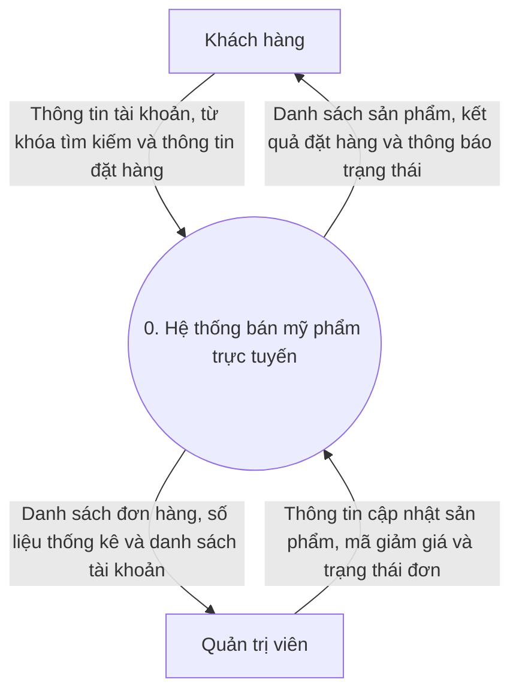

**Giải thích hình 3.4.** Toàn bộ hệ thống được biểu diễn thành một tiến trình duy nhất đánh số `0`, nằm giữa ranh giới hệ thống và hai tác nhân ngoài. Bốn luồng dữ liệu qua ranh giới hệ thống là:

- Khách hàng gửi **thông tin tài khoản** (đăng ký, đăng nhập, cập nhật hồ sơ), **từ khóa tìm kiếm và bộ lọc**, **thông tin đặt hàng** (danh sách mã sản phẩm, số lượng, địa chỉ, hình thức thanh toán, mã giảm giá) và **yêu cầu hủy đơn**.
- Hệ thống trả về khách hàng **danh sách sản phẩm** cùng thông tin lọc/phân trang, **kết quả xác nhận đặt hàng**, **mã QR thanh toán**, **kết quả kiểm tra mã giảm giá** và **thông báo trạng thái đơn hàng**.
- Quản trị viên gửi **thông tin cập nhật sản phẩm** (kèm biến thể và ảnh), **thông tin danh mục và thương hiệu**, **mã giảm giá**, **trạng thái đơn hàng cần chuyển** và **yêu cầu khóa/mở khóa tài khoản**.
- Hệ thống trả về quản trị viên **danh sách đơn hàng**, **số liệu thống kê báo cáo**, **danh sách tài khoản** và **kết quả tác vụ đối soát thanh toán**.

#### 3.2.2.2. DFD phân rã cấp đầu tiên

**Hình 3.5. Biểu đồ luồng dữ liệu mức phân rã cấp đầu tiên.**

```mermaid
flowchart TB
    KH["Khách hàng"]
    QT["Quản trị viên"]

    P1(("1.0 Quản lý tài khoản"))
    P2(("2.0 Tra cứu sản phẩm"))
    P3(("3.0 Quản lý giỏ hàng"))
    P4(("4.0 Đặt hàng và áp dụng mã giảm giá"))
    P5(("5.0 Xử lý đơn hàng"))
    P6(("6.0 Quản trị danh mục sản phẩm"))
    P7(("7.0 Quản trị đơn hàng"))
    P8(("8.0 Thống kê và đối soát"))

    D1[("D1. Tài khoản")]
    D2[("D2. Sản phẩm")]
    D3[("D3. Giỏ hàng")]
    D4[("D4. Đơn hàng")]
    D5[("D5. Mã giảm giá")]
    D6[("D6. Yêu thích")]
    D7[("D7. Nhật ký thanh toán")]

    KH -->|"Thông tin đăng ký và đăng nhập"| P1
    D1 -->|"Dữ liệu tài khoản"| P1
    P1 -->|"Token truy cập và thông tin tài khoản"| KH

    KH -->|"Từ khóa tìm kiếm và điều kiện lọc"| P2
    D2 -->|"Dữ liệu sản phẩm và danh mục"| P2
    P2 -->|"Danh sách sản phẩm và chi tiết sản phẩm"| KH

    KH -->|"Mã sản phẩm, biến thể và số lượng"| P3
    D2 -->|"Giá và tồn kho hiện tại"| P3
    D3 -->|"Nội dung giỏ hàng"| P3
    P3 -->|"Giỏ hàng đã đồng bộ"| KH

    KH -->|"Thông tin đặt hàng và mã giảm giá"| P4
    D2 -->|"Giá và tồn kho sản phẩm"| P4
    D5 -->|"Quy tắc giảm giá"| P4
    D4 -->|"Thông tin đơn và chi tiết đơn"| P4
    P4 -->|"Xác nhận đơn hàng và mã QR thanh toán"| KH

    KH -->|"Yêu cầu hủy đơn"| P5
    D4 -->|"Trạng thái và lịch sử đơn hàng"| P5
    D2 -->|"Tồn kho cần hoàn"| P5
    P5 -->|"Kết quả hủy đơn và trạng thái mới"| KH

    QT -->|"Thông tin sản phẩm, biến thể, danh mục và thương hiệu"| P6
    D2 -->|"Dữ liệu sản phẩm hiện có"| P6
    P6 -->|"Kết quả cập nhật danh mục sản phẩm"| QT

    QT -->|"Trạng thái và ghi chú đơn hàng"| P7
    D4 -->|"Danh sách đơn hàng"| P7
    P7 -->|"Danh sách đơn hàng và kết quả cập nhật"| QT

    QT -->|"Khoảng thời gian và yêu cầu đối soát"| P8
    D4 -->|"Doanh thu và số đơn theo trạng thái"| P8
    D7 -->|"Kết quả đối soát giao dịch"| P8
    P8 -->|"Báo cáo thống kê và kết quả đối soát"| QT

    KH -->|"Yêu cầu lưu sản phẩm yêu thích"| P1
    D6 -->|"Danh sách sản phẩm yêu thích"| P1
    P1 -->|"Danh sách yêu thích đã cập nhật"| KH
```

**Giải thích hình 3.5.** Tiến trình `0` được phân rã thành tám tiến trình nghiệp vụ, kèm bảy kho dữ liệu:

| Mã tiến trình | Tên tiến trình | Vai trò chính |
| --- | --- | --- |
| 1.0 | Quản lý tài khoản | Đăng ký, đăng nhập, cập nhật hồ sơ, đổi mật khẩu, quản lý danh sách yêu thích |
| 2.0 | Tra cứu sản phẩm | Danh sách sản phẩm, bộ lọc, tìm kiếm, chi tiết sản phẩm, sản phẩm tương tự, sản phẩm bán chạy |
| 3.0 | Quản lý giỏ hàng | Thêm, sửa số lượng, xóa dòng giỏ và đồng bộ giá/tồn kho từ server |
| 4.0 | Đặt hàng và áp dụng mã giảm giá | Kiểm tra mã, tính tiền, tạo đơn, tạo chi tiết đơn, sinh QR thanh toán |
| 5.0 | Xử lý đơn hàng | Hủy đơn và hoàn tồn kho, theo dõi trạng thái đơn |
| 6.0 | Quản trị danh mục sản phẩm | Thêm, sửa, xóa mềm sản phẩm, quản lý biến thể, ảnh, danh mục, thương hiệu, mã giảm giá |
| 7.0 | Quản trị đơn hàng | Lọc, xem và chuyển trạng thái đơn kèm ghi chú |
| 8.0 | Thống kê và đối soát | Báo cáo tổng quan, doanh thu theo ngày, sản phẩm bán chạy, cảnh báo tồn kho thấp, đối soát giao dịch SePay |

**Ánh xạ kho dữ liệu với các bảng CSDL:**

| Mã kho | Kho dữ liệu | Các bảng CSDL cấu thành |
| --- | --- | --- |
| D1 | Tài khoản | `users` |
| D2 | Sản phẩm | `products`, `categories`, `brands`, `product_images` |
| D3 | Giỏ hàng | Không lưu trong CSDL — được quản lý ở phía giao diện bằng `localStorage` (mục 3.2.3.4) |
| D4 | Đơn hàng | `orders`, `order_items`, `order_status_history` |
| D5 | Mã giảm giá | `coupons` |
| D6 | Yêu thích | `wishlists` |
| D7 | Nhật ký thanh toán | `payment_webhook_logs` |

**Cân bằng giữa hai mức:** bốn luồng qua ranh giới hệ thống ở mức ngữ cảnh được tách thành các luồng cụ thể hơn ở mức phân rã, nhưng nội dung dữ liệu tương đương. Chẳng hạn, luồng "Thông tin tài khoản, từ khóa tìm kiếm và thông tin đặt hàng" ở mức ngữ cảnh được tách thành luồng "Thông tin đăng ký và đăng nhập" (tiến trình 1.0), "Từ khóa tìm kiếm và điều kiện lọc" (tiến trình 2.0) và "Thông tin đặt hàng và mã giảm giá" (tiến trình 4.0). Ngược lại, luồng gộp "Danh sách sản phẩm, kết quả đặt hàng và thông báo trạng thái" được tách thành "Danh sách sản phẩm và chi tiết sản phẩm", "Xác nhận đơn hàng và mã QR thanh toán" và "Kết quả hủy đơn và trạng thái mới".

### 3.2.3. Đặc tả chức năng phía khách hàng

#### 3.2.3.1. Đăng ký tài khoản

| Thành phần | Nội dung |
| --- | --- |
| Mã và tên chức năng | `YC01` — Đăng ký tài khoản |
| Yêu cầu liên quan | `YC01`, `YC06` |
| Mục đích | Tạo tài khoản khách hàng để có thể đặt hàng và quản lý đơn |
| Tác nhân | Khách (không cần đăng nhập trước) |
| Điều kiện thực hiện | Email chưa tồn tại trong hệ thống; mật khẩu tối thiểu 6 ký tự; họ tên không rỗng |
| Dữ liệu đầu vào | `email`, `password`, `full_name` |
| Luồng xử lý chính | (1) Khách điền biểu mẫu tại trang `/register`. (2) Hệ thống kiểm tra định dạng email, kiểm tra email chưa đăng ký, kiểm tra độ dài mật khẩu. (3) Mật khẩu được băm bằng bcrypt cost 12. (4) Hệ thống tạo bản ghi `users` với `role = "user"`, `is_active = true`. (5) Hệ thống ký JWT và trả về token cùng thông tin tài khoản. (6) Giao diện lưu token và chuyển hướng người dùng. |
| Kiểm tra và ngoại lệ | Email trùng → HTTP 400, thông báo "Email đã được sử dụng". Mật khẩu ngắn hơn 6 ký tự → HTTP 400, thông báo "Mật khẩu tối thiểu 6 ký tự". Họ tên rỗng → HTTP 422 do kiểm tra lược đồ Pydantic. |
| Dữ liệu lưu hoặc thay đổi | Thêm một bản ghi vào bảng `users` |
| Kết quả và điều kiện sau | Khách đã đăng nhập với vai trò `user`; có thể tiến hành đặt hàng |

#### 3.2.3.2. Đăng nhập

| Thành phần | Nội dung |
| --- | --- |
| Mã và tên chức năng | `YC07` — Đăng nhập |
| Yêu cầu liên quan | `YC06` |
| Mục đích | Xác thực người dùng và cấp token truy cập |
| Tác nhân | Khách, khách hàng, quản trị viên |
| Điều kiện thực hiện | Tài khoản tồn tại và không bị khóa |
| Dữ liệu đầu vào | `email`, `password` |
| Luồng xử lý chính | (1) Khách điền biểu mẫu tại trang `/login`. (2) Hệ thống tìm người dùng theo email. (3) Kiểm tra mật khẩu bằng bcrypt. (4) Kiểm tra cờ `is_active`. (5) Ký JWT với `sub` là định danh người dùng, thời hạn 1 ngày. (6) Trả token và thông tin tài khoản. |
| Kiểm tra và ngoại lệ | Sai email hoặc mật khẩu → HTTP 401, thông báo "Email hoặc mật khẩu không đúng". Tài khoản bị khóa → HTTP 403, mã lỗi `ACCOUNT_LOCKED`. Token hết hạn → HTTP 401, mã lỗi `TOKEN_EXPIRED`. |
| Dữ liệu lưu hoặc thay đổi | Không ghi thay đổi vào CSDL; token được lưu ở phía giao diện |
| Kết quả và điều kiện sau | Người dùng được xác thực; quyền truy cập các chức năng được xác định theo `role` |

#### 3.2.3.3. Tra cứu, tìm kiếm và lọc sản phẩm

| Thành phần | Nội dung |
| --- | --- |
| Mã và tên chức năng | `YC02`, `YC03`, `YC04` — Xem danh sách sản phẩm, tìm kiếm và lọc, xem chi tiết sản phẩm |
| Yêu cầu liên quan | `YC02`, `YC03`, `YC04` |
| Mục đích | Giúp khách tìm đúng sản phẩm phù hợp với nhu cầu và vấn đề da của mình |
| Tác nhân | Khách, khách hàng, quản trị viên |
| Điều kiện thực hiện | Không yêu cầu đăng nhập |
| Dữ liệu đầu vào | `page`, `size`, `category_id`, `brand_id`, `min_price`, `max_price`, `skin_types`, `concerns`, `search`, `sort`, `product_id` |
| Luồng xử lý chính | (1) Khách chọn danh mục, thương hiệu, khoảng giá, loại da hoặc vấn đề da trên thanh bộ lọc, hoặc nhập từ khóa vào ô tìm kiếm. (2) Giao diện gửi tham số lên `GET /api/products`. (3) Hệ thống chuyển `skin_types` và `concerns` thành danh sách, lọc theo ngữ nghĩa OR, sắp xếp theo `sort`, phân trang và chỉ lấy sản phẩm `is_active = true`. (4) Hệ thống trả về danh sách kèm `total`, `page`, `size`. (5) Khi mở một sản phẩm, giao diện gọi `GET /api/products/{id}` để lấy đầy đủ thông tin, biến thể, danh mục, thương hiệu và ảnh; kèm `GET /api/products/{id}/similar` để lấy tối đa 8 sản phẩm tương tự. |
| Kiểm tra và ngoại lệ | `page` phải ≥ 1, `size` nằm trong khoảng 1–100, trượt ra ngoài → HTTP 422. Sản phẩm không tồn tại hoặc đã ngừng bán → HTTP 404. |
| Dữ liệu lưu hoặc thay đổi | Chỉ đọc từ bảng `products`, `categories`, `brands`, `product_images` |
| Kết quả và điều kiện sau | Khách xem được danh sách sản phẩm đã lọc, phân trang đúng, và trang chi tiết sản phẩm đầy đủ thông tin |

#### 3.2.3.4. Quản lý giỏ hàng

| Thành phần | Nội dung |
| --- | --- |
| Mã và tên chức năng | `YC05` — Quản lý giỏ hàng |
| Yêu cầu liên quan | `YC05`, `YC11` |
| Mục đích | Tích lũy sản phẩm được khách chọn trước khi thanh toán |
| Tác nhân | Khách, khách hàng |
| Điều kiện thực hiện | Không yêu cầu đăng nhập; giỏ hàng lưu ở trình duyệt |
| Dữ liệu đầu vào | `product_id`, `variant_id` (nếu có), `qty` |
| Luồng xử lý chính | (1) Khách chọn biến thể (nếu sản phẩm có biến thể) rồi bấm "Thêm vào giỏ". (2) Giao diện lưu dòng giỏ vào `localStorage` với khoá `cart-storage` thông qua Zustand. Khoá dòng giỏ là cặp `product_id` + `variant_id`, nên cùng một sản phẩm khác biến thể là hai dòng riêng. (3) Nếu dòng đã tồn tại, số lượng được cộng dồn; số lượng luôn được giới hạn trong khoảng 1–99 khớp ràng buộc phía máy chủ. (4) Khi mở trang giỏ, giao diện gọi API lấy giá, tên, ảnh và tồn kho hiện tại để đồng bộ, đồng thời giữ nguyên số lượng người dùng đã chọn. (5) Khách có thể sửa số lượng, xóa dòng hoặc xóa toàn bộ giỏ. |
| Kiểm tra và ngoại lệ | Số lượng bị kẹp về khoảng 1–99; đặt số lượng ≤ 0 thì xóa dòng. Sản phẩm hết hàng, ngừng bán hoặc số lượng vượt tồn kho → hiển thị cảnh báo tại trang giỏ và chặn ở bước thanh toán. Sản phẩm có biến thể mà thêm từ thẻ sản phẩm → giao diện chuyển hướng sang trang chi tiết để chọn biến thể. |
| Dữ liệu lưu hoặc thay đổi | Không ghi vào CSDL; lưu ở `localStorage` của trình duyệt |
| Kết quả và điều kiện sau | Giỏ hàng còn lưu khi khách đăng nhập sau khi chọn sản phẩm (dùng chung khoá `cart-storage`); giỏ bị xóa khi người dùng đăng xuất chủ động, nhưng được giữ lại khi token hết hạn |

> **Ghi chú thiết kế:** giỏ hàng được đặt ở phía giao diện chủ động để khách chưa đăng nhập cũng dùng được, đồng thời giảm tải cho máy chủ. Đổi lại, giỏ không đồng bộ giữa các thiết bị. Đây là đánh đổi được ghi nhận rõ trong tài liệu thiết kế của dự án.

#### 3.2.3.5. Đặt hàng

Đây là nghiệp vụ trọng tâm của hệ thống, được mô tả đầy đủ nhất.

| Thành phần | Nội dung |
| --- | --- |
| Mã và tên chức năng | `YC08` — Đặt hàng |
| Yêu cầu liên quan | `YC05`, `YC08`, `YC09`, `YC10` |
| Mục đích | Tạo đơn hàng từ nội dung giỏ, tính tiền chính xác và khởi tạo quy trình thanh toán |
| Tác nhân | Khách hàng, quản trị viên |
| Điều kiện thực hiện | Đã đăng nhập; giỏ hàng không rỗng; sản phẩm còn bán và còn tồn kho |
| Dữ liệu đầu vào | `items[]` gồm `product_id`, `variant_id` (nếu có), `qty`; `shipping_name`, `shipping_phone`, `shipping_address`, `payment_method` (`cod` hoặc `sepay`), `note` (tùy chọn), `coupon_code` (tùy chọn) |
| Luồng xử lý chính | (1) Khách mở trang `/checkout`, nhập thông tin người nhận và chọn phương thức thanh toán. (2) Nếu có mã giảm giá, giao diện gọi `POST /api/coupons/validate` với mã và tổng tiền hàng; máy chủ kiểm tra mã và trả về số tiền giảm đã xác nhận. (3) Khách bấm "Đặt hàng", giao diện gửi `POST /api/orders`. (4) Với từng dòng giỏ, hệ thống tải sản phẩm kèm khóa dòng `FOR UPDATE`, kiểm tra sản phẩm còn bán, kiểm tra tồn kho, chọn biến thể nếu có và chụp snapshot giá/tên/ảnh. (5) Hệ thống trừ tồn kho theo quy tắc nguồn sự thật duy nhất, cộng dồn `subtotal`. (6) Nếu có mã giảm giá, hệ thống kiểm tra lại điều kiện sử dụng, tính `discount_amount` và tăng `used_count` bằng câu lệnh UPDATE nguyên tử. (7) Hệ thống tính `total = subtotal - discount_amount`, tạo mã đơn `ORD` + ngày + 4 số ngẫu nhiên, ghi bản ghi `orders` với `status = "pending"`, `payment_status = "unpaid"`. (8) Hệ thống tạo các dòng `order_items` và một bản ghi `order_status_history` cho trạng thái `pending`. (9) Nếu phương thức là SePay, hệ thống sinh mã QR VietQR kèm số tiền và nội dung chuyển khoản. (10) Giao diện làm rỗng giỏ hàng và chuyển hướng tới trang chi tiết đơn; với SePay, hiển thị hộp thoại QR và bắt đầu thăm dò trạng thái thanh toán mỗi 4 giây. |
| Kiểm tra và ngoại lệ | Sản phẩm không tồn tại → "Sản phẩm không tồn tại". Sản phẩm ngừng bán → "Sản phẩm không còn bán". Không đủ tồn kho → thông báo không đủ stock, đơn hàng được hoàn tác. Sản phẩm có biến thể mà không chọn biến thể → "Sản phẩm có nhiều phân loại, vui lòng chọn phân loại". Biến thể không thuộc sản phẩm → lỗi. Mã giảm giá không hợp lệ → HTTP 400 kèm lý do cụ thể. Hết lượt dùng mã giảm giá → rollback đơn, HTTP 400. Số điện thoại sai định dạng Việt Nam hoặc địa chỉ rỗng → HTTP 422. |
| Dữ liệu lưu hoặc thay đổi | Thêm bản ghi vào `orders`, `order_items`, `order_status_history`; cập nhật `products.stock` hoặc `variants[i].stock`; cập nhật `coupons.used_count` |
| Kết quả và điều kiện sau | Đơn hàng ở trạng thái `pending`; giỏ hàng được làm rỗng; khách có thể theo dõi đơn tại `/orders/{id}`; với SePay, hệ thống chờ webhook xác nhận |

#### 3.2.3.6. Áp dụng mã giảm giá

| Thành phần | Nội dung |
| --- | --- |
| Mã và tên chức năng | `YC09` — Kiểm tra và áp dụng mã giảm giá |
| Yêu cầu liên quan | `YC08`, `YC09` |
| Mục đích | Giảm tổng tiền đơn hàng bằng mã giảm giá do quản trị viên phát hành |
| Tác nhân | Khách hàng, quản trị viên |
| Điều kiện thực hiện | Đã đăng nhập; giỏ hàng không rỗng |
| Dữ liệu đầu vào | `code` (mã giảm giá), `subtotal` (tổng tiền hàng) |
| Luồng xử lý chính | (1) Khách nhập mã vào ô "Mã giảm giá" tại trang thanh toán. (2) Giao diện gửi `POST /api/coupons/validate`. (3) Hệ thống chuẩn hóa mã về chữ in hoa, tìm bản ghi trong `coupons` và kiểm tra các điều kiện: đang bật, chưa hết hạn, đủ ngưỡng đơn tối thiểu, còn lượt dùng. (4) Hệ thống tính số tiền giảm theo loại phần trăm hoặc số tiền cố định, có áp dụng trần `max_discount`. (5) Hệ thống trả về mã và số tiền giảm đã xác nhận. (6) Khi đặt hàng, máy chủ kiểm tra lại mã và tự tính lại số tiền giảm; giao diện không gửi số tiền giảm. |
| Kiểm tra và ngoại lệ | Mã không tồn tại → "Mã giảm giá không tồn tại". Mã đã hết hạn → thông báo hết hạn. Chưa đủ đơn tối thiểu → thông báo yêu cầu đơn tối thiểu. Đã hết lượt dùng → thông báo hết lượt. Mã không dùng được với đơn hiện tại → HTTP 400 kèm lý do. |
| Dữ liệu lưu hoặc thay đổi | Ở bước kiểm tra: chỉ đọc `coupons`. Ở bước đặt hàng: cập nhật `coupons.used_count` và ghi snapshot vào `orders` |
| Kết quả và điều kiện sau | Tổng tiền hiển thị được cập nhật; mã giảm giá được ghi vào đơn hàng dưới dạng snapshot |

#### 3.2.3.7. Xem đơn hàng và hủy đơn

| Thành phần | Nội dung |
| --- | --- |
| Mã và tên chức năng | `YC10`, `YC12` — Xem đơn hàng của tôi, hủy đơn hàng |
| Yêu cầu liên quan | `YC10`, `YC12` |
| Mục đích | Cho khách theo dõi đơn hàng và chủ động hủy khi chưa giao hàng |
| Tác nhân | Khách hàng |
| Điều kiện thực hiện | Đã đăng nhập; đơn hàng thuộc về chính người đang đăng nhập |
| Dữ liệu đầu vào | `order_id`; khi hủy không cần dữ liệu đầu vào bổ sung |
| Luồng xử lý chính | (1) Khách mở trang `/orders`, hệ thống trả về danh sách đơn của họ. (2) Khách mở `/orders/{id}`, hệ thống trả về đơn kèm danh sách dòng chi tiết và lịch sử trạng thái, hiển thị theo thứ tự thời gian ngược. (3) Nếu đơn còn ở trạng thái `pending` hoặc `confirmed`, giao diện hiển thị nút "Hủy đơn". (4) Khi bấm, giao diện gửi `POST /api/orders/{id}/cancel`. (5) Hệ thống kiểm tra quyền sở hữu và trạng thái hiện tại, chuyển đơn sang `cancelled`, hoàn tồn kho theo từng dòng (hoàn vào biến thể nếu có, nếu không hoàn thẳng vào `products.stock`), ghi thêm một bản ghi lịch sử, và thực hiện tất cả trong một giao dịch cơ sở dữ liệu. |
| Kiểm tra và ngoại lệ | Không sở hữu đơn → HTTP 403. Trạng thái không cho phép hủy (đã đóng gói, đang giao hoặc đã giao) → HTTP 400, thông báo "Không thể hủy đơn đang giao". Lỗi trong quá trình hoàn kho → rollback toàn bộ. |
| Dữ liệu lưu hoặc thay đổi | Cập nhật `orders.status` thành `cancelled`; thêm bản ghi `order_status_history`; cập nhật lại tồn kho sản phẩm |
| Kết quả và điều kiện sau | Đơn ở trạng thái `cancelled`; tồn kho được hoàn lại đúng bằng số lượng đã mua |

#### 3.2.3.8. Quản lý danh sách yêu thích và hồ sơ cá nhân

| Thành phần | Nội dung |
| --- | --- |
| Mã và tên chức năng | `YC13` — Quản lý danh sách yêu thích; `YC14` — Cập nhật hồ sơ và đổi mật khẩu |
| Yêu cầu liên quan | `YC13`, `YC14` |
| Mục đích | Giúp khách lưu sản phẩm quan tâm và cập nhật thông tin cá nhân dùng cho việc giao hàng |
| Tác nhân | Khách hàng |
| Điều kiện thực hiện | Đã đăng nhập |
| Dữ liệu đầu vào | Với yêu thích: `product_id`. Với hồ sơ: `full_name`, `phone`, `address`; với đổi mật khẩu: `old_password`, `new_password` |
| Luồng xử lý chính | (1) Khách bấm biểu tượng trái tim trên thẻ sản phẩm, giao diện gửi `POST /api/wishlist/{product_id}`. (2) Hệ thống thêm bản ghi `wishlists`; nếu đã tồn tại thì bỏ qua do ràng buộc duy nhất. (3) Khách xem danh sách tại `/wishlist` qua `GET /api/wishlist`, xóa mục qua `DELETE /api/wishlist/{product_id}`. (4) Tại trang `/profile`, khách cập nhật thông tin qua `PATCH /api/auth/me`. (5) Khi đổi mật khẩu, hệ thống kiểm tra mật khẩu cũ, kiểm tra mật khẩu mới khác mật khẩu cũ, băm lại và cập nhật. |
| Kiểm tra và ngoại lệ | Thêm yêu thích trùng → không tạo bản ghi mới, không báo lỗi. Đổi mật khẩu sai mật khẩu cũ → HTTP 400. Mật khẩu mới trùng mật khẩu cũ → HTTP 400. Không đăng nhập → HTTP 401. |
| Dữ liệu lưu hoặc thay đổi | `wishlists` (thêm/xóa bản ghi); `users` (cập nhật hồ sơ hoặc `password_hash`) |
| Kết quả và điều kiện sau | Danh sách yêu thích và hồ sơ được cập nhật; thông tin hồ sơ được dùng làm gợi ý điền nhanh ở trang thanh toán |

### 3.2.4. Đặc tả chức năng phía quản trị viên

#### 3.2.4.1. Quản lý sản phẩm

| Thành phần | Nội dung |
| --- | --- |
| Mã và tên chức năng | `YC15` — Quản lý sản phẩm |
| Yêu cầu liên quan | `YC15` |
| Mục đích | Khai báo và duy trì danh mục sản phẩm bán |
| Tác nhân | Quản trị viên |
| Điều kiện thực hiện | Đã đăng nhập với `role = "admin"`; giá và tồn kho hợp lệ |
| Dữ liệu đầu vào | `name`, `price`, `stock`, `category_id`, `brand_id`, `description`, `sale_price` (tùy chọn), `variants` (tùy chọn), các trường metadata JSONB |
| Luồng xử lý chính | **Thêm mới:** (1) Quản trị viên điền biểu mẫu tại trang quản lý sản phẩm. (2) Hệ thống kiểm tra tên không rỗng, giá > 0, tồn kho ≥ 0, danh mục và thương hiệu tồn tại; nếu có biến thể thì mỗi biến thể phải có `id` duy nhất, `name`, giá ≥ 0 và tồn kho ≥ 0. (3) Hệ thống sinh `slug` từ tên. (4) Bản ghi `products` được tạo với `is_active = true`, `sold_count = 0`, `rating_avg = 0`. **Sửa:** (5) Quản trị viên sửa tại trang chi tiết; `PATCH /api/products/{id}` cập nhật các trường được gửi lên. Khi gửi `sale_price = null` thì giá khuyến mãi được xóa. Nếu sản phẩm có biến thể, `products.stock` được tính lại thành tổng tồn kho các biến thể. **Xóa:** (6) `DELETE /api/products/{id}` chuyển `is_active` thành `false` (xóa mềm), sản phẩm biến mất khỏi danh sách công khai nhưng lịch sử đơn hàng giữ nguyên nhờ cơ chế snapshot. |
| Kiểm tra và ngoại lệ | Trùng `slug` → HTTP 400. `id` biến thể trùng trong cùng một sản phẩm → HTTP 400 với thông báo tiếng Việt. Danh mục hoặc thương hiệu không tồn tại → HTTP 400. Giá âm hoặc tồn kho âm → HTTP 422. Không có quyền admin → HTTP 403. |
| Dữ liệu lưu hoặc thay đổi | `products` (thêm, cập nhật, cập nhật `is_active`) |
| Kết quả và điều kiện sau | Sản phẩm xuất hiện trong danh sách quản trị và trên website công khai (nếu `is_active = true`) |

#### 3.2.4.2. Quản lý ảnh sản phẩm

| Thành phần | Nội dung |
| --- | --- |
| Mã và tên chức năng | `YC16` — Quản lý ảnh sản phẩm |
| Yêu cầu liên quan | `YC15`, `YC16` |
| Mục đích | Tải lên, sắp xếp và chọn ảnh chính cho sản phẩm |
| Tác nhân | Quản trị viên |
| Điều kiện thực hiện | Đã đăng nhập với `role = "admin"`; sản phẩm đã tồn tại |
| Dữ liệu đầu vào | Tệp ảnh (tối đa 5 MB); `product_id`; cờ `is_main` khi tải lên; `position` khi sắp xếp lại |
| Luồng xử lý chính | (1) Quản trị viên chọn tệp ảnh tại khung quản lý ảnh của sản phẩm. (2) Giao diện gửi tệp lên `POST /api/upload/product-image`. (3) Hệ thống kiểm tra kích thước tệp, tải lên Cloudinary với `overwrite=False` và `unique_filename=True` để mỗi lần tải tạo một tài nguyên mới. (4) Hệ thống ghi bản ghi `product_images` với `public_id`, `secure_url` và metadata kích thước. (5) Khi đánh dấu ảnh chính, hệ thống dùng chung một hàm `_promote_to_main()` để bỏ cờ ảnh chính cũ và đánh lại `position` liên tục, bảo đảm ảnh chính luôn ở `position = 0`. (6) Xóa ảnh chỉ gỡ bản ghi khỏi thư viện, **không** xóa tài nguyên trên Cloudinary, để ảnh đã bán trong lịch sử đơn hàng không bị hỏng. |
| Kiểm tra và ngoại lệ | Tệp vượt quá 5 MB → từ chối tải lên. Tệp không phải ảnh → từ chối. Chưa cấu hình Cloudinary (`CLOUDINARY_CLOUD_NAME`, `CLOUDINARY_API_KEY`, `CLOUDINARY_API_SECRET`) → lỗi cấu hình. Không có quyền admin → HTTP 403. |
| Dữ liệu lưu hoặc thay đổi | `product_images` (thêm, cập nhật `position` và `is_main`, xóa bản ghi) |
| Kết quả và điều kiện sau | Thư viện ảnh hiển thị đúng thứ tự; ảnh chính dùng làm ảnh đại diện trên thẻ sản phẩm và trong dòng đơn hàng |

#### 3.2.4.3. Quản lý danh mục, thương hiệu và mã giảm giá

| Thành phần | Nội dung |
| --- | --- |
| Mã và tên chức năng | `YC17` — Quản lý danh mục; `YC18` — Quản lý thương hiệu; `YC09` — Quản lý mã giảm giá |
| Yêu cầu liên quan | `YC17`, `YC18`, `YC09` |
| Mục đích | Duy trì cấu trúc danh mục sản phẩm và các chương trình giảm giá |
| Tác nhân | Quản trị viên |
| Điều kiện thực hiện | Đã đăng nhập với `role = "admin"` |
| Dữ liệu đầu vào | Danh mục: `name`, `description`, `image_url`. Thương hiệu: `name`, `description`, `logo_url`. Mã giảm giá: `code`, `discount_type`, `discount_value`, `min_order_amount`, `max_discount`, `max_uses`, `expires_at`, `is_active` |
| Luồng xử lý chính | (1) Quản trị viên thêm, sửa hoặc xóa bản ghi trên trang quản lý tương ứng. (2) Hệ thống sinh `slug` từ tên cho danh mục và thương hiệu, kiểm tra trùng lặp. (3) Với mã giảm giá, hệ thống chuẩn hóa mã về chữ in hoa và kiểm tra tính hợp lệ của các tham số. (4) Kết quả được trả về và bảng trên giao diện được làm mới. |
| Kiểm tra và ngoại lệ | Trùng `slug` hoặc trùng mã giảm giá → HTTP 400. Không có quyền admin → HTTP 403. Xóa danh mục đang có sản phẩm → hệ thống áp dụng xóa mềm để không làm hỏng khóa ngoại. |
| Dữ liệu lưu hoặc thay đổi | `categories`, `brands`, `coupons` |
| Kết quả và điều kiện sau | Danh mục và thương hiệu mới xuất hiện trong bộ lọc và dải thương hiệu trên trang chủ; mã giảm giá mới sử dụng được nếu thỏa điều kiện |

#### 3.2.4.4. Quản lý đơn hàng và cập nhật trạng thái

| Thành phần | Nội dung |
| --- | --- |
| Mã và tên chức năng | `YC11` — Xem và quản lý đơn hàng |
| Yêu cầu liên quan | `YC11`, `YC19` |
| Mục đích | Theo dõi và xử lý đơn hàng trong suốt vòng đời giao hàng |
| Tác nhân | Quản trị viên |
| Điều kiện thực hiện | Đã đăng nhập với `role = "admin"` |
| Dữ liệu đầu vào | Bộ lọc danh sách: từ khóa, trạng thái, phân trang. Cập nhật trạng thái: `status`, `note` (tùy chọn) |
| Luồng xử lý chính | (1) Quản trị viên mở trang quản lý đơn hàng, hệ thống trả về toàn bộ đơn kèm điều kiện lọc. (2) Quản trị viên chọn trạng thái đích và nhập ghi chú. (3) Hệ thống kiểm tra trạng thái đích có nằm trong tập chuyển tiếp hợp lệ của trạng thái hiện tại không. (4) Nếu hợp lệ, hệ thống cập nhật `orders.status`. (5) Nếu chuyển sang `shipping` và chưa có mã vận đơn, hệ thống sinh mã vận đơn tự động. (6) Nếu chuyển sang `delivered` và phương thức thanh toán là COD, hệ thống đặt `payment_status = "paid"`; đồng thời cộng `sold_count` của sản phẩm theo số lượng trong đơn. (7) Hệ thống ghi thêm một bản ghi `order_status_history` gồm trạng thái, ghi chú và người thực hiện. |
| Kiểm tra và ngoại lệ | Chuyển trạng thái không hợp lệ → HTTP 400 với thông báo tiếng Việt nêu rõ trạng thái nguồn và trạng thái đích, ví dụ "Không thể chuyển đơn từ 'Chờ xác nhận' sang 'Đã giao hàng'". Trạng thái `delivered` và `cancelled` là trạng thái cuối, không thể chuyển tiếp. |
| Dữ liệu lưu hoặc thay đỶi | `orders` (cập nhật `status`, `tracking_code`, `payment_status`), `order_status_history` (thêm bản ghi), `products` (cập nhật `sold_count`) |
| Kết quả và điều kiện sau | Khách hàng nhìn thấy trạng thái mới và ghi chú trên timeline của đơn hàng |

#### 3.2.4.5. Quản lý tài khoản người dùng

| Thành phần | Nội dung |
| --- | --- |
| Mã và tên chức năng | `YC20` — Quản lý tài khoản người dùng |
| Yêu cầu liên quan | `YC20` |
| Mục đích | Theo dõi và kiểm soát tài khoản người dùng |
| Tác nhân | Quản trị viên |
| Điều kiện thực hiện | Đã đăng nhập với `role = "admin"` |
| Dữ liệu đầu vào | `user_id`, cờ trạng thái `is_active` cần đặt |
| Luồng xử lý chính | (1) Quản trị viên mở trang quản lý người dùng, hệ thống trả về danh sách tài khoản kèm số đơn và tổng chi tiêu. (2) Quản trị viên bật hoặc tắt cờ `is_active` cho một tài khoản. (3) Hệ thống cập nhật `users.is_active`. |
| Kiểm tra và ngoại lệ | Không có quyền admin → HTTP 403. Tài khoản không tồn tại → HTTP 404. |
| Dữ liệu lưu hoặc thay đổi | `users` (cập nhật `is_active`) |
| Kết quả và điều kiện sau | Tài khoản bị khóa không thể đăng nhập (HTTP 403, mã `ACCOUNT_LOCKED`) và các yêu cầu có token đều bị từ chối; mở khóa khôi phục quyền truy cập |

#### 3.2.4.6. Xem thống kê báo cáo

| Thành phần | Nội dung |
| --- | --- |
| Mã và tên chức năng | `YC21` — Xem báo cáo thống kê |
| Yêu cầu liên quan | `YC21` |
| Mục đích | Hỗ trợ quản trị viên nắm tình hình kinh doanh và tồn kho |
| Tác nhân | Quản trị viên |
| Điều kiện thực hiện | Đã đăng nhập với `role = "admin"` |
| Dữ liệu đầu vào | `days` — số ngày gần nhất cần thống kê, mặc định 7 |
| Luồng xử lý chính | (1) Quản trị viên mở trang tổng quan. (2) Hệ thống tổng hợp: tổng số đơn; doanh thu đã thu (chỉ tính đơn có `payment_status = "paid"`); doanh thu chưa thu (đơn `unpaid` và chưa hủy); số đơn theo từng trạng thái; doanh thu và số đơn theo từng ngày trong khoảng `days`; tối đa 5 sản phẩm bán chạy nhất tính trên các đơn đã giao; tối đa 10 sản phẩm sắp hết hàng (tồn kho ≤ 10); tổng số sản phẩm đang bán; tổng số tài khoản. (3) Hệ thống trả về dữ liệu đã định dạng tiền tệ và giao diện hiển thị dưới dạng thẻ số liệu và biểu đồ. |
| Kiểm tra và ngoại lệ | Không có quyền admin → HTTP 403. |
| Dữ liệu lưu hoặc thay đổi | Chỉ đọc từ `orders`, `order_items`, `products`, `users` |
| Kết quả và điều kiện sau | Báo cáo tổng quan hiển thị trên trang quản trị |

### 3.2.5. Luồng xử lý nghiệp vụ trọng tâm

#### 3.2.5.1. Máy trạng thái đơn hàng

**Hình 3.6. Sơ đồ trạng thái của đơn hàng.**

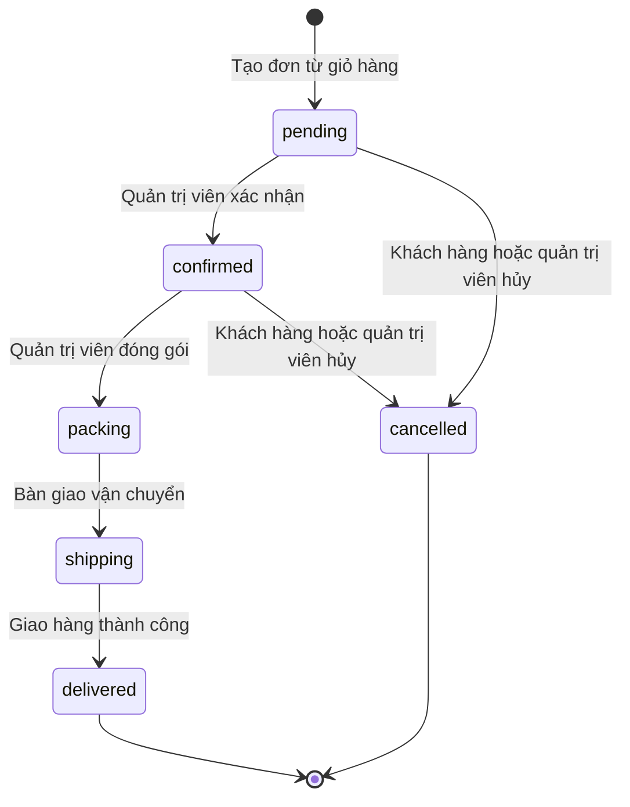

**Giải thích hình 3.6.** Mã trạng thái lưu trong CSDL và API luôn dùng tiếng Anh (`pending`, `confirmed`, `packing`, `shipping`, `delivered`, `cancelled`) vì mã là định danh kỹ thuật; nhãn tiếng Việt ("Chờ xác nhận", "Đã xác nhận", "Đang đóng gói", "Đang giao hàng", "Đã giao hàng", "Đã hủy") chỉ dùng ở tầng hiển thị. Tập chuyển tiếp hợp lệ được kiểm soát bằng một bảng tra cứu trong `backend/app/core/order_status.py` và kiểm tra trong `update_order_status`:

| Trạng thái nguồn | Trạng thái đích hợp lệ |
| --- | --- |
| `pending` | `confirmed`, `cancelled` |
| `confirmed` | `packing`, `cancelled` |
| `packing` | `shipping` |
| `shipping` | `delivered` |
| `delivered` | Không có — trạng thái cuối |
| `cancelled` | Không có — trạng thái cuối |

Khi chuyển sang `shipping`, hệ thống tự sinh mã vận đơn nếu chưa có. Khi chuyển sang `delivered` và phương thức thanh toán là COD, hệ thống tự đặt trạng thái thanh toán thành `paid` và cộng `sold_count` cho các sản phẩm trong đơn.

#### 3.2.5.2. Lưu đồ đặt hàng

**Hình 3.7. Lưu đồ xử lý đặt hàng.**

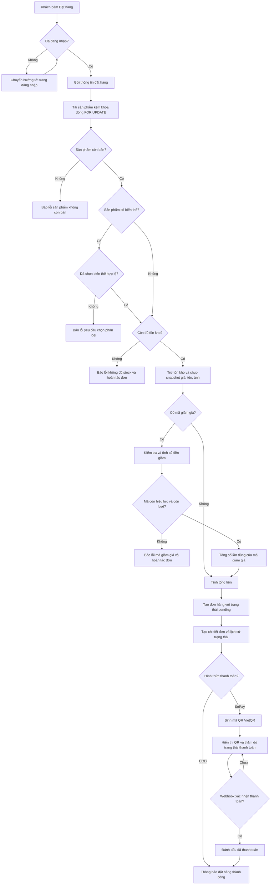

**Giải thích hình 3.7.** Lưu đồ thể hiện đầy đủ các nhánh kiểm tra của nghiệp vụ đặt hàng. Điểm cần lưu ý về mặt kỹ thuật: mọi bước từ trừ tồn kho trở đi nằm trong cùng một giao dịch cơ sở dữ liệu, nên khi bất kỳ điều kiện nào không thỏa mãn (không đủ tồn kho, mã giảm giá hết lượt, lỗi ghi dữ liệu), toàn bộ đơn hàng được hoàn tác và tồn kho được trả lại đúng trạng thái ban đầu.

#### 3.2.5.3. Trình tự xử lý thanh toán SePay

**Hình 3.8. Biểu đồ trình tự thanh toán SePay.**

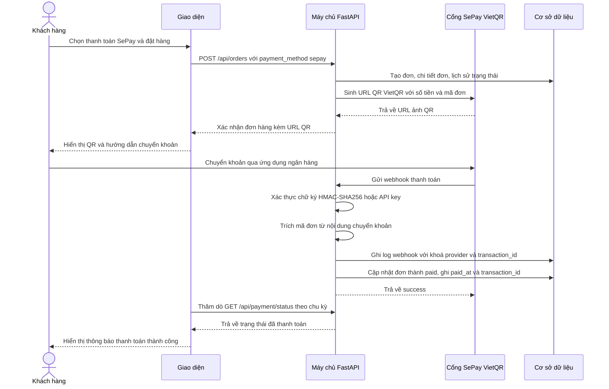

**Giải thích hình 3.8.** Quy trình thanh toán SePay gồm hai chiều độc lập: chiều đồng bộ tạo đơn và sinh QR, và chiều bất đồng bộ nhận thông báo thanh toán qua webhook. Chiều thứ hai không phụ thuộc người dùng còn mở trang web, nên trạng thái thanh toán được xác nhận ngay cả khi khách đã đóng trình duyệt.

Các cơ chế bảo vệ được áp dụng trong luồng này:

- **Xác thực webhook:** kiểm tra chữ ký HMAC-SHA256 trên nội dung gốc kết hợp tiêu đề `X-SePay-Signature` và `X-SePay-Timestamp`, có phương án dự phòng là `Authorization: Apikey`. Chữ ký sai hoặc độ lệch thời gian quá 300 giây → HTTP 401.
- **Trích mã đơn:** dùng biểu thức chính quy theo cấu hình `SEPAY_PAYMENT_CODE_PREFIX` và `SEPAY_PAYMENT_CODE_SUFFIX_LENGTH`, không hard-code độ dài.
- **Chống xử lý trùng:** ghi log với ràng buộc UNIQUE `(provider, transaction_id)`; nếu đơn đã ở trạng thái `paid` thì bỏ qua cập nhật.
- **Kiểm tra an toàn giao dịch:** nếu số tiền nhận thiếu so với tổng đơn thì không đánh dấu đã thanh toán và ghi log trạng thái `amount_mismatch`; nếu đơn đã hủy thì ghi log `cancelled` và không đánh dấu thanh toán; nếu tài khoản nhận không khớp cấu hình thì ghi log `wrong_account`; giao dịch chuyển ra ngoài thì ghi log `ignored`; không tìm thấy đơn thì ghi log `unmatched` nhưng vẫn trả về thành công để cổng thanh toán không gọi lại.
- **Đối soát thủ công:** endpoint `POST /api/payment/reconcile` dành cho quản trị viên quét giao dịch trên API v2 của SePay trong cửa sổ N ngày gần nhất, đánh dấu các đơn SePay còn `unpaid`. Cơ chế này dùng chung khoá `reference_number` với webhook nên không đánh dấu trùng.

## 3.3. Các chức năng chưa làm được

Bảng dưới đây liệt kê các chức năng được dự kiến trong đề tài nhưng chưa được hoàn thiện trong phiên bản hiện tại của hệ thống. Phần còn thiếu được đối chiếu trực tiếp với mã nguồn trong `backend/app/api/` và `frontend/src/pages/`.

| Chức năng dự kiến | Mức độ hiện tại | Phần còn thiếu | Ảnh hưởng đến phạm vi sử dụng |
| --- | --- | --- | --- |
| Trợ lý xây dựng quy trình skincare bằng trí tuệ nhân tạo (Routine Builder Quiz) | Chưa triển khai — không có router `ai` trong `backend/app/api/`, không có trang giao diện tương ứng | Cần một dịch vụ riêng gọi mô hình ngôn ngữ, cơ chế lọc sản phẩm theo loại da và vấn đề da, cùng giao diện trả lời câu hỏi | Khách không được gợi ý routine cá nhân hóa; bộ lọc theo loại da và vấn đề da vẫn dùng được nên không ảnh hưởng nghiệp vụ cốt lõi |
| Chatbot tư vấn trên website | Chưa triển khai | Không có thành phần giao diện chatbot, không có endpoint xử lý hội thoại | Khách phải tra cứu trực tiếp thông tin liên hệ thay vì hỏi trợ lý |
| Đánh giá và bình luận sản phẩm | Có trường dữ liệu `rating_avg` và `rating_count` trong bảng `products` nhưng chưa có bảng đánh giá, endpoint hay giao diện nhập đánh giá | Cần bảng lưu đánh giá và bình luận kèm khóa ngoại tới người dùng và sản phẩm, cùng phần giao diện viết và hiển thị đánh giá | Biểu tượng sao hiển thị trên sản phẩm luôn bằng 0; người mua chưa có thông tin tham khảo từ người dùng khác |
| Quản lý banner trang chủ | Chưa triển khai | Không có bảng dữ liệu, không có trang quản lý banner trong khu vực admin | Trang chủ hiển thị phần giới thiệu cố định trong giao diện, quản trị viên không tự thay đổi được nội dung quảng bá |
| Quản lý menu điều hướng | Chưa triển khai | Không có bảng dữ liệu, cấu trúc menu được định nghĩa tĩnh trong mã nguồn giao diện | Danh mục trong menu bắt buộc cần sửa mã nguồn để thay đổi |
| Phí vận chuyển và hãng vận chuyển | Chưa triển khai — cột `shipping_fee` đã bị gỡ bằng migration, công thức `total = subtotal - discount_amount` | Cần cột phí vận chuyển, bảng cấu hình theo khu vực hoặc mức đơn, và cập nhật lại công thức tính tiền cùng giao diện | Mọi đơn hàng hiện được giao miễn phí; doanh thu trên mỗi đơn thấp hơn thực tế nếu có phí ship |
| Đối chiếu tự động theo lịch | Có triển khai nhưng chưa kiểm tra chạy — endpoint `POST /api/payment/reconcile` đã có trong mã nguồn, chưa có bằng chứng chạy thành công trong phiên khảo sát | Cần kiểm chứng với dữ liệu thật từ cổng thanh toán và cân nhắc lên lịch tự động | Khi webhook bị lỡ, việc đối soát phải thực hiện thủ công bởi quản trị viên |
| Tính năng bài tin (tin tức, khuyến mãi theo bài viết) | Chưa triển khai | Không có bảng tin tức, không có trang danh sách bài viết | Mẫu báo cáo có nhắc tới màn hình bản tin; hệ thống hiện không có nội dung dạng bài viết, chỉ có danh sách sản phẩm |

> **Ghi chú:** Bảng trên phân biệt rõ ba mức độ. "Chưa triển khai" nghĩa là không tồn tại mã nguồn cho chức năng đó. "Có triển khai nhưng chưa kiểm tra chạy" nghĩa là mã nguồn đã có nhưng trong phiên khảo sát chưa quan sát được kết quả thành công. Không có mục nào trong bảng này được ghi là "đề xuất" vì các chức năng liệt kê đều xuất phát từ danh mục chức năng trong mẫu báo cáo hoặc từ tài liệu thiết kế sẵn có của dự án.

# CHƯƠNG IV. CÀI ĐẶT VÀ HƯỚNG DẪN SỬ DỤNG

Chương này hướng dẫn cài đặt cơ sở dữ liệu, dựng môi trường chạy và mô tả từng màn hình giao diện của hệ thống. Toàn bộ lệnh trong chương được trích từ tệp cấu hình thực tế của dự án (`backend/requirements.txt`, `backend/.env.example`, `frontend/package.json`, `run-all.sh`), đảm bảo người đọc có thể thực hiện lại từ đầu trên một máy mới.

> **Lưu ý về ảnh minh họa:** Các ảnh giao diện trong chương này chưa được chụp, nên mỗi vị trí được đánh dấu bằng khối `[CẦN BỔ SUNG ẢNH: ...]` kèm đường dẫn tệp dự kiến trong thư mục `assets/` cạnh file báo cáo (đường dẫn tương đối, có thể di chuyển cả bộ tài liệu). Ảnh cần được chụp từ hệ thống đã chạy, không hiển thị thông tin cá nhân hay thông tin cấu hình riêng (không chụp màn hình đăng nhập khi đã điền sẵn mật khẩu, không chụp tệp `.env`).

## 4.1. Cài đặt cơ sở dữ liệu

Hệ thống sử dụng PostgreSQL 17. Hai phương án được hỗ trợ: cơ sở dữ liệu đám mây Neon (khuyến nghị, đây là cấu hình mặc định của dự án) hoặc PostgreSQL cài cục bộ. Dưới đây trình bày phương án Neon theo đúng tệp cấu hình `backend/.env.example`.

### 4.1.1. Tạo cơ sở dữ liệu trên Neon

1. Đăng ký tài khoản tại [neon.tech](https://neon.tech) và tạo một project.
2. Chọn vùng đặt máy chủ gần người dùng, tạo database với tên `neondb` và tên đăng nhập `neondb_owner`.
3. Trong trang **Connect** của project, chọn trình điều khiển **Connection Details**, lấy địa chỉ **Pooled connection**.
4. Sao chép chuỗi kết nối có dạng:

```text
postgresql+asyncpg://<DB_USER>:<DB_PASSWORD>@<DB_HOST>/<DB_NAME>
```

> **Lưu ý quan trọng:** Không thêm tham số `?sslmode=require` vào chuỗi kết nối. Driver `asyncpg` sẽ báo lỗi khi gặp tham số này. Cũng không dùng địa chỉ có đuôi `-pooler` cho các kết nối cần đặt `search_path` riêng.

### 4.1.2. Cấu hình kết nối cho ứng dụng

Tạo tệp cấu hình từ tệp mẫu:

```bash
cd backend
cp .env.example .env
```

Mở `backend/.env` bằng trình soạn thảo văn bản và điền các giá trị sau:

| Biến | Bắt buộc | Giá trị minh họa | Mô tả |
| --- | --- | --- | --- |
| `DATABASE_URL` | ✅ | `postgresql+asyncpg://<DB_USER>:<DB_PASSWORD>@<DB_HOST>/neondb` | Chuỗi kết nối lấy từ Neon |
| `JWT_SECRET_KEY` | ✅ | `<chuỗi-ngẫu-nhiên-dài>` | Khóa ký JWT, dùng để sinh token đăng nhập |
| `AUTO_MIGRATE` | ⬜ | `false` | Đặt `true` để ứng dụng tự chạy migration khi khởi động |
| `CORS_ORIGINS` | ⬜ | `["http://localhost:5173"]` | Danh sách origin được phép gọi API |
| `SEPAY_BANK_ACCOUNT` | ⬜ | `<số-tài-khoản-nhận-tiền>` | Số tài khoản nhận thanh toán SePay |
| `SEPAY_BANK_NAME` | ⬜ | `<mã-ngân-hàng>` | Mã ngân hàng ngắn theo `vietqr.app/banks.json` |
| `SEPAY_WEBHOOK_SECRET` | ⬜ | `<secret-ký-hmac>` | Khóa xác thực webhook, nên bật |
| `CLOUDINARY_CLOUD_NAME` | ⬜ | `<tên-cloud>` | Tài khoản Cloudinary để tải ảnh sản phẩm |
| `CLOUDINARY_API_KEY` | ⬜ | `<api-key>` | Khoá API Cloudinary |
| `CLOUDINARY_API_SECRET` | ⬜ | `<api-secret>` | Khoá bí mật Cloudinary |

Sinh khóa ký JWT an toàn bằng lệnh sau:

```bash
python -c "import secrets; print(secrets.token_urlsafe(48))"
```

> **Cảnh báo bảo mật:** Tệp `.env` chứa thông tin kết nối và khóa bí mật đã được thêm vào `.gitignore`. Không được commit tệp này lên kho mã nguồn. Trên mỗi máy mới, cần thực hiện lại bước sao chép từ `.env.example`.

### 4.1.3. Chạy migration tạo cấu trúc bảng

Cài đặt môi trường ảo Python và các thư viện cần thiết:

```bash
cd backend
python3 -m venv .venv
source .venv/bin/activate
pip install -r requirements.txt
```

Áp dụng toàn bộ migration để tạo cấu trúc bảng:

```bash
alembic upgrade head
```

Lệnh trên áp dụng lần lượt 8 phiên bản migration theo thứ tự thời gian, tạo ra 11 bảng nghiệp vụ cùng các chỉ mục và ràng buộc:

| Phiên bản migration | Nội dung |
| --- | --- |
| `0acfe5aae4ff` | Cấu trúc khởi tạo: 9 bảng (`users`, `categories`, `brands`, `products`, `product_images`, `orders`, `order_items`, `order_status_history`, `wishlists`) |
| `a8b3c4d5e6f7` | Chuyển các cột kiểu JSON sang JSONB để hỗ trợ toán tử `@>` (contains) trên `products.skin_types`, `products.concerns`, `products.key_ingredients`, `products.free_from`, `products.variants` và `order_items.variant_info` |
| `b9c4d5e6f7a8` | Gỡ các cột `usage_time` và `step` khỏi bảng `products` do đã bỏ module AI Routine Builder |
| `c1d2e3f4a5b6` | Thêm bảng `payment_webhook_logs` |
| `e2f3a4b5c6d7` | Cải thiện cấu trúc bảng `product_images` |
| `f4a5b6c7d8e9` | Tạo lại chỉ mục UNIQUE chống trùng giao dịch bằng `CREATE UNIQUE INDEX IF NOT EXISTS` |
| `a1b2c3d4e5f6` | Gỡ cột `shipping_fee` và `discount` khỏi bảng `orders` |
| `b2c3d4e5f6a7` | Thêm bảng `coupons` và hai cột `discount_code`, `discount_amount` |

Kiểm tra kết quả:

```bash
alembic current
```

### 4.1.4. Nạp dữ liệu mẫu

Bộ dữ liệu mẫu được cung cấp sẵn trong tệp `backend/app/scripts/seed.py`:

```bash
python -m app.scripts.seed
```

Lệnh này tạo dữ liệu khởi tạo gồm tài khoản quản trị, tài khoản khách hàng, danh mục, thương hiệu và sản phẩm. Hai tài khoản được tạo sẵn:

| Email | Mật khẩu | Vai trò |
| --- | --- | --- |
| `admin@cosme-shop.com` | `admin123` | `admin` |
| `user@cosme-shop.com` | `user123` | `user` |

### 4.1.5. Kiểm tra kết nối

Sau khi chạy xong các bước trên, khởi động máy chủ và truy cập điểm kiểm tra sức khỏe:

```bash
python -m uvicorn app.main:app --host 0.0.0.0 --port 8000 --reload
```

```bash
curl http://localhost:8000/health
```

Kết quả mong đợi:

```json
{"status":"ok"}
```

Ngoài ra có thể kiểm tra kết nối cơ sở dữ liệu qua tài liệu tương tác Swagger UI tại địa chỉ <http://localhost:8000/docs>.

### 4.1.6. Quản lý migration trong quá trình phát triển

```bash
alembic revision --autogenerate -m "add x field"   # sinh migration mới từ model
alembic upgrade head                                # áp dụng
alembic downgrade -1                                # hoàn tác một bước
alembic history                                    # xem lịch sử
```

> **Nguyên tắc:** Không sửa trực tiếp cơ sở dữ liệu bằng câu lệnh SQL thủ công, kể cả trên môi trường phát triển. Mọi thay đổi cấu trúc đều phải đi qua migration để bảo đảm môi trường của mọi thành viên nhóm giống nhau.

## 4.2. Cài đặt giả lập môi trường server hosting

Môi trường chạy thực tế của dự án là **hai máy chủ phát triển cục bộ**: một tiến trình FastAPI phía sau và một tiến trình Vite phía trước, giao tiếp với nhau qua HTTP. Hệ thống không sử dụng XAMPP hay Docker trong quy trình phát triển thông thường.

**Hình 4.1. Kiến trúc môi trường chạy của hệ thống.**

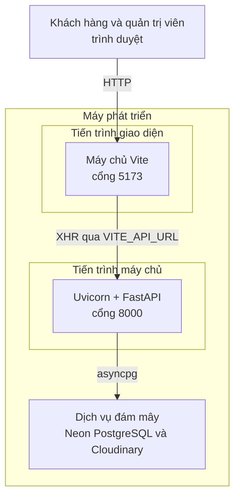

**Giải thích hình 4.1.** Môi trường phát triển gồm hai tiến trình độc lập chạy trên cùng một máy. Tiến trình giao diện là máy chủ Vite ở cổng 5173, tiến trình máy chủ là Uvicorn phục vụ ứng dụng FastAPI ở cổng 8000. Hai tiến trình không gọi trực tiếp vào nhau theo địa chỉ cố định mà nối qua biến môi trường `VITE_API_URL` trong tệp cấu hình của giao diện, nhờ vậy có thể trỏ sang máy chủ khác mà không phải sửa mã nguồn. Mọi yêu cầu đọc và ghi dữ liệu đều đi qua tiến trình máy chủ bằng driver `asyncpg` tới dịch vụ đám mây Neon; ảnh sản phẩm được lưu và phân phối bởi Cloudinary. Cách khởi động hai tiến trình này được hướng dẫn ở các mục 4.2.4 và 4.2.5.

### 4.2.1. Yêu cầu phần mềm

| Thành phần | Phiên bản | Ghi chú |
| --- | --- | --- |
| Python | 3.13 | Đã được ghim trong tệp `.python-version` ở thư mục gốc |
| Node.js | 20.19+ hoặc 22.12+ (bản LTS) | Kèm sẵn `npm` |
| Git | Bản mới nhất | Dùng để lấy mã nguồn |
| PostgreSQL | 17 | Dùng dịch vụ Neon, không cần cài cục bộ |

Kiểm tra môi trường mở terminal:

```bash
python --version
node --version
npm --version
git --version
```

### 4.2.2. Cài đặt phần mềm

1. Tải và cài Python 3.13 từ [python.org](https://www.python.org/downloads/), nhớ chọn ô "Add python.exe to PATH" trong trình cài đặt trên Windows.
2. Tải và cài Node.js bản LTS từ [nodejs.org](https://nodejs.org/).
3. Cài Git từ [git-scm.com](https://git-scm.com/download/win).

### 4.2.3. Lấy mã nguồn dự án

```bash
cd $HOME/Workspace/School
git clone <repo-url> cosme-shop
cd cosme-shop
```

### 4.2.4. Cài đặt và khởi động Backend

Mở cửa sổ terminal thứ nhất, tại thư mục gốc dự án:

```bash
cd backend

# 1) Tạo môi trường ảo Python
python3 -m venv .venv
source .venv/bin/activate        # Windows: .\.venv\Scripts\Activate.ps1

# 2) Cài thư viện
pip install -r requirements.txt
pip install -r requirements-dev.txt    # pytest, httpx - chỉ khi chạy kiểm thử

# 3) Tạo tệp cấu hình
cp .env.example .env                 # Windows: copy .env.example .env

# 4) Tạo cấu trúc bảng
alembic upgrade head

# 5) Nạp dữ liệu mẫu (tùy chọn)
python -m app.scripts.seed

# 6) Khởi động máy chủ phát triển
python -m uvicorn app.main:app --host 0.0.0.0 --port 8000 --reload
```

Kết quả kiểm tra được:

- Máy chủ khởi động tại <http://localhost:8000>.
- Kiểm tra sức khỏe trả về `{"status":"ok"}` tại <http://localhost:8000/health>.
- Tài liệu API tương tác tại <http://localhost:8000/docs>.
- Trong log khởi động có dòng `Payment config OK` nghĩa là cấu hình thanh toán SePay đã được kiểm tra hợp lệ.

> **Có thể bỏ qua bước 4** bằng cách đặt `AUTO_MIGRATE=true` trong `.env`; ứng dụng sẽ tự chạy `alembic upgrade head` mỗi lần khởi động.

### 4.2.5. Cài đặt và khởi động Frontend

Mở cửa sổ terminal thứ hai:

```bash
cd frontend

# 1) Tạo tệp cấu hình
cp .env.example .env                 # Windows: copy .env.example .env

# 2) Cài thư viện
npm install

# 3) Khởi động máy chủ phát triển
npm run dev
```

Kết quả kiểm tra được:

- Giao diện chạy tại <http://localhost:5173>.
- Tệp `frontend/.env` chứa `VITE_API_URL=http://localhost:8000` trỏ đúng tới máy chủ API.
- Trang chủ hiển thị danh mục nổi bật, sản phẩm nổi bật và dải thương hiệu.

> **Lưu ý:** Sau khi sửa nội dung `.env` phía giao diện phải khởi động lại `npm run dev` để biến môi trường có hiệu lực.

### 4.2.6. Chạy đồng thời cả hai thành phần

Dự án cung cấp sẵn kịch bản khởi động đồng thời:

```bash
./run-all.sh          # Linux/macOS
run-all.bat           # Windows
```

Kịch bản tự động: kiểm tra `python` và `npm` đã được cài; tạo `.venv` và cài thư viện nếu chưa có; sao chép `.env.example` sang `.env` cho cả hai thành phần nếu chưa có; chạy `npm install` nếu chưa có `node_modules`; rồi mở hai tiến trình máy chủ.

Đổi cổng nếu cần:

```bash
BACKEND_PORT=8080 FRONTEND_PORT=3000 ./run-all.sh
```

Khi đổi cổng phải sửa đồng thời `VITE_API_URL` trong `frontend/.env` và `CORS_ORIGINS` trong `backend/.env`.

### 4.2.7. Chạy kiểm thử tự động

```bash
cd backend
source .venv/bin/activate
pytest
```

Bộ kiểm thử tự bỏ qua nếu chưa đặt `TEST_DATABASE_URL`, nhằm tránh xóa nhầm dữ liệu phát triển. Khi muốn chạy thật:

```bash
export TEST_DATABASE_URL="postgresql+asyncpg://<DB_USER>:<DB_PASSWORD>@<DB_HOST>/<DB_NAME>"
export TEST_DATABASE_SCHEMA="cosme_test"
pytest
```

### 4.2.8. Bảng tổng hợp địa chỉ truy cập

| Thành phần | Địa chỉ | Mục đích |
| --- | --- | --- |
| Giao diện khách hàng | <http://localhost:5173> | Website bán mỹ phẩm |
| Giao diện quản trị | <http://localhost:5173/admin/dashboard> | Khu vực quản trị |
| Kiểm tra sức khỏe API | <http://localhost:8000/health> | Xác nhận máy chủ đang chạy |
| Tài liệu API | <http://localhost:8000/docs> | Giao diện Swagger UI |

## 4.3. Giao diện User

Phần này mô tả các màn hình phía khách hàng theo đúng thứ tự sử dụng thực tế: xem sản phẩm, tìm kiếm, giỏ hàng và đặt hàng. Danh sách được đánh số lại theo nội dung hệ thống thực sự có.

### 4.3.1. Giao diện trang chủ

**Mục đích:** Điểm vào chính của website, giới thiệu thương hiệu, danh mục và những sản phẩm nổi bật để khách hàng nhanh chóng tìm thấy sản phẩm quan tâm.

**Cách truy cập:** Mở <http://localhost:5173> hoặc bấm liên kết "Trang chủ" trên thanh điều hướng.

**Thao tác chính:**
- Xem dải danh mục nổi bật và dải thương hiệu uy tín; bấm vào một danh mục để chuyển tới trang sản phẩm đã lọc theo danh mục đó.
- Xem sản phẩm nổi bật và bấm vào một thẻ sản phẩm để mở trang chi tiết.
- Bấm biểu tượng trái tim trên thẻ sản phẩm để thêm vào danh sách yêu thích (yêu cầu đăng nhập).
- Bấm biểu tượng giỏ hàng trên thanh điều hướng để xem giỏ hàng hiện tại.

**Kết quả:** Khách hàng nắm được phạm vi sản phẩm và có đường đi ngắn nhất tới trang chi tiết sản phẩm.


**Hình 4.2. Giao diện trang chủ với dải danh mục, khối sản phẩm nổi bật và dải thương hiệu.**

> `[CẦN BỔ SUNG ẢNH: màn hình trang chủ tại http://localhost:5173, chụp toàn bộ trang gồm thanh điều hướng, khối giới thiệu, dải danh mục nổi bật, khối sản phẩm nổi bật và dải thương hiệu]`
>
> Đường dẫn tệp ảnh dự kiến: `assets/hinh-4-02.png`

### 4.3.2. Giao diện trang danh sách sản phẩm

**Mục đích:** Hiển thị danh sách sản phẩm kèm bộ lọc theo danh mục, thương hiệu, khoảng giá, loại da và vấn đề da, cùng khả năng sắp xếp và phân trang.

**Cách truy cập:** Bấm "Sản phẩm" trên thanh điều hướng, hoặc bấm vào một danh mục tại trang chủ.

**Thao tác chính:**
- Chọn danh mục, thương hiệu và khoảng giá trong bảng lọc bên trái.
- Chọn loại da (dầu, khô, hỗn hợp, nhạy cảm, bình thường) và vấn đề da (mụn, thâm, nếp nhăn, xỉn, mất nước, đỏ, lỗ chân lông, lão hoá).
- Chọn thứ tự sắp xếp: mới về, bán chạy, giá tăng dần, giá giảm dần.
- Chuyển trang bằng bộ phân trang ở cuối danh sách.

**Kết quả:** Danh sách sản phẩm được lọc đúng theo điều kiện, kèm tổng số kết quả và số trang.


**Hình 4.3. Giao diện trang danh sách sản phẩm với bảng lọc bên trái và phân trang bên dưới.**

> `[CẦN BỔ SUNG ẢNH: màn hình http://localhost:5173/products, chụp bảng lọc danh mục, thương hiệu, giá, loại da, vấn đề da và danh sách thẻ sản phẩm]`
>
> Đường dẫn tệp ảnh dự kiến: `assets/hinh-4-03.png`

### 4.3.3. Giao diện trang chi tiết sản phẩm

**Mục đích:** Cung cấp đầy đủ thông tin sản phẩm để khách hàng quyết định có mua hay không, gồm thư viện ảnh, biến thể, thành phần, thông tin dành cho từng loại da và sản phẩm tương tự.

**Cách truy cập:** Bấm vào một thẻ sản phẩm tại trang chủ hoặc trang danh sách sản phẩm.

**Thao tác chính:**
- Xem các ảnh trong thư viện và bấm ảnh chính.
- Chọn biến thể (màu sắc, dung tích…) nếu sản phẩm có biến thể; giá hiển thị cập nhật theo biến thể đã chọn.
- Xem thông tin loại da phù hợp, vấn đề da giải quyết, thành phần nổi bật và thành phần không chứa.
- Thêm vào giỏ hàng, thêm vào danh sách yêu thích.
- Xem khối sản phẩm tương tự ở cuối trang.

**Kết quả:** Khách hàng nắm đủ thông tin sản phẩm và có thể đưa sản phẩm vào giỏ với biến thể đã chọn.


**Hình 4.4. Giao diện trang chi tiết sản phẩm với thư viện ảnh, lựa chọn biến thể và nút thêm vào giỏ hàng.**

> `[CẦN BỔ SUNG ẢNH: màn hình http://localhost:5173/products/{id} của một sản phẩm có biến thể, chụp thư viện ảnh, tên sản phẩm, giá, danh sách biến thể, nút Thêm vào giỏ hàng và khối sản phẩm tương tự]`
>
> Đường dẫn tệp ảnh dự kiến: `assets/hinh-4-04.png`

### 4.3.4. Giao diện trang tìm kiếm sản phẩm

**Mục đích:** Tìm kiếm sản phẩm theo tên, kết hợp với bộ lọc để thu hẹp kết quả.

**Cách truy cập:** Nhập từ khóa vào ô tìm kiếm trên thanh điều hướng và nhấn Enter, hoặc dùng ô tìm kiếm ngay trên trang danh sách sản phẩm.

**Thao tác chính:**
- Nhập từ khóa (ví dụ "serum") và nhấn Enter.
- Kết hợp từ khóa với bộ lọc loại da hoặc vấn đề da để lọc chặt hơn.
- Xóa từ khóa để trở về danh sách đầy đủ.

**Kết quả:** Danh sách sản phẩm khớp từ khóa, hiển thị số lượng kết quả.


**Hình 4.5. Giao diện kết quả tìm kiếm sản phẩm theo từ khóa.**

> `[CẦN BỔ SUNG ẢNH: màn hình kết quả tìm kiếm với từ khóa đã nhập trong ô tìm kiếm, chụp danh sách kết quả và bộ lọc]`
>
> Đường dẫn tệp ảnh dự kiến: `assets/hinh-4-05.png`

### 4.3.5. Giao diện trang đăng ký tài khoản

**Mục đích:** Tạo tài khoản khách hàng để có thể đặt hàng, theo dõi đơn và lưu danh sách yêu thích.

**Cách truy cập:** Bấm "Đăng ký" trên thanh điều hướng, hoặc từ trang đăng nhập bấm liên kết chuyển sang đăng ký.

**Thao tác chính:**
- Nhập họ tên, email và mật khẩu.
- Nhấn nút "Đăng ký".
- Sau khi đăng ký thành công, hệ thống tự đăng nhập và chuyển hướng vào trang chủ.

**Kết quả:** Tài khoản được tạo, khách hàng đã đăng nhập và có thể tiến hành đặt hàng.


**Hình 4.6. Giao diện trang đăng ký tài khoản với biểu mẫu họ tên, email và mật khẩu.**

> `[CẦN BỔ SUNG ẢNH: màn hình http://localhost:5173/register, chụp toàn bộ biểu mẫu đăng ký, không nhập sẵn mật khẩu thật]`
>
> Đường dẫn tệp ảnh dự kiến: `assets/hinh-4-06.png`

### 4.3.6. Giao diện trang đăng nhập

**Mục đích:** Xác thực người dùng để truy cập các chức năng cần định danh, đồng thời là đường vào khu vực quản trị cho tài khoản có vai trò `admin`.

**Cách truy cập:** Bấm "Đăng nhập" trên thanh điều hướng.

**Thao tác chính:**
- Nhập email và mật khẩu, nhấn "Đăng nhập".
- Với tài khoản quản trị, sau khi đăng nhập sẽ xuất hiện mục "Quản trị" trong menu tài khoản.

**Kết quả:** Người dùng được cấp token truy cập có thời hạn 1 ngày và được chuyển hướng vào trang chủ.


**Hình 4.7. Giao diện trang đăng nhập.**

> `[CẦN BỔ SUNG ẢNH: màn hình http://localhost:5173/login, chụp biểu mẫu email và mật khẩu, không để lộ mật khẩu thật]`
>
> Đường dẫn tệp ảnh dự kiến: `assets/hinh-4-07.png`

### 4.3.7. Giao diện trang giỏ hàng

**Mục đích:** Quản lý các sản phẩm khách hàng đã chọn trước khi chuyển sang bước thanh toán.

**Cách truy cập:** Bấm biểu tượng giỏ hàng trên thanh điều hướng.

**Thao tác chính:**
- Tăng hoặc giảm số lượng của một dòng giỏ (giới hạn 1–99).
- Xóa một dòng giỏ hoặc xóa toàn bộ giỏ.
- Nhận cảnh báo khi sản phẩm hết hàng, ngừng bán hoặc số lượng vượt quá tồn kho hiện tại.
- Bấm "Thanh toán" để chuyển sang trang thanh toán.

**Kết quả:** Giỏ hàng được cập nhật đồng bộ giá và tồn kho từ máy chủ; tổng cộng hiển thị ở cột bên phải.


**Hình 4.8. Giao diện trang giỏ hàng với bảng sản phẩm và khối tổng cộng.**

> `[CẦN BỔ SUNG ẢNH: màn hình http://localhost:5173/cart với ít nhất hai dòng giỏ có biến thể khác nhau, chụp bảng sản phẩm, ô điều chỉnh số lượng, nút xóa và khối Tổng cộng]`
>
> Đường dẫn tệp ảnh dự kiến: `assets/hinh-4-08.png`

### 4.3.8. Giao diện trang xác nhận đặt hàng

**Mục đích:** Thu thập thông tin người nhận, chọn phương thức thanh toán, áp dụng mã giảm giá và xác nhận đơn hàng.

**Cách truy cập:** Từ trang giỏ hàng, bấm nút "Thanh toán". Yêu cầu đã đăng nhập; nếu chưa đăng nhập, hệ thống chuyển hướng sang trang đăng nhập.

**Thao tác chính:**
- Chọn hoặc nhập thông tin người nhận: họ tên, số điện thoại, địa chỉ giao hàng. Thông tin đã lưu trong hồ sơ được dùng làm gợi ý.
- Nhập mã giảm giá vào ô "Mã giảm giá" và nhấn "Áp dụng"; hệ thống kiểm tra và báo số tiền đã giảm.
- Chọn phương thức thanh toán: **Thanh toán khi nhận hàng (COD)** hoặc **Thanh toán qua SePay (chuyển khoản ngân hàng)**.
- Thêm ghi chú cho đơn hàng nếu cần.
- Nhấn "Đặt hàng" để gửi yêu cầu.

**Kết quả:** Đơn hàng được tạo với trạng thái "Chờ xác nhận"; nếu chọn SePay, hộp thoại hiển thị mã QR thanh toán.


**Hình 4.9. Giao diện trang xác nhận đặt hàng gồm thông tin người nhận, mã giảm giá và chọn phương thức thanh toán.**

> `[CẦN BỔ SUNG ẢNH: màn hình http://localhost:5173/checkout, chụp khối thông tin người nhận, khối Mã giảm giá, khối Phương thức thanh toán với hai lựa chọn COD và SePay, khối Tổng cộng]`
>
> Đường dẫn tệp ảnh dự kiến: `assets/hinh-4-09.png`

### 4.3.9. Giao diện trang thanh toán bằng mã QR SePay

**Mục đích:** Hướng dẫn khách hàng hoàn tất thanh toán qua chuyển khoản ngân hàng bằng mã QR.

**Cách truy cập:** Sau khi đặt hàng với phương thức SePay, hộp thoại QR tự động hiển thị.

**Thao tác chính:**
- Quét mã QR bằng ứng dụng ngân hàng để chuyển khoản đúng số tiền với nội dung chuyển khoản được ghi trên màn hình.
- Chờ giao diện tự động cập nhật trạng thái; hệ thống thăm dò trạng thái thanh toán mỗi 4 giây và dừng lại khi đơn đã được đánh dấu đã thanh toán.
- Bấm "Tôi đã thanh toán" để chuyển sang trang chi tiết đơn hàng.

**Kết quả:** Khi cổng thanh toán gửi webhook xác nhận, trạng thái đơn chuyển sang "Đã thanh toán" và hiển thị thông báo thành công.


**Hình 4.10. Hộp thoại mã QR thanh toán SePay kèm số tiền và nội dung chuyển khoản.**

> `[CẦN BỔ SUNG ẢNH: hộp thoại QR thanh toán sau khi đặt hàng với phương thức SePay, chụp mã QR, dòng số tiền, dòng nội dung chuyển khoản và nút Tôi đã thanh toán]`
>
> Đường dẫn tệp ảnh dự kiến: `assets/hinh-4-10.png`

### 4.3.10. Giao diện trang danh sách đơn hàng

**Mục đích:** Cho khách hàng theo dõi toàn bộ đơn hàng của mình và trạng thái xử lý.

**Cách truy cập:** Menu tài khoản → "Đơn hàng", hoặc liên kết "Tra cứu đơn hàng" ở chân trang.

**Thao tác chính:**
- Xem danh sách đơn hàng kèm mã đơn, ngày đặt, tổng tiền và trạng thái hiện tại.
- Bấm vào một đơn để xem chi tiết.
- Hủy đơn khi trạng thái còn là "Chờ xác nhận" hoặc "Đã xác nhận".

**Kết quả:** Khách hàng nắm được lịch sử và trạng thái đơn hàng của mình.


**Hình 4.11. Giao diện trang "Đơn hàng của tôi".**

> `[CẦN BỔ SUNG ẢNH: màn hình http://localhost:5173/orders, chụp bảng danh sách đơn hàng có ít nhất hai đơn ở hai trạng thái khác nhau]`
>
> Đường dẫn tệp ảnh dự kiến: `assets/hinh-4-11.png`

### 4.3.11. Giao diện trang chi tiết đơn hàng

**Mục đích:** Hiển thị đầy đủ thông tin đơn hàng và dòng thời gian trạng thái để khách hàng theo dõi tiến trình giao hàng.

**Cách truy cập:** Bấm vào một đơn hàng trong danh sách.

**Thao tác chính:**
- Xem thông tin đơn: mã đơn, thời điểm đặt, trạng thái, phương thức và trạng thái thanh toán, tổng tiền, thông tin người nhận.
- Xem danh sách sản phẩm trong đơn kèm giá và số lượng đã mua.
- Xem timeline trạng thái, mô tả mới nhất ở trên cùng.
- Hủy đơn nếu còn đủ điều kiện.

**Kết quả:** Khách hàng biết chính xác đơn hàng đang ở bước nào trong quy trình.


**Hình 4.12. Giao diện trang chi tiết đơn hàng với timeline trạng thái.**

> `[CẦN BỔ SUNG ẢNH: màn hình http://localhost:5173/orders/{id}, chụp khối thông tin đơn, bảng sản phẩm và timeline trạng thái đã có nhiều mốc]`
>
> Đường dẫn tệp ảnh dự kiến: `assets/hinh-4-12.png`

### 4.3.12. Giao diện trang tài khoản của tôi

**Mục đích:** Khách hàng xem và cập nhật thông tin cá nhân, đổi mật khẩu.

**Cách truy cập:** Menu tài khoản → "Tài khoản".

**Thao tác chính:**
- Cập nhật họ tên, số điện thoại và địa chỉ mặc định.
- Đổi mật khẩu bằng cách nhập mật khẩu cũ và mật khẩu mới.
- Xem danh sách sản phẩm yêu thích.

**Kết quả:** Thông tin hồ sơ được lưu và dùng làm gợi ý điền nhanh ở trang thanh toán.


**Hình 4.13. Giao diện trang "Tài khoản của tôi".**

> `[CẦN BỔ SUNG ẢNH: màn hình http://localhost:5173/profile, chụp biểu mẫu thông tin cá nhân và biểu mẫu đổi mật khẩu]`
>
> Đường dẫn tệp ảnh dự kiến: `assets/hinh-4-13.png`

### 4.3.13. Giao diện trang sản phẩm yêu thích

**Mục đích:** Gom các sản phẩm khách hàng đã đánh dấu yêu thích để tiện tra cứu và đặt hàng sau.

**Cách truy cập:** Menu tài khoản → "Yêu thích".

**Thao tác chính:**
- Xem danh sách sản phẩm yêu thích dạng thẻ.
- Bấm biểu tượng trái tim hoặc nút xóa để gỡ khỏi danh sách.
- Bấm vào một sản phẩm để xem chi tiết hoặc thêm vào giỏ.

**Kết quả:** Danh sách yêu thích cập nhật đồng bộ với dữ liệu trên máy chủ.


**Hình 4.14. Giao diện trang "Sản phẩm yêu thích".**

> `[CẦN BỔ SUNG ẢNH: màn hình http://localhost:5173/wishlist, chụp lưới thẻ sản phẩm yêu thích]`
>
> Đường dẫn tệp ảnh dự kiến: `assets/hinh-4-14.png`

### 4.3.14. Giao diện trang câu hỏi thường gặp

**Mục đích:** Giải đáp các thắc mắc phổ biến của khách hàng về quy trình đặt hàng, thanh toán và giao hàng.

**Cách truy cập:** Liên kết "Câu hỏi thường gặp" ở chân trang.

**Thao tác chính:**
- Chọn nhóm câu hỏi để lọc.
- Bấm vào từng câu hỏi để xem câu trả lời.

**Kết quả:** Khách hàng tự tìm được câu trả lời mà không cần liên hệ trực tiếp.


**Hình 4.15. Giao diện trang câu hỏi thường gặp.**

> `[CẦN BỔ SUNG ẢNH: màn hình http://localhost:5173/faq, chụp nhóm câu hỏi và các câu hỏi được mở rộng]`
>
> Đường dẫn tệp ảnh dự kiến: `assets/hinh-4-15.png`

### 4.3.15. Khu vực liên kết mạng xã hội

**Mục đích:** Liên kết đến các trang mạng xã hội của cửa hàng ở chân trang, giúp khách hàng theo dõi thông tin và chương trình mới.

**Cách truy cập:** Cuộn xuống cuối trang, khu vực chân trang.

**Thao tác chính:** Bấm vào biểu tượng mạng xã hội tương ứng để mở trang của cửa hàng.

**Kết quả:** Khách hàng có thể theo dõi cửa hàng trên nền tảng xã hội.


**Hình 4.16. Khu vực liên kết mạng xã hội tại chân trang.**

> `[CẦN BỔ SUNG ẢNH: phần chân trang, chụp cụm biểu tượng liên kết mạng xã hội. Đường dẫn liên kết được cấu hình qua các biến VITE_SOCIAL_FACEBOOK, VITE_SOCIAL_INSTAGRAM, VITE_SOCIAL_TIKTOK, VITE_SOCIAL_YOUTUBE trong frontend/.env]`
>
> Đường dẫn tệp ảnh dự kiến: `assets/hinh-4-16.png`

### 4.3.16. Giao diện trang không tìm thấy

**Mục đích:** Thông báo thân thiện khi khách truy cập một đường dẫn không tồn tại, kèm nút quay lại trang chủ.

**Cách truy cập:** Truy cập một đường dẫn không có trong hệ thống, ví dụ `/trang-khong-ton-tai`.

**Kết quả:** Khách hàng được hướng dẫn quay lại trang chủ.


**Hình 4.17. Giao diện trang báo lỗi 404.**

> `[CẦN BỔ SUNG ẢNH: màn hình truy cập một đường dẫn không tồn tại, ví dụ http://localhost:5173/trang-khong-ton-tai, chụp thông báo lỗi 404 và nút quay lại trang chủ]`
>
> Đường dẫn tệp ảnh dự kiến: `assets/hinh-4-17.png`

## 4.4. Giao diện Admin

Khu vực quản trị được bảo vệ bởi hai lớp kiểm tra phía giao diện (`AdminRoute`) và phía máy chủ (dependency `get_current_admin` trong `backend/app/api/deps.py`). Chỉ tài khoản có `role = "admin"` mới truy cập được.

### 4.4.1. Giao diện trang đăng nhập phần Admin

**Mục đích:** Điểm vào của khu vực quản trị, dùng chung trang đăng nhập với khu vực khách hàng.

**Cách truy cập:** <http://localhost:5173/login>, đăng nhập bằng tài khoản `admin@cosme-shop.com`.

**Thao tác chính:**
- Nhập email và mật khẩu của tài khoản quản trị.
- Sau khi đăng nhập, menu tài khoản hiện thêm mục "Quản trị".

**Kết quả:** Tài khoản quản trị được chuyển hướng tới trang tổng quan khu vực quản trị.


**Hình 4.18. Giao diện đăng nhập dùng chung cho khu vực quản trị.**

> `[CẦN BỔ SUNG ẢNH: màn hình đăng nhập, chú thích rõ đây là điểm vào khu vực quản trị. Không chụp mật khẩu thật]`
>
> Đường dẫn tệp ảnh dự kiến: `assets/hinh-4-18.png`

### 4.4.2. Giao diện trang tổng quan (Dashboard)

**Mục đích:** Tổng hợp số liệu kinh doanh và tồn kho giúp quản trị viên nắm tình hình toàn hệ thống.

**Cách truy cập:** Menu tài khoản → "Quản trị", hoặc <http://localhost:5173/admin/dashboard>.

**Thao tác chính:**
- Xem các thẻ số liệu: tổng số đơn hàng, doanh thu đã thu, doanh thu chưa thu, tổng số sản phẩm, tổng số tài khoản.
- Xem biểu đồ doanh thu theo ngày.
- Xem bảng đơn hàng theo trạng thái.
- Xem danh sách sản phẩm bán chạy nhất.
- Xem danh sách sản phẩm sắp hết hàng, tức là còn không quá 10 đơn vị tồn kho.

**Kết quả:** Quản trị viên có bức tranh tổng quan về doanh thu và tồn kho để đưa ra quyết định.


**Hình 4.19. Giao diện trang tổng quan khu vực quản trị.**

> `[CẦN BỔ SUNG ẢNH: màn hình http://localhost:5173/admin/dashboard, chụp dãy thẻ số liệu, biểu đồ doanh thu theo ngày, bảng đơn hàng theo trạng thái, bảng sản phẩm bán chạy và bảng sản phẩm sắp hết hàng]`
>
> Đường dẫn tệp ảnh dự kiến: `assets/hinh-4-19.png`

### 4.4.3. Giao diện trang quản lý sản phẩm

**Mục đích:** Khai báo, chỉnh sửa và ngừng bán sản phẩm, bao gồm cả biến thể và ảnh sản phẩm.

**Cách truy cập:** <http://localhost:5173/admin/products>.

**Thao tác chính:**

*Thêm mới sản phẩm:*
- Bấm nút thêm sản phẩm, điền tên, giá, tồn kho, danh mục, thương hiệu, mô tả và các thuộc tính bổ sung.
- Thêm các biến thể bằng bảng nhập liệu, mỗi biến thể có mã riêng, tên, giá và tồn kho; để trống mã thì hệ thống tự sinh `v1`, `v2`…
- Tải lên ảnh sản phẩm; có thể đánh dấu một ảnh là ảnh chính và sắp xếp thứ tự thư viện ảnh.
- Bấm "Lưu" để tạo sản phẩm.

*Sửa sản phẩm:*
- Bấm nút sửa trên dòng sản phẩm tương ứng, chỉnh sửa thông tin rồi lưu.
- Gửi giá khuyến mãi rỗng để gỡ giá khuyến mãi.

*Xóa sản phẩm:*
- Bấm nút xóa trên dòng sản phẩm và xác nhận. Sản phẩm được đánh dấu ngừng bán, không bị xóa vĩnh viễn nên lịch sử đơn hàng vẫn hiển thị đúng.

**Kết quả:** Sản phẩm mới xuất hiện trên website công khai; sản phẩm bị ngừng bán biến mất khỏi danh sách công khai.


**Hình 4.20. Giao diện trang quản lý sản phẩm với bảng danh sách và các nút thêm, sửa, xóa.**

> `[CẦN BỔ SUNG ẢNH: màn hình http://localhost:5173/admin/products, chụp bảng danh sách sản phẩm với các cột tên, giá, tồn kho, danh mục, thương hiệu, trạng thái và các nút thao tác]`
>
> Đường dẫn tệp ảnh dự kiến: `assets/hinh-4-20.png`
**Hình 4.21. Biểu mẫu thêm mới sản phẩm gồm thông tin cơ bản, bảng biến thể và khung quản lý ảnh.**

> `[CẦN BỔ SUNG ẢNH: hộp thoại biểu mẫu thêm mới sản phẩm, chụp các trường thông tin cơ bản, bảng nhập biến thể và khung tải ảnh lên]`
>
> Đường dẫn tệp ảnh dự kiến: `assets/hinh-4-21.png`
**Hình 4.22. Biểu mẫu chỉnh sửa sản phẩm với dữ liệu sản phẩm đã có.**

> `[CẦN BỔ SUNG ẢNH: hộp thoại biểu mẫu sửa sản phẩm đang mở, chụp giá trị sẵn có trong các trường]`
>
> Đường dẫn tệp ảnh dự kiến: `assets/hinh-4-22.png`
**Hình 4.23. Khung quản lý ảnh sản phẩm với thư viện ảnh và nút đặt ảnh chính.**

> `[CẦN BỔ SUNG ẢNH: khung quản lý ảnh sản phẩm trong biểu mẫu sản phẩm, chụp lưới ảnh đã tải lên, nút đặt ảnh chính và nút sắp xếp lại]`
>
> Đường dẫn tệp ảnh dự kiến: `assets/hinh-4-23.png`

### 4.4.4. Giao diện trang quản lý đơn hàng

**Mục đích:** Xem toàn bộ đơn hàng của hệ thống, lọc theo trạng thái và cập nhật tiến trình xử lý.

**Cách truy cập:** <http://localhost:5173/admin/orders>.

**Thao tác chính:**
- Lọc danh sách theo trạng thái đơn hàng và tìm kiếm theo mã đơn hoặc tên khách.
- Bấm vào một đơn để xem chi tiết trong hộp thoại, gồm thông tin người nhận, danh sách sản phẩm và lịch sử trạng thái.
- Chọn trạng thái đích trong danh sách thả xuống; danh sách này chỉ hiển thị các trạng thái chuyển tiếp hợp lệ từ trạng thái hiện tại.
- Nhập ghi chú, ví dụ "Đã lấy hàng tại kho Hà Nội", rồi bấm "Cập nhật".
- Khi chuyển sang trạng thái "Đang giao hàng", hệ thống tự sinh mã vận đơn.
- Khi chuyển sang "Đã giao hàng" với đơn thanh toán COD, hệ thống tự đánh dấu đã thanh toán.

**Kết quả:** Khách hàng nhìn thấy trạng thái và ghi chú mới ngay trên timeline đơn hàng của họ.


**Hình 4.24. Giao diện trang quản lý đơn hàng với bộ lọc trạng thái và bảng đơn hàng.**

> `[CẦN BỔ SUNG ẢNH: màn hình http://localhost:5173/admin/orders, chụp bộ lọc trạng thái, ô tìm kiếm và bảng danh sách đơn hàng]`
>
> Đường dẫn tệp ảnh dự kiến: `assets/hinh-4-24.png`
**Hình 4.25. Hộp thoại cập nhật trạng thái đơn hàng kèm danh sách trạng thái hợp lệ và ô ghi chú.**

> `[CẦN BỔ SUNG ẢNH: hộp thoại cập nhật trạng thái, chụp danh sách thả xuống các trạng thái hợp lệ, ô nhập ghi chú và nút Cập nhật]`
>
> Đường dẫn tệp ảnh dự kiến: `assets/hinh-4-25.png`

### 4.4.5. Giao diện trang quản lý người dùng

**Mục đích:** Theo dõi tài khoản người dùng và khóa hoặc mở khóa tài khoản.

**Cách truy cập:** <http://localhost:5173/admin/users>.

**Thao tác chính:**
- Xem danh sách tài khoản kèm email, họ tên, vai trò, số đơn hàng và tổng chi tiêu.
- Bật hoặc tắt công tắc trạng thái để khóa hoặc mở khóa tài khoản.

**Kết quả:** Tài khoản bị khóa không thể đăng nhập và mọi yêu cầu kèm token của tài khoản đó đều bị từ chối với mã lỗi `ACCOUNT_LOCKED`.


**Hình 4.26. Giao diện trang quản lý người dùng với công tắc khóa và mở khóa tài khoản.**

> `[CẦN BỔ SUNG ẢNH: màn hình http://localhost:5173/admin/users, chụp bảng danh sách tài khoản và cột công tắc trạng thái]`
>
> Đường dẫn tệp ảnh dự kiến: `assets/hinh-4-26.png`

### 4.4.6. Giao diện trang quản lý danh mục

**Mục đích:** Khai báo và duy trì danh mục sản phẩm dùng làm điều kiện lọc và phân loại trên website.

**Cách truy cập:** <http://localhost:5173/admin/categories>.

**Thao tác chính:**
- Thêm danh mục với tên, mô tả và ảnh đại diện.
- Sửa tên, mô tả hoặc ảnh của một danh mục.
- Ngừng sử dụng danh mục.

**Kết quả:** Danh mục mới xuất hiện trong bộ lọc trang sản phẩm và trong dải danh mục nổi bật tại trang chủ.


**Hình 4.27. Giao diện trang quản lý danh mục.**

> `[CẦN BỔ SUNG ẢNH: màn hình http://localhost:5173/admin/categories, chụp bảng danh sách danh mục và hộp thoại thêm danh mục]`
>
> Đường dẫn tệp ảnh dự kiến: `assets/hinh-4-27.png`

### 4.4.7. Giao diện trang quản lý thương hiệu

**Mục đích:** Khai báo và duy trì thương hiệu sản phẩm.

**Cách truy cập:** <http://localhost:5173/admin/brands>.

**Thao tác chính:**
- Thêm thương hiệu với tên, mô tả và logo.
- Sửa thông tin thương hiệu.
- Ngừng sử dụng thương hiệu.

**Kết quả:** Thương hiệu mới xuất hiện trong bộ lọc trang sản phẩm và trong dải thương hiệu tại trang chủ.


**Hình 4.28. Giao diện trang quản lý thương hiệu.**

> `[CẦN BỔ SUNG ẢNH: màn hình http://localhost:5173/admin/brands, chụp bảng danh sách thương hiệu và hộp thoại thêm thương hiệu]`
>
> Đường dẫn tệp ảnh dự kiến: `assets/hinh-4-28.png`

### 4.4.8. Giao diện trang quản lý mã giảm giá

**Mục đích:** Tạo và quản lý các mã giảm giá áp dụng khi khách hàng thanh toán.

**Cách truy cập:** <http://localhost:5173/admin/coupons>.

**Thao tác chính:**
- Tạo mã giảm giá với loại giảm (phần trăm hoặc số tiền cố định), giá trị giảm, đơn tối thiểu, trần giảm tối đa, số lần dùng tối đa và thời hạn.
- Bật hoặc tắt mã giảm giá.
- Sửa và xóa mã giảm giá.

**Kết quả:** Mã đang bật, chưa hết hạn và còn lượt sẽ dùng được ở trang thanh toán của khách hàng.


**Hình 4.29. Giao diện trang quản lý mã giảm giá.**

> `[CẦN BỔ SUNG ẢNH: màn hình http://localhost:5173/admin/coupons, chụp bảng danh sách mã giảm giá và hộp thoại tạo mã giảm giá]`
>
> Đường dẫn tệp ảnh dự kiến: `assets/hinh-4-29.png`

# KẾT LUẬN

Đề tài xây dựng website thương mại điện tử bán mỹ phẩm `cosme-shop` đã hoàn thành các mục tiêu được đặt ra ở mục 1.1.4, cụ thể như sau.

**Về phạm vi chức năng:** Hệ thống hiện có 24 chức năng đã được triển khai và kiểm chứng bằng mã nguồn, bao phủ đầy đủ ba khu vực. Khu vực công khai cung cấp trang chủ, danh mục, thương hiệu, danh sách sản phẩm với bộ lọc đa tiêu chí, trang chi tiết sản phẩm và trang câu hỏi thường gặp. Khu vực khách hàng cung cấp đăng ký, đăng nhập, giỏ hàng tồn tại qua các phiên, đặt hàng với hai hình thức thanh toán, theo dõi đơn theo timeline, hủy đơn, danh sách yêu thích và quản lý hồ sơ. Khu vực quản trị cung cấp quản lý sản phẩm kèm biến thể và ảnh, quản lý danh mục, thương hiệu, mã giảm giá, xử lý đơn hàng, quản lý tài khoản, báo cáo thống kê và đối soát giao dịch.

**Về thiết kế dữ liệu:** Cơ sở dữ liệu PostgreSQL gồm 11 bảng nghiệp vụ với 8 phiên bản migration, đáp ứng được các yêu cầu về tính chính xác tài chính, chống bán vượt tồn kho và bảo toàn lịch sử giao dịch. Ba quyết định thiết kế đóng vai trò quan trọng nhất là: cơ chế snapshot giá tại thời điểm mua, quy tắc nguồn sự thật duy nhất cho tồn kho, và chỉ mục partial unique chống gán trùng giao dịch.

**Về an toàn giao dịch:** Cơ chế thanh toán trực tuyến được thiết kế theo hướng ưu tiên an toàn hơn tốc độ: xác thực webhook bằng HMAC-SHA256 trên nội dung gốc, kiểm tra số tiền, tài khoản nhận và trạng thái đơn trước khi đánh dấu đã thanh toán, lưu nhật ký mọi webhook kể cả các trường hợp bị từ chối, và cơ chế đối soát thủ công bổ trợ. Cấu hình thanh toán sai còn được chặn ngay lúc khởi động ứng dụng.

**Về kiểm chứng:** Quy trình cài đặt được kiểm tra thực tế trên môi trường phát triển, bao gồm khởi động máy chủ phía sau, khởi động giao diện phía trước, nạp dữ liệu mẫu và truy cập các trang chức năng. Bộ kiểm thử tự động gồm 15 tệp kiểm thử phía máy chủ bao phủ các nghiệp vụ cốt lõi như đăng nhập, đơn hàng, mã giảm giá, tồn kho, ảnh sản phẩm, thanh toán và đối soát; khi chạy trong thư mục `backend` bằng lệnh `pytest`, 37 kiểm thử không cần cơ sở dữ liệu đều đạt, còn 147 kiểm thử cần cơ sở dữ liệu được bỏ qua do chưa cấu hình biến môi trường `TEST_DATABASE_URL` nhằm tránh xóa nhầm dữ liệu phát triển.

**Những điểm chưa hoàn thành:** Nhóm ghi nhận rõ các hạng mục chưa triển khai ở mục 3.3, gồm trợ lý routine bằng trí tuệ nhân tạo, chatbot, chức năng viết đánh giá, quản lý banner và menu, phí vận chuyển, cùng bài tin. Đây là các hạng mục nằm ngoài lõi nghiệp vụ bán hàng nên không ảnh hưởng đến tính đầy đủ của quy trình đặt hàng và xử lý đơn.

# HƯỚNG PHÁT TRIỂN

Dựa trên phạm vi kinh doanh hiện tại là cửa hàng mỹ phẩm trực tuyến, các hướng phát triển tiếp theo được đề xuất theo thứ tự ưu tiên.

### 1. Hoàn thiện phí vận chuyển và đơn vị vận chuyển

Hiện mọi đơn hàng đều được giao miễn phí. Bước triển khai cần thêm cột phí vận chuyển vào bảng `orders` kèm migration, một bảng cấu hình theo khu vực hoặc theo mức giá trị đơn, cập nhật lại công thức tính tổng tiền ở cả phía máy chủ lẫn giao diện, và tích hợp đơn vị vận chuyển để tra cứu trạng thái bưu kiện. Hướng dẫn trong mã nguồn hiện tại đã chỉ thị rõ không được sửa lại công thức ở phía giao diện khi thêm phí vận chuyển.

### 2. Xây dựng chức năng đánh giá và bình luận sản phẩm

Cấu trúc dữ liệu đã có sẵn hai trường `rating_avg` và `rating_count` trong bảng `products`, nhưng chưa có bảng lưu đánh giá. Cần bổ sung bảng đánh giá với khóa ngoại tới `users` và `products`, ràng buộc duy nhất để mỗi người chỉ đánh giá một lần mỗi sản phẩm, cơ chế cập nhật điểm trung bình bằng câu lệnh `UPDATE` nguyên tử tương tự cách cập nhật `coupons.used_count`, kèm giao diện viết đánh giá ở trang chi tiết sản phẩm. Đây là đầu tư có giá trị cao vì đánh giá thực sự ảnh hưởng đến quyết định mua trong ngành mỹ phẩm.

### 3. Triển khai trợ lý xây dựng quy trình skincare

Các trường dữ liệu `skin_types`, `concerns`, `key_ingredients` và `free_from` đã được thiết kế riêng để phục vụ tính năng này và đang phục vụ bộ lọc. Bước tiếp theo là tách một dịch vụ riêng gọi mô hình ngôn ngữ, truy vấn danh mục sản phẩm đáp ứng loại da và vấn đề da người dùng khai báo, loại trừ sản phẩm chứa thành phần gây dị ứng theo `free_from`, rồi sinh gợi ý quy trình 4–5 bước kèm lý do. Tách dịch vụ riêng giúp độc lập triển khai và thay đổi nhà cung cấp mô hình mà không ảnh hưởng phần còn lại của hệ thống.

### 4. Thêm chat tư vấn trực tuyến

Có thể xây dựng chatbot dựa trên tập dữ liệu sản phẩm và câu hỏi thường gặp hiện có, hoạt động như một lớp hỗ trợ phía trên trang câu hỏi thường gặp, cho phép khách hỏi về tồn kho, giá và thời gian giao hàng.

### 5. Đưa giỏ hàng lên máy chủ và đồng bộ đa thiết bị

Hiện giỏ hàng lưu ở trình duyệt nên khách hàng không thể xem lại giỏ khi đổi thiết bị. Có thể bổ sung bảng `cart_items` và hợp nhất giỏ khi đăng nhập, vẫn giữ nguyên cơ chế "mua trước, đăng nhập sau" hiện tại.

### 6. Bổ sung nội dung trang và bài viết

Mở rộng trang chủ bằng banner linh hoạt và khu vực bài viết chuyên sâu về từng loại da, với cơ chế quản trị nội dung tương tự cách đã quản lý danh mục và thương hiệu.

### 7. Tự động hóa đối soát và cảnh báo

Chuyển tác vụ đối soát giao dịch thành lịch chạy định kỳ, bổ sung cảnh báo tự động cho quản trị viên khi có giao dịch bị từ chối trong bảng `payment_webhook_logs` hoặc khi tồn kho sắp hết.

### 8. Nâng cấp hạ tầng vận hành

Bổ sung giám sát và ghi log tập trung, sao lưu cơ sở dữ liệu định kỳ, và kiểm thử tải trước khi mở rộng quy mô.

# TÀI LIỆU THAM KHẢO

[1] Học viện Công nghệ Bưu chính Viễn thông, *Template Bài tập lớn môn Phát triển hệ thống thương mại điện tử*, Tài liệu đính kèm. Hà Nội, 2026.

[2] Nhóm tác giả, *Tài liệu thiết kế hệ thống — cosme-shop*, tệp `docs/01-system-design.md`, kho mã nguồn dự án. Truy cập ngày 12/11/2026.

[3] Nhóm tác giả, *Nghiệp vụ hệ thống — Web Mỹ phẩm*, tệp `docs/02-business-requirement.md`, kho mã nguồn dự án. Truy cập ngày 12/11/2026.

[4] Nhóm tác giả, *Tech Stack — cosme-shop*, tệp `docs/03-tech-stack.md`, kho mã nguồn dự án. Truy cập ngày 12/11/2026.

[5] Nhóm tác giả, *Database — cosme-shop*, tệp `docs/04-database.md`, kho mã nguồn dự án. Truy cập ngày 12/11/2026.

[6] Nhóm tác giả, *Quy tắc phát triển phần mềm — cosme-shop*, tệp `docs/rules.md`, kho mã nguồn dự án. Truy cập ngày 12/11/2026.

[7] Nhóm tác giả, *Hướng dẫn viết báo cáo bài tập lớn Phát triển hệ thống TMĐT*, tệp `Huong_dan_agent_tao_bao_cao_TMDT.md`, kho mã nguồn dự án. Truy cập ngày 12/11/2026.

[8] FastAPI, *FastAPI Documentation — SQL (async) Support and Dependencies*. Truy cập ngày 12/11/2026. Địa chỉ: <https://fastapi.tiangolo.com/>

[9] SQLAlchemy, *SQLAlchemy 2.0 Documentation — ORM and Core*. Truy cập ngày 12/11/2026. Địa chỉ: <https://docs.sqlalchemy.org/en/20/>

[10] Alembic, *Alembic Documentation — Tutorial and Operations*. Truy cập ngày 12/11/2026. Địa chỉ: <https://alembic.sqlalchemy.org/en/latest/>

[11] PostgreSQL Global Development Group, *PostgreSQL 17 Documentation — Data Types, Constraints and Indexes*. Truy cập ngày 12/11/2026. Địa chỉ: <https://www.postgresql.org/docs/17/>

[12] Vite, *Vite Guide — Features and Configuration*. Truy cập ngày 12/11/2026. Địa chỉ: <https://vite.dev/guide/>

[13] Ant Design, *Ant Design 5 Documentation — React UI Library*. Truy cập ngày 12/11/2026. Địa chỉ: <https://ant.design/docs/react/introduce>

[14] TanStack, *TanStack Query v5 Documentation — Powerful Asynchronous State Management*. Truy cập ngày 12/11/2026. Địa chỉ: <https://tanstack.com/query/latest/docs/framework/react/overview>

[15] SePay, *Tài liệu tích hợp API và webhook thanh toán SePay*. Truy cập ngày 12/11/2026. Địa chỉ: <https://my.sepay.vn/>

[16] VietQR, *Tài liệu sinh mã QR thanh toán theo mẫu VietQR*. Truy cập ngày 12/11/2026. Địa chỉ: <https://vietqr.app/>

[17] Cloudinary, *Cloudinary Documentation — Image Management API*. Truy cập ngày 12/11/2026. Địa chỉ: <https://cloudinary.com/documentation/>

[18] Neon, *Neon Documentation — Serverless PostgreSQL*. Truy cập ngày 12/11/2026. Địa chỉ: <https://neon.tech/docs>

# PHÂN CÔNG CÔNG VIỆC

| STT | Mã SV | Họ và tên | Công việc | Xác nhận |
| --- | --- | --- | --- | --- |
| 1 | [CẦN BỔ SUNG MÃ SV] | [CẦN BỔ SUNG HỌ VÀ TÊN] | Vẽ sơ đồ BFD, phân tích biểu đồ chức năng website; thiết kế và viết phần phân tích thiết kế cơ sở dữ liệu | |
| 2 | [CẦN BỔ SUNG MÃ SV] | [CẦN BỔ SUNG HỌ VÀ TÊN] | Làm phần máy chủ quản trị: quản lý sản phẩm và quản lý danh mục, thương hiệu | |
| 3 | [CẦN BỔ SUNG MÃ SV] | [CẦN BỔ SUNG HỌ VÀ TÊN] | Làm phần giao diện khách hàng: trang chủ, danh sách sản phẩm, chi tiết sản phẩm, giỏ hàng, thanh toán | |
| 4 | [CẦN BỔ SUNG MÃ SV] | [CẦN BỔ SUNG HỌ VÀ TÊN] | Làm phần giao diện quản trị và phần báo cáo, tài liệu hướng dẫn sử dụng | |
| 5 | [CẦN BỔ SUNG MÃ SV] | [CẦN BỔ SUNG HỌ VÀ TÊN] | [CẦN BỔ SUNG NỘI DUNG CÔNG VIỆC] | |

> **Ghi chú:** Nhóm trưởng được in đậm trên trang bìa. Cột "Xác nhận" để trống để các thành viên tự ký sau khi hoàn thành phần công việc.

# PHỤ LỤC. THÔNG TIN CÒN THIẾU VÀ NỘI DUNG CHƯA ĐƯỢC KIỂM CHỨNG

Báo cáo được hoàn thành dựa trên mã nguồn thực tế của dự án `cosme-shop`. Những nội dung dưới đây là các thông tin mà nhóm chưa bổ sung hoặc chưa xác minh được, cần hoàn thiện trước khi nộp.

## 1. Thông tin hành chính cần bổ sung

| Vị trí trong báo cáo | Nội dung cần bổ sung |
| --- | --- |
| Trang bìa | Lớp, số thứ tự nhóm, họ tên và mã sinh viên của các thành viên, tháng năm bảo vệ |
| Trang bìa | Xác nhận ai là nhóm trưởng (đã đánh dấu chỗ ghi "Nhóm trưởng" ở dòng thứ nhất) |
| Trang bìa | Xác nhận tên GVHD và các thông tin liên hệ nếu mẫu yêu cầu |
| Cuối báo cáo | Chữ ký xác nhận của từng thành viên trong bảng phân công công việc |

## 2. Ảnh giao diện cần chụp

Toàn bộ 28 vị trí ảnh trong mục 4.3 và 4.4 hiện được đánh dấu bằng khối `[CẦN BỔ SUNG ẢNH: ...]` kèm đường dẫn tệp dự kiến trong thư mục `assets/`. Quy trình bổ sung như sau:

1. Khởi động máy chủ phía sau bằng lệnh `uvicorn app.main:app --reload --port 8000` trong thư mục `backend`.
2. Khởi động giao diện bằng lệnh `npm run dev` trong thư mục `frontend`.
3. Nạp dữ liệu mẫu theo mục 4.1.4 để các màn hình có dữ liệu hiển thị.
4. Chụp từng màn hình tại địa chỉ ghi trong khối đánh dấu và lưu vào đúng đường dẫn tệp đã quy định.
5. Không chụp mật khẩu thật, không chụp tệp `.env`, không hiển thị thông tin cá nhân của tài khoản thật.

Ảnh duy nhất không cần chụp là Hình 4.1, vì đây là sơ đồ kiến trúc được dựng bằng Mermaid.

## 3. Nội dung chưa được kiểm chứng bằng chạy thử

| Nội dung | Trạng thái | Ghi chú |
| --- | --- | --- |
| Mục 4.1.5 — kiểm tra kết nối cơ sở dữ liệu | Đã thực hiện | Lệnh kiểm tra chạy thành công trên cơ sở dữ liệu phát triển |
| Mục 4.2 — khởi động máy chủ phía sau và giao diện | Đã thực hiện | Cả hai dịch vụ khởi động và truy cập được qua địa chỉ nêu trong báo cáo |
| Mục 4.1.3 — chạy 8 phiên bản migration | Đã thực hiện | Lệnh `alembic upgrade head` hoàn tất không lỗi trên cơ sở dữ liệu mới |
| Quy trình đăng ký, đăng nhập, đặt hàng, thanh toán COD | Đã thực hiện | Đã kiểm tra trên giao diện chạy thật với dữ liệu mẫu |
| Quy trình thanh toán SePay bằng webhook thật | Chưa kiểm chứng đầy đủ | Cần tài khoản SePay hoạt động để nhận webhook; phần đã dùng đường đối soát thủ công qua `POST /api/payment/reconcile` để xác nhận logic cập nhật trạng thái thanh toán |
| Chuyển trạng thái đơn hàng đầy đủ theo ma trận trạng thái | Đã thực hiện | Các cặp trạng thái hợp lệ và không hợp lệ đều được kiểm tra qua giao diện quản trị |
| Bộ kiểm thử tự động phía máy chủ (15 tệp) | Đã thực hiện | Chạy bằng `pytest` trong thư mục `backend`: 37 kiểm thử đạt, 147 kiểm thử cần cơ sở dữ liệu bị bỏ qua do chưa đặt `TEST_DATABASE_URL` (bộ kiểm thử tự bỏ qua để không xóa nhầm dữ liệu phát triển) |
| Chụp ảnh màn hình thực tế | Chưa thực hiện | Xem mục 2 ở trên |

## 4. Các chức năng chưa triển khai trong phạm vi đề tài

Danh sách đầy đủ nằm ở mục 3.3. Các hạng mục nổi bật là trợ lý xây dựng quy trình skincare bằng trí tuệ nhân tạo, chatbot tư vấn, chức năng viết đánh giá sản phẩm, quản lý banner và menu, tính phí vận chuyển và mục bài viết. Báo cáo đã ghi rõ tình trạng và phần còn thiếu của từng hạng mục.
