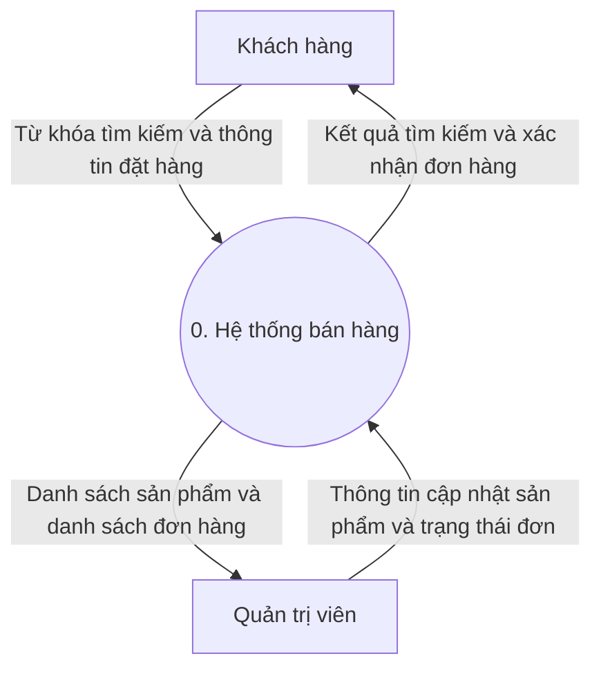
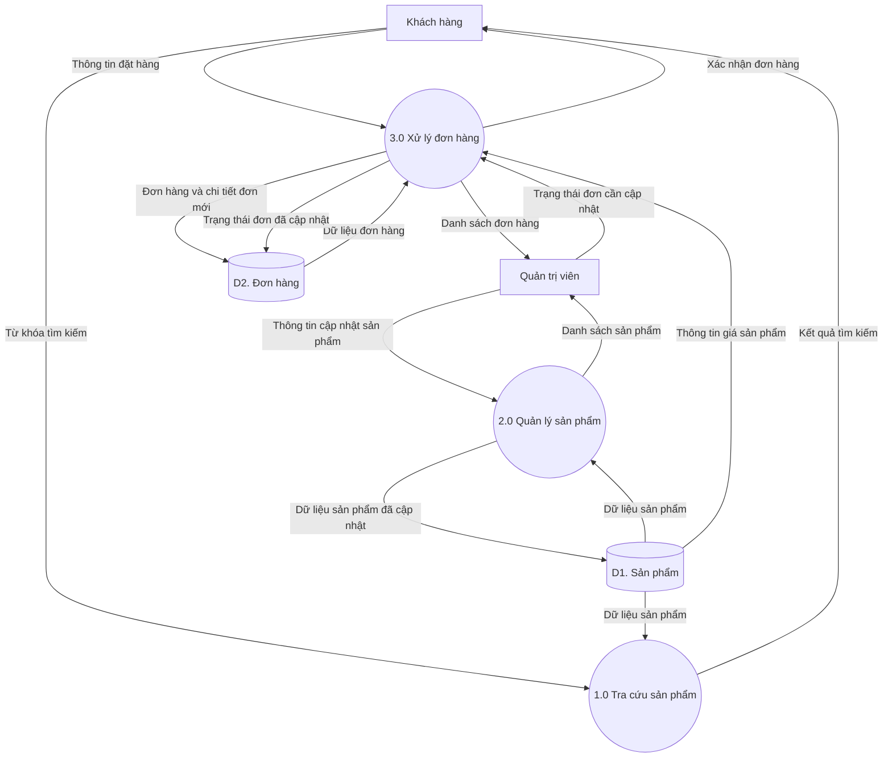

# Hướng dẫn agent tự tạo báo cáo BTL Phát triển hệ thống TMĐT

## 1. Nhiệm vụ

Tạo báo cáo tiếng Việt cho dự án website thương mại điện tử, bám theo tài liệu `Template BTL PTHT TMĐT.pdf` do người dùng cung cấp. Khảo sát dự án thực tế, xác định chức năng và cơ sở dữ liệu, sau đó viết báo cáo hoàn chỉnh theo cấu trúc bên dưới.

Toàn bộ sơ đồ do agent tạo phải dùng Mermaid và đặt trong khối mã `mermaid`. Ảnh chụp giao diện lấy từ website thực tế để minh họa Chương IV. Báo cáo cần đủ thông tin để thành viên nhóm giải thích cách hệ thống hoạt động và thực hiện lại các bước cài đặt.

Phạm vi hiện tại là báo cáo website TMĐT theo mẫu đính kèm. Chỉ sử dụng thông tin thuộc dự án website đang được cung cấp.

## 2. Đầu vào cần thu thập

| Đầu vào | Cách sử dụng |
| --- | --- |
| Mẫu báo cáo PDF | Xác định cấu trúc chương, trang bìa và các phần cuối báo cáo |
| Tên đề tài và loại sản phẩm kinh doanh | Thống nhất tên hệ thống, bối cảnh và ví dụ nghiệp vụ |
| Mã nguồn hoặc thư mục dự án | Kiểm tra chức năng, phân quyền, xử lý nghiệp vụ và cách chạy |
| Schema, migration hoặc file SQL | Xác định tên bảng, trường, khóa, quan hệ và dữ liệu khởi tạo |
| README, cấu hình mẫu và tệp quản lý phụ thuộc | Xác định công nghệ, phiên bản và lệnh cài đặt |
| Website chạy được hoặc hướng dẫn chạy cục bộ | Quan sát luồng thao tác, chụp giao diện và đối chiếu triển khai |
| Thông tin nhóm | Điền lớp, số nhóm, thành viên, mã sinh viên, nhóm trưởng và phân công |
| Yêu cầu bổ sung của giảng viên | Điều chỉnh độ dài, định dạng và phạm vi cần trình bày |

Chủ động đọc các nguồn được cung cấp trước khi hỏi thêm. Gom những thông tin còn thiếu có ảnh hưởng lớn thành một lần hỏi ngắn. Có thể tiếp tục viết các phần đã có căn cứ trong khi chờ bổ sung.

Nếu thiếu tên nhóm, thành viên hoặc thông tin hành chính, dùng dấu đánh dấu cụ thể như `[CẦN BỔ SUNG TÊN ĐỀ TÀI]`. Nếu thiếu mã nguồn hoặc schema, ghi rõ phần thiết kế nào là đề xuất và phần nào chưa được xác minh. Nếu chưa có giao diện thực tế, ghi vị trí ảnh cần bổ sung cùng tên màn hình, thao tác và nội dung cần chụp.

## 3. Căn cứ và mức độ hoàn thành

- Mô tả tính năng dựa trên mã nguồn, dữ liệu, giao diện hoặc tài liệu dự án đã kiểm tra.
- Đối chiếu tên chức năng giữa yêu cầu, BFD, DFD, đặc tả, cơ sở dữ liệu và hướng dẫn sử dụng.
- Ghi đúng các tên bảng, trường, trạng thái đơn hàng và vai trò trong dự án.
- Phân biệt rõ ba tình trạng khi cần thiết bằng các nhãn `đã xác minh`, `có triển khai nhưng chưa kiểm tra chạy` và `đề xuất`.
- Chỉ ghi một chức năng là đã chạy thành công khi đã quan sát được kết quả hoặc có bằng chứng kiểm tra phù hợp.
- Các mục chatbot, thanh toán trực tuyến, banner, menu, khuyến mãi và thống kê trong mẫu được đối chiếu với phạm vi dự án. Ghi tình trạng thực tế tại mục 3.3 nếu đó là chức năng nhóm dự kiến nhưng chưa hoàn thành.
- Mô tả khảo sát theo hoạt động thực sự đã thực hiện. Với khảo sát website tham khảo, ghi nguồn và ngày truy cập. Chỉ đưa số liệu khảo sát người dùng khi có dữ liệu được cung cấp.
- Với tài liệu tham khảo, sử dụng nguồn thực sự đã đọc. Ghi rõ nội dung tham khảo trong phần liên quan và đặt đường dẫn ở cuối đoạn hoặc mục tài liệu tham khảo.
- Trong hướng dẫn cấu hình, dùng các giá trị minh họa như `<DB_NAME>` và `<DB_USER>` cho thông tin riêng của hệ thống.

## 4. Đầu ra và độ dài dự kiến

Đầu ra mặc định là một file `Bao_cao_BTL_PTHT_TMDT.md`, chứa đầy đủ báo cáo và mã Mermaid. Nếu có ảnh giao diện, đặt ảnh trong thư mục `assets/` cạnh file và sử dụng đường dẫn tương đối để có thể di chuyển cả bộ tài liệu. Thông báo rõ ảnh hoặc thông tin nào còn cần bổ sung.

Nếu người dùng yêu cầu xuất Word hoặc PDF, tạo thêm định dạng đó, render các sơ đồ Mermaid thành ảnh rõ nét để chèn vào tài liệu, đồng thời giữ mã Mermaid trong file Markdown. Kiểm tra hình ảnh và bố cục của bản xuất trước khi giao.

Mục tiêu tham khảo là khoảng 30–40 trang khi dàn trang A4, hướng tới 35 trang. Đây là đề xuất về quy mô, mẫu PDF hiện tại chưa quy định số trang bắt buộc. Số trang Markdown chỉ có thể ước tính cho tới khi dàn trang.

| Thành phần | Số trang tham khảo |
| --- | --- |
| Bìa và mục lục | 3 |
| Chương I | 4 |
| Chương II | 3 |
| Chương III | 9 |
| Chương IV | 13 |
| Kết luận, hướng phát triển, tham khảo và phân công | 3 |
| Tổng mục tiêu | 35 |

Điều chỉnh theo số lượng chức năng thực tế. Ưu tiên trình bày đủ nghiệp vụ chính, sơ đồ dễ đọc và ảnh có giải thích. Chỉ dành dung lượng cho kiến thức, công nghệ và nội dung phục vụ dự án.

## 5. Cấu trúc báo cáo bắt buộc

### Trang bìa và mục lục

Trang bìa bám theo mẫu, gồm học viện, khoa, tên môn, tên đề tài, lớp, số nhóm, giảng viên hướng dẫn, thành viên và thời gian. Mẫu hiện tại ghi Học viện Công nghệ Bưu chính Viễn thông, Khoa Công nghệ thông tin 1, môn Phát triển hệ thống TMĐT và GVHD TS. Lê Văn Vịnh. Đối chiếu với thông tin người dùng xác nhận cho lớp hiện tại. In đậm tên nhóm trưởng theo mẫu.

Tạo mục lục dựa trên tiêu đề thực tế. Khi xuất Word, sử dụng Heading và mục lục tự động. Đánh số tiểu mục liên tục, sửa lỗi trùng số 4.3.9 đang có trong mẫu gốc.

### Chương I. Mô tả, khảo sát và xác định yêu cầu bài toán

#### 1.1. Mô tả bài toán

Giới thiệu đơn vị hoặc mô hình kinh doanh, sản phẩm bán, khách hàng mục tiêu, vấn đề cần giải quyết và mục tiêu xây dựng website. Chốt phạm vi triển khai để các chương sau có cùng giới hạn.

#### 1.2. Khảo sát, xác định yêu cầu bài toán

Tổ chức thành các phần phù hợp với đầu vào thực tế.

- Đặc điểm hoạt động bán hàng và quy trình nghiệp vụ hiện tại hoặc quy trình dự kiến của đề tài.
- Các đối tượng sử dụng và quyền hạn của từng đối tượng.
- Yêu cầu chức năng của khách hàng và quản trị viên.
- Yêu cầu phi chức năng có thể đối chiếu, như tính dễ sử dụng, phân quyền, bảo vệ thông tin và khả năng chạy trong môi trường dự án.

Lập bảng yêu cầu với các cột `Mã yêu cầu`, `Vai trò`, `Tên chức năng`, `Mô tả`, `Mức ưu tiên` và `Tình trạng`. Dùng mã ổn định, chẳng hạn `YC01`, để đối chiếu sang đặc tả chức năng.

#### 1.3. Phạm vi và quy trình nghiệp vụ tổng quát

Nêu các chức năng nhóm triển khai và giới hạn của phiên bản hiện tại. Diễn giải quy trình từ tìm sản phẩm đến tạo và xử lý đơn hàng theo đúng hệ thống.

### Chương II. Kiến thức áp dụng

Trình bày ngắn các kiến thức phục vụ việc đọc và hiểu thiết kế ở Chương III. Mỗi công nghệ cần nêu vai trò cụ thể trong dự án.

#### 2.1. Phân tích và thiết kế hệ thống

- **2.1.1. Biểu đồ phân cấp chức năng BFD** — khái niệm, thành phần, cách đọc và mục đích áp dụng.
- **2.1.2. Biểu đồ luồng dữ liệu DFD** — tác nhân ngoài, tiến trình, kho dữ liệu, luồng dữ liệu, mức ngữ cảnh và mức phân rã.

#### 2.2. Quản trị hệ thống

Giới thiệu các nội dung quản trị dự án có sử dụng, như xác thực, phân quyền, quản lý tài khoản và cấu hình môi trường chạy. Ghi rõ công nghệ hoặc cơ chế thực tế tương ứng.

#### 2.3. Cơ sở dữ liệu

Giới thiệu hệ quản trị CSDL được dùng, mô hình dữ liệu và các khái niệm cần thiết để hiểu thiết kế. Liên hệ khóa chính, khóa ngoại và quan hệ với dữ liệu sản phẩm, khách hàng và đơn hàng của đề tài.

#### 2.4. Ngôn ngữ lập trình và công nghệ

Liệt kê các ngôn ngữ, framework, thư viện chính cùng vai trò. Phiên bản lấy từ tệp phụ thuộc hoặc môi trường đã kiểm tra. Chỉ đưa những công nghệ tham gia vào sản phẩm.

### Chương III. Phân tích thiết kế hệ thống

Đây là phần trọng tâm về cấu trúc dữ liệu và cách các chức năng xử lý thông tin.

#### 3.1. Phân tích thiết kế CSDL

Nên tổ chức thành các mục sau.

1. **3.1.1. Các thực thể và quan hệ** — giải thích dữ liệu cần lưu và quan hệ giữa các thực thể.
2. **3.1.2. Sơ đồ ERD** — dùng Mermaid `erDiagram`, đối chiếu với schema hoặc migration thực tế.
3. **3.1.3. Đặc tả các bảng dữ liệu** — mỗi bảng có tên, mục đích và bảng mô tả trường.
4. **3.1.4. Ràng buộc dữ liệu và quy tắc nghiệp vụ** — trình bày các ràng buộc thực tế, ví dụ trường bắt buộc, giá trị duy nhất hoặc cách lưu chi tiết đơn hàng.

Mẫu đặc tả trường gồm `Tên trường`, `Kiểu dữ liệu`, `Khóa hoặc ràng buộc`, `Cho phép rỗng`, `Ý nghĩa`. Tên bảng và tên trường phải khớp dữ liệu dự án. Đánh dấu quan hệ logic nếu ứng dụng sử dụng quan hệ đó nhưng schema chưa khai báo khóa ngoại.

#### 3.2. Phân tích thiết kế chức năng

Mục này dự kiến khoảng 5–7 trang, điều chỉnh theo độ phức tạp của dự án.

##### 3.2.1. Phân rã chức năng của hệ thống

Vẽ BFD bằng Mermaid `flowchart TB`. Gốc là tên website, bên dưới chia nhóm chức năng theo vai trò thực tế. Với mô hình thông thường, hai nhánh chính là khách hàng và quản trị viên. Thêm nhánh chức năng con theo phạm vi đã xác minh. Tên nút diễn đạt chức năng như `Quản lý sản phẩm`, `Tra cứu sản phẩm`, `Xử lý đơn hàng`.

##### 3.2.2. Biểu đồ luồng dữ liệu

Tạo tối thiểu hai sơ đồ nếu dữ liệu đầu vào đủ để xác định luồng.

- **DFD mức ngữ cảnh** — biểu diễn toàn hệ thống bằng một tiến trình số 0, các tác nhân ngoài và các luồng dữ liệu qua ranh giới hệ thống.
- **DFD phân rã cấp đầu tiên** — phân rã tiến trình 0 thành các tiến trình nghiệp vụ chính, bổ sung kho dữ liệu và luồng dữ liệu nội bộ.

Trong báo cáo này, thống nhất cách gọi `mức ngữ cảnh` và `mức phân rã cấp đầu tiên` để tránh nhầm do cách đánh số mức khác nhau giữa tài liệu. Nếu cần phân rã sâu một chức năng, dùng số 3.1, 3.2… cho các tiến trình con của 3.0.

Sau mỗi hình, viết một đoạn giải thích các tác nhân, dữ liệu đi vào, kết quả đi ra và vai trò kho dữ liệu. Chỉ phân rã sâu những nghiệp vụ cần thêm chi tiết để hiểu cách xử lý.

##### 3.2.3. Đặc tả chức năng phía khách hàng

Chọn các chức năng có trong dự án, ví dụ đăng ký, đăng nhập, tìm kiếm, xem sản phẩm, quản lý giỏ hàng, đặt hàng hoặc xem lịch sử đơn.

Ưu tiên mô tả đầy đủ nghiệp vụ đặt hàng. Với chức năng đơn giản, có thể gộp các thao tác liên quan trong cùng bảng.

##### 3.2.4. Đặc tả chức năng phía quản trị viên

Mô tả theo quyền thực tế, ví dụ quản lý sản phẩm, danh mục, đơn hàng, tài khoản, khuyến mãi hoặc thống kê. Các thao tác thêm, sửa, xóa sản phẩm có thể gộp trong một đặc tả `Quản lý sản phẩm`, với từng luồng thao tác rõ ràng.

Với đơn hàng, ghi chính xác các trạng thái và điều kiện chuyển trạng thái được triển khai. Nếu có thanh toán trực tuyến, xác định tác nhân cổng thanh toán, dữ liệu gửi nhận và cách ứng dụng xử lý kết quả dựa trên mã nguồn thực tế.

##### Mẫu bảng đặc tả một chức năng

| Thành phần | Nội dung agent cần viết |
| --- | --- |
| Mã và tên chức năng | Mã ổn định cùng tên thống nhất với sơ đồ |
| Yêu cầu liên quan | Mã yêu cầu tương ứng từ Chương I |
| Mục đích | Kết quả nghiệp vụ mà chức năng tạo ra |
| Tác nhân | Vai trò được sử dụng chức năng |
| Điều kiện thực hiện | Trạng thái cần có trước khi thao tác |
| Dữ liệu đầu vào | Các thông tin được nhập, gửi hoặc đọc |
| Luồng xử lý chính | Các bước có thứ tự, nêu rõ thao tác của người dùng và xử lý của hệ thống |
| Kiểm tra và ngoại lệ | Trường hợp sai dữ liệu, thiếu quyền hoặc lỗi có liên quan cùng phản hồi thực tế |
| Dữ liệu lưu hoặc thay đổi | Bảng hoặc kho dữ liệu bị tác động |
| Kết quả và điều kiện sau | Thông tin trả về và trạng thái dữ liệu sau khi hoàn tất |

Ví dụ với chức năng đặt hàng, cần xác định điều kiện đăng nhập, cách tính giá, thông tin nhận hàng, nơi lưu đơn và chi tiết đơn. Việc kiểm tra tồn kho, trừ kho, làm rỗng giỏ hàng, xử lý lỗi ghi dữ liệu hoặc gửi thông báo phải được đối chiếu với triển khai rồi mới mô tả là hành vi hiện có.

##### 3.2.5. Luồng xử lý nghiệp vụ trọng tâm khi cần

Có thể bổ sung một lưu đồ Mermaid `flowchart` hoặc một biểu đồ `sequenceDiagram` cho nghiệp vụ phức tạp như đặt hàng hoặc xác nhận thanh toán. Ghi đúng tên loại sơ đồ trong chú thích. Sơ đồ cần làm rõ thứ tự xử lý hoặc nhánh điều kiện có ý nghĩa.

#### 3.3. Các chức năng chưa làm được

Lập bảng gồm `Chức năng dự kiến`, `Mức độ hiện tại`, `Phần còn thiếu` và `Ảnh hưởng đến phạm vi sử dụng`. Phân biệt phần chưa triển khai với phần đã có mã nguồn nhưng chưa kiểm tra chạy. Chỉ nêu nguyên nhân khi có căn cứ từ nhóm hoặc quá trình kiểm tra.

### Chương IV. Cài đặt và hướng dẫn sử dụng

#### 4.1. Cài đặt CSDL

Ghi các bước tạo CSDL, cấu hình kết nối, chạy migration hoặc import SQL, nạp dữ liệu mẫu và kiểm tra kết nối. Lệnh và tên file phải khớp dự án.

#### 4.2. Cài đặt giả lập môi trường server hosting

Giữ tiêu đề chính theo mẫu, bên trong mô tả đúng môi trường chạy thực tế, như máy chủ phát triển của framework, XAMPP hoặc Docker. Nêu phần mềm cần có, phiên bản đã xác định, thư mục chạy lệnh, cài phụ thuộc, cấu hình mẫu, khởi động và địa chỉ truy cập. Ghi kết quả kiểm tra thực hiện được và các bước còn chưa xác minh.

#### 4.3. Giao diện User

Trình bày các màn hình thực sự tồn tại. Với mỗi màn hình, nêu mục đích, cách truy cập, thao tác chính, kết quả và ảnh minh họa. Có thể sắp xếp theo trình tự xem sản phẩm, tìm kiếm, giỏ hàng và đặt hàng.

Danh sách màn hình trong mẫu được dùng để đối chiếu phạm vi, gồm trang chủ, sản phẩm, chi tiết sản phẩm, tìm kiếm, đăng ký, đăng nhập, giỏ hàng, xác nhận đặt hàng, thanh toán, hình thức thanh toán, giải đáp thắc mắc, liên hệ, chatbot và khu vực liên kết mạng xã hội. Đánh số lại theo nội dung thực tế được trình bày.

#### 4.4. Giao diện Admin

Mô tả các màn hình quản trị hiện có, như đăng nhập, trang tổng quan, thêm/sửa/xóa sản phẩm, quản lý tài khoản, đơn hàng, thống kê, banner, menu hoặc khuyến mãi. Các màn hình có thao tác tương tự có thể trình bày cùng một mục với ảnh và giải thích đủ rõ.

Mỗi ảnh cần có số hình và chú thích riêng. Chụp từ hệ thống đã chạy, tránh hiển thị thông tin cá nhân và thông tin cấu hình riêng. Với ảnh chưa thể chụp, dùng dấu đánh dấu mô tả đúng màn hình cần bổ sung.

### Các phần cuối báo cáo

- **Kết luận** — đối chiếu mục tiêu với phần đã hoàn thành và kết quả có căn cứ.
- **Hướng phát triển** — đề xuất phù hợp với giới hạn và phạm vi kinh doanh của website.
- **Tài liệu tham khảo** — liệt kê các nguồn thực sự sử dụng, đánh số thống nhất và bổ sung ngày truy cập khi phù hợp.
- **Phân công công việc** — giữ các cột STT, mã sinh viên, họ và tên, công việc, xác nhận theo mẫu. Phần xác nhận để thành viên hoàn thiện.

## 6. Quy ước Mermaid

### 6.1. Yêu cầu chung

- Mỗi sơ đồ nằm trong một khối mã có nhãn `mermaid` và có số hình, tên hình, giải thích ở ngoài khối mã.
- Dùng ID ngắn, ổn định như `KH`, `QT`, `P1`, `D1`. Nhãn hiển thị sử dụng tiếng Việt đầy đủ.
- Đặt nhãn chứa dấu câu hoặc dấu ngoặc trong dấu nháy kép.
- Ưu tiên `flowchart TB` khi sơ đồ nhiều nút. Chia hình theo nghiệp vụ khi hình quá rộng hoặc khó đọc. Tối đa năm nút hoặc đối tượng trên một hàng ngang.
- Dùng `erDiagram` cho quan hệ dữ liệu, `flowchart` cho BFD, DFD và lưu đồ, `sequenceDiagram` cho thứ tự trao đổi khi cần.
- Giữ màu sắc và kiểu chữ đơn giản, bảo đảm đọc được khi in. Dùng nhãn văn bản đầy đủ để phân biệt các thành phần.
- Kiểm tra cú pháp và khả năng render bằng công cụ Mermaid sẵn có. Nếu chưa render được, ghi rõ việc kiểm tra cú pháp hoặc bố cục còn chưa hoàn tất.

### 6.2. Quy ước BFD

BFD thể hiện phân cấp chức năng bằng quan hệ cha–con. Đặt tên chức năng theo hành động và đối tượng. Mọi nút con phải phù hợp với chức năng cha và có thể đối chiếu với phạm vi hệ thống.

### 6.3. Quy ước DFD bằng Mermaid

Mermaid chưa có kiểu biểu đồ DFD chuyên dụng. Sử dụng `flowchart` và ghi chú quy ước hình học ngay trong báo cáo.

| Thành phần DFD | Cách biểu diễn bằng Mermaid | Nội dung nhãn |
| --- | --- | --- |
| Tác nhân ngoài | `KH["Khách hàng"]` | Vai trò hoặc hệ thống bên ngoài |
| Tiến trình | `P1(("1.0 Tra cứu sản phẩm"))` | Số tiến trình và hành động xử lý |
| Kho dữ liệu | `D1[("D1. Sản phẩm")]` | Mã kho và tên dữ liệu |
| Luồng dữ liệu | `KH -->|Từ khóa tìm kiếm| P1` | Thông tin được truyền |

Hình trụ là ký hiệu quy ước cho kho dữ liệu trong bản Mermaid này. Chú thích này cần đi kèm sơ đồ để người đọc hiểu cách biểu diễn.

Kiểm tra các quy tắc sau khi vẽ.

1. Mỗi luồng dùng một mũi tên có hướng và tên dữ liệu cụ thể. Hai chiều trao đổi dùng hai mũi tên riêng.
2. Luồng dữ liệu nối tác nhân với tiến trình, tiến trình với tiến trình hoặc tiến trình với kho dữ liệu.
3. Mỗi tiến trình có dữ liệu vào và dữ liệu ra phù hợp với phép xử lý.
4. Mức ngữ cảnh có một tiến trình toàn hệ thống và các tác nhân ngoài.
5. Các luồng qua ranh giới hệ thống ở mức phân rã phải cân bằng với mức ngữ cảnh. Một luồng gộp có thể được tách thành nhiều luồng cụ thể nếu nội dung dữ liệu vẫn tương đương.
6. Tên mũi tên diễn đạt dữ liệu như `Thông tin đặt hàng`, `Dữ liệu sản phẩm`, `Xác nhận đơn hàng`. Các nhánh điều kiện và thứ tự thao tác được thể hiện trong lưu đồ nghiệp vụ khi cần.
7. Kho dữ liệu có thể đại diện một tập dữ liệu nghiệp vụ gồm nhiều bảng. Giải thích ánh xạ kho dữ liệu với các bảng trong mục 3.1.

### 6.4. Ví dụ Mermaid để tham khảo cấu trúc

Ví dụ dưới đây minh họa website có ba nhóm chức năng. Khi tạo báo cáo, điều chỉnh theo các chức năng, tác nhân và kho dữ liệu thực tế đã khảo sát.

**Ví dụ DFD mức ngữ cảnh**

**Ví dụ DFD phân rã cấp đầu tiên**

Ví dụ này gộp đơn hàng và chi tiết đơn vào kho D2. Chức năng tài khoản, thanh toán, giỏ hàng và các tác nhân khác cần được bổ sung vào cả hai mức khi thuộc phạm vi phân tích của website thực tế.

## 7. Trình tự làm việc của agent

1. Đọc mẫu và các tài liệu đầu vào. Khảo sát cấu trúc dự án, schema, điểm vào ứng dụng, cơ chế phân quyền và các luồng nghiệp vụ chính.
2. Lập danh sách yêu cầu, chức năng thực tế, công nghệ và thông tin còn thiếu. Thống nhất tên gọi dùng xuyên suốt báo cáo.
3. Viết Chương III từ dữ liệu và xử lý thực tế. Tạo BFD, DFD và ERD bằng Mermaid, đối chiếu quan hệ giữa chúng.
4. Chạy hệ thống theo hướng dẫn hiện có khi điều kiện cho phép. Kiểm tra luồng chính bằng dữ liệu mẫu, ghi kết quả và chụp các màn hình cần cho Chương IV.
5. Viết Chương IV với các bước có thể thực hiện lại. Nếu có bước chưa chạy được, chỉ rõ tình trạng và điểm cần bổ sung.
6. Hoàn thiện Chương I và II theo phạm vi đã xác định, rồi viết các phần kết luận, tham khảo và phân công.
7. Rà soát số mục, số bảng, số hình, tên chức năng, sơ đồ và liên kết ảnh. Kiểm tra phần đầu ra theo danh sách nghiệm thu bên dưới.
8. Giao file báo cáo cùng các ảnh phụ thuộc nếu có, tóm tắt phần đã hoàn thành và liệt kê ngắn các dữ liệu còn thiếu hoặc nội dung chưa xác minh.

## 8. Tiêu chí nghiệm thu

- [ ] Báo cáo có đủ bốn chương và các phần cuối theo mẫu.
- [ ] Chương II giải thích các kiến thức cần dùng, Chương III áp dụng vào thiết kế của dự án, Chương IV hướng dẫn thao tác trên sản phẩm thực tế.
- [ ] Mục 3.1 có ERD và mô tả bảng khớp schema đã cung cấp.
- [ ] Mục 3.2 có BFD, DFD mức ngữ cảnh, DFD phân rã và đặc tả các chức năng chính.
- [ ] Mọi sơ đồ tự tạo đều có mã Mermaid, tiêu đề và giải thích.
- [ ] DFD có tên luồng dữ liệu, tiến trình có dữ liệu vào/ra và hai mức cân bằng qua ranh giới hệ thống.
- [ ] Vai trò, chức năng, kho dữ liệu và bảng CSDL thống nhất giữa các phần.
- [ ] Quy trình cài đặt dùng đúng công nghệ và tên tệp của dự án.
- [ ] Ảnh giao diện có nguồn từ website thực tế, hoặc vị trí thiếu ảnh được đánh dấu cụ thể.
- [ ] Chức năng chưa hoàn thành được nêu ở mục 3.3 với tình trạng rõ ràng.
- [ ] Thông tin hành chính, phân công và kết quả kiểm tra có căn cứ hoặc có dấu đánh dấu cần bổ sung.
- [ ] Các mục đánh số liên tục, mọi đường dẫn ảnh đều hoạt động và nội dung dễ đọc khi xuất tài liệu.
- [ ] File giao cuối cùng nêu rõ các thông tin còn thiếu và những phần chưa được kiểm tra.
