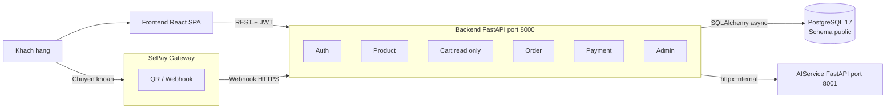
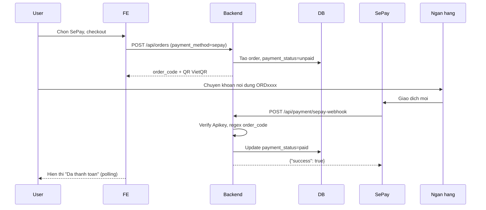
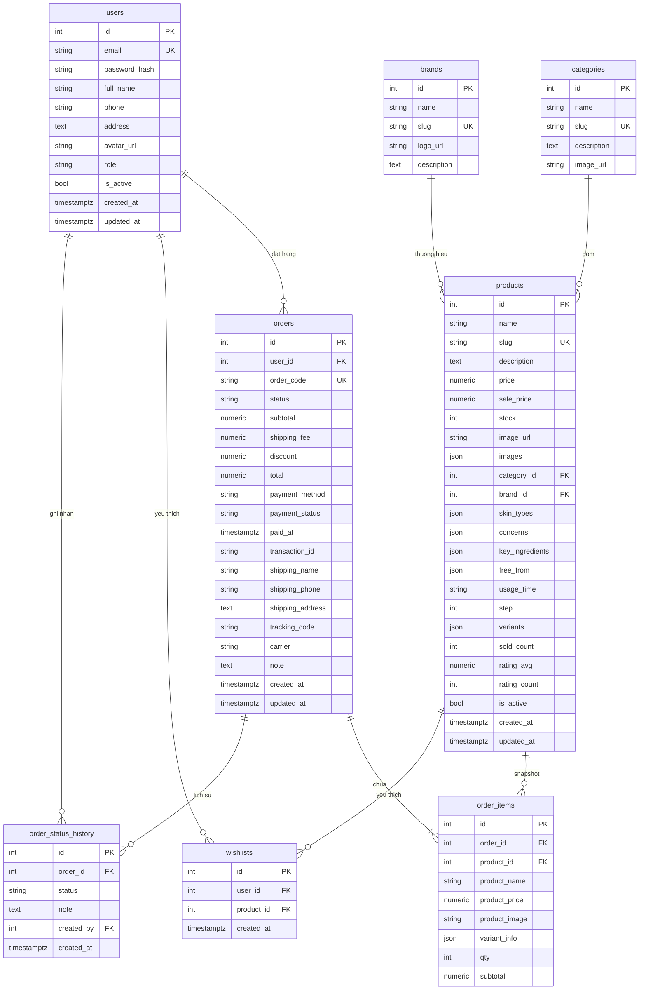
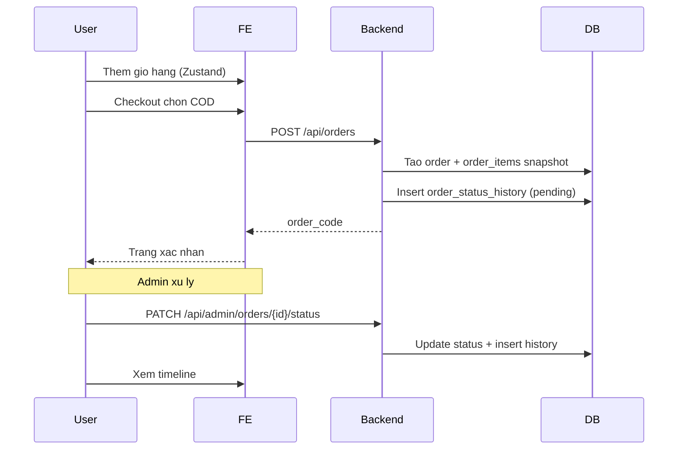
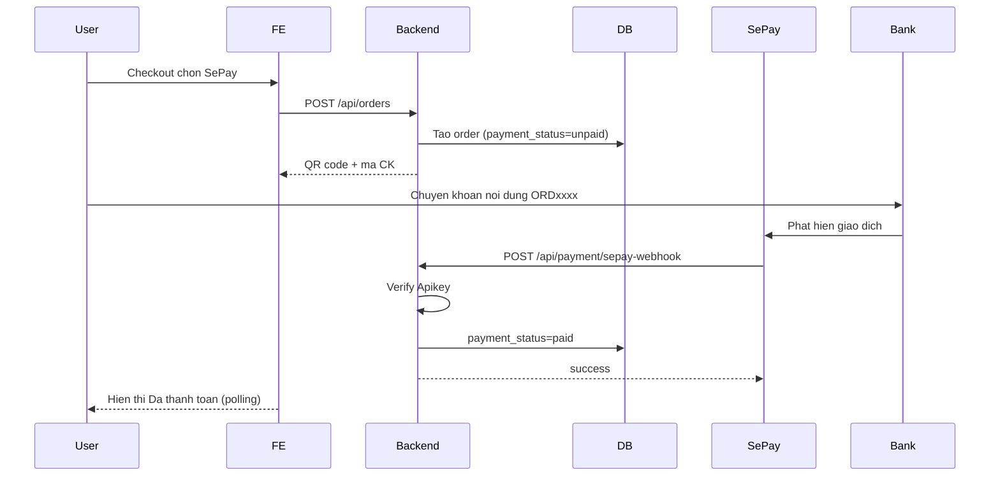
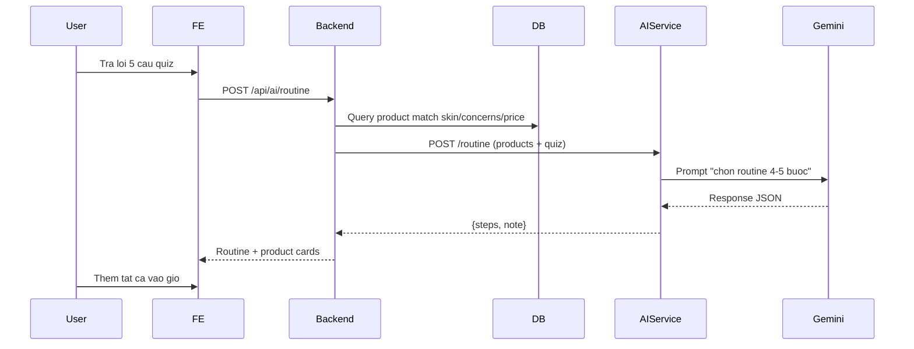
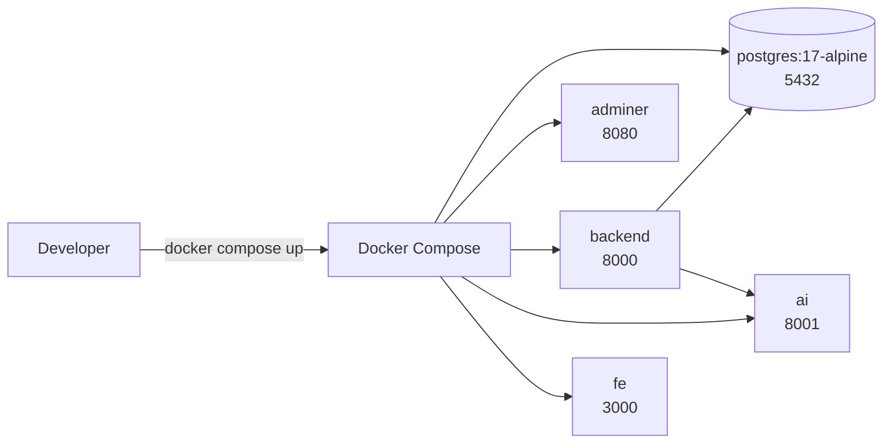

# Thiết kế hệ thống — Web Mỹ phẩm

Tài liệu này mô tả kiến trúc tổng thể, các thành phần, sơ đồ quan hệ cơ sở dữ liệu, các luồng nghiệp vụ chính và các quyết định thiết kế quan trọng của hệ thống bán mỹ phẩm `cosme-shop`.

## 1. Tổng quan kiến trúc

Hệ thống theo mô hình monorepo 3 module, triển khai dạng client-server với backend làm API gateway trung tâm.



Ba module chính:

- `/backend` (FastAPI, port `8000`) — API gateway, xử lý nghiệp vụ, kết nối database, gọi AI service, nhận webhook SePay.
- `/ai` (FastAPI, port `8001`) — Service AI riêng, gọi Gemini API để tạo Routine Builder.
- `/fe` (React + Vite + TypeScript) — Single-page app cho khách hàng và admin.

## 2. Thành phần hệ thống

### 2.1 Frontend (React SPA)

- Vai trò: giao diện người dùng và admin.
- Giao tiếp: REST API với backend qua Axios.
- State: Zustand (client state) + TanStack Query (server state).
- Deploy: static files, có thể serve qua Nginx hoặc Vite preview.

### 2.2 Backend (FastAPI)

- Vai trò: API gateway, xử lý toàn bộ nghiệp vụ.
- Giao tiếp:
  - Nhận request từ FE.
  - Gọi AI service qua HTTP nội bộ.
  - Nhận webhook từ SePay.
  - Truy vấn PostgreSQL async.
- Auth: JWT HS256, token hết hạn sau 1 ngày.

### 2.3 AI Service (FastAPI riêng)

- Vai trò: xử lý logic AI, tách khỏi backend để dễ bảo trì.
- Giao tiếp:
  - Nhận request từ backend (không expose public).
  - Gọi Gemini API (`google-genai` SDK).
- Không có: database, auth, session.
- Endpoint duy nhất: `POST /routine` (tạo skincare routine từ quiz input).

### 2.4 Database (PostgreSQL 17)

- Một database duy nhất: `cosme_shop`.
- 8 bảng nghiệp vụ trong schema `public` (chi tiết ở mục 3).
- Không dùng `pgvector` — AI dùng Gemini API trực tiếp, không có embedding.

### 2.5 SePay Gateway

- Vai trò: xác nhận chuyển khoản qua webhook.
- Flow:



## 3. Thiết kế database

### 3.1 Sơ đồ quan hệ



### 3.2 Cấu trúc JSON variants

```json
[
  {
    "id": "v1",
    "name": "Do Ruby",
    "price": 350000,
    "stock": 20,
    "image_url": "https://.../do-ruby.jpg"
  },
  {
    "id": "v2",
    "name": "Hong Dao",
    "price": 350000,
    "stock": 15,
    "image_url": "https://.../hong-dao.jpg"
  }
]
```

**Quy tắc:**

- `variants = null` — sản phẩm không có biến thể, dùng `price`/`stock` chính.
- `variants = [...]` — mỗi variant có giá/stock riêng.
- Khi order, snapshot `variant_info = {"id": "v1", "name": "Do Ruby"}` vào `order_items`.

## 4. Thiết kế API

### 4.1 Quy ước chung

- Prefix: `/api`.
- Response thành công: `{ "data": ..., "message": "OK" }`.
- Response lỗi: `{ "detail": "...", "code": "ERROR_CODE" }`.
- Auth: `Authorization: Bearer <JWT>`.
- Pagination: `?page=1&size=20` → `{ data, total, page, size }`.
- Thời gian: ISO 8601 UTC.

### 4.2 Danh sách endpoints

| Nhóm | Method | Path | Phân quyền |
|---|---|---|---|
| Auth | POST | `/api/auth/register` | Public |
| Auth | POST | `/api/auth/login` | Public |
| Auth | GET | `/api/auth/me` | User |
| Auth | PATCH | `/api/auth/me` | User |
| Auth | POST | `/api/auth/change-password` | User |
| Products | GET | `/api/products` | Public (filter + paginate) |
| Products | GET | `/api/products/{id}` | Public |
| Products | GET | `/api/products/{id}/similar` | Public |
| Products | GET | `/api/products/best-sellers` | Public |
| Products | POST | `/api/products` | Admin |
| Products | PATCH | `/api/products/{id}` | Admin |
| Products | DELETE | `/api/products/{id}` | Admin |
| Categories | GET | `/api/categories` | Public |
| Categories | POST | `/api/categories` | Admin |
| Categories | PATCH | `/api/categories/{id}` | Admin |
| Categories | DELETE | `/api/categories/{id}` | Admin |
| Brands | GET | `/api/brands` | Public |
| Brands | POST | `/api/brands` | Admin |
| Brands | PATCH | `/api/brands/{id}` | Admin |
| Brands | DELETE | `/api/brands/{id}` | Admin |
| Orders | POST | `/api/orders` | User (checkout) |
| Orders | GET | `/api/orders` | User (đơn của mình) |
| Orders | GET | `/api/orders/{id}` | User (chi tiết + history) |
| Orders | POST | `/api/orders/{id}/cancel` | User |
| Orders | GET | `/api/admin/orders` | Admin |
| Orders | PATCH | `/api/admin/orders/{id}/status` | Admin |
| Payment | POST | `/api/payment/sepay-webhook` | SePay |
| Payment | GET | `/api/payment/status/{order_id}` | User |
| Wishlist | GET | `/api/wishlist` | User |
| Wishlist | POST | `/api/wishlist/{product_id}` | User |
| Wishlist | DELETE | `/api/wishlist/{product_id}` | User |
| AI | POST | `/api/ai/routine` | Public |

### 4.3 AI Service endpoints (nội bộ)

- `POST /routine` — nhận quiz + danh sách sản phẩm đã match → gọi Gemini → trả routine.

## 5. Luồng nghiệp vụ chính

### 5.1 Đặt hàng COD



### 5.2 Đặt hàng SePay



### 5.3 Routine Builder



## 6. Bảo mật

### 6.1 Auth

- JWT HS256, secret key lưu trong `.env`.
- Token hết hạn sau 1 ngày.
- Password hash bằng bcrypt (cost 12).
- Không lưu plaintext password, không log token.

### 6.2 Phân quyền

- Dependency `get_current_user` — bắt buộc đăng nhập.
- Dependency `get_current_admin` — check role == `"admin"`.
- Mọi endpoint admin đều có check `[admin]` trong service layer.

### 6.3 Webhook SePay

- Verify `Authorization: Apikey <SEPAY_KEY>` trong header.
- Chỉ xử lý khi API key khớp.
- Idempotent: nếu đơn đã `paid` thì không update lại.

### 6.4 CORS

- `allow_origins=["http://localhost:3000"]`
- `allow_credentials=True`

### 6.5 Upload ảnh

- Chỉ admin upload được.
- Giới hạn 5MB, chỉ chấp nhận jpg/png/webp.
- Lưu local `uploads/` hoặc Cloudinary (tuỳ chọn).

## 7. Triển khai

### 7.1 Local dev (Docker Compose)

Cấu hình 5 services:



| Service | Port | Image / Build |
|---|---|---|
| postgres | 5432 | `postgres:17-alpine` |
| adminer | 8080 | `adminer:latest` |
| backend | 8000 | build từ `./backend` |
| ai | 8001 | build từ `./ai` |
| fe | 3000 | build từ `./fe` |

### 7.2 Webhook SePay khi dev

Do SePay cần URL public HTTPS, có 3 cách:

- **Cách 1 — Cloudflare Tunnel (khuyên dùng):**

```bash
cloudflared tunnel --url http://localhost:8000
```

Nhận URL `https://xxx.trycloudflare.com` → cấu hình trên SePay.

- **Cách 2 — VPS làm relay:** VPS nhận webhook → forward về local qua SSH tunnel.
- **Cách 3 — ngrok:**

```bash
ngrok http 8000
```

### 7.3 Production (nếu deploy thật)

- VPS Ubuntu 22.04.
- Nginx reverse proxy + Let's Encrypt SSL.
- Docker Compose chạy 4 service (bỏ adminer).
- PostgreSQL backup định kỳ.

## 8. Hiệu năng & mở rộng

### 8.1 Hiệu năng hiện tại

- Async toàn bộ (FastAPI + SQLAlchemy async).
- Connection pool 20, max overflow 10.
- TanStack Query cache 5 phút trên FE.

### 8.2 Điểm nghẽn tiềm ẩn

- AI service gọi Gemini API — có thể chậm 2–5s.
- Webhook SePay — cần idempotent để tránh duplicate.

### 8.3 Mở rộng (không làm trong đồ án)

- Redis cache cho product list.
- Celery cho background job (email, PDF).
- CDN cho ảnh sản phẩm.
- Load balancer cho AI service.

## 9. Quyết định thiết kế quan trọng

| Quyết định | Lý do |
|---|---|
| Giỏ hàng ở FE | Guest cũng có giỏ, không cần API riêng |
| Snapshot giá vào `order_items` | Đơn cũ không đổi khi admin sửa giá |
| Variants dạng JSON | Không cần bảng riêng, đủ cho đồ án |
| AI service tách riêng | Dễ bảo trì, có thể thay LLM provider |
| Không dùng pgvector | AI dùng Gemini API trực tiếp, không embedding |
| COD + SePay | COD ổn định, SePay có điểm nhấn |
| Không refresh token | Overkill cho đồ án |
| PostgreSQL 17 | Phiên bản stable mới nhất, asyncpg hỗ trợ đầy đủ |
| Frontend TypeScript + React 19 | Type safety, ecosystem mới |
