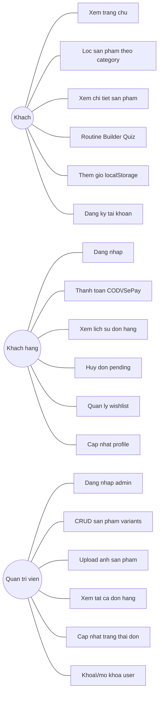
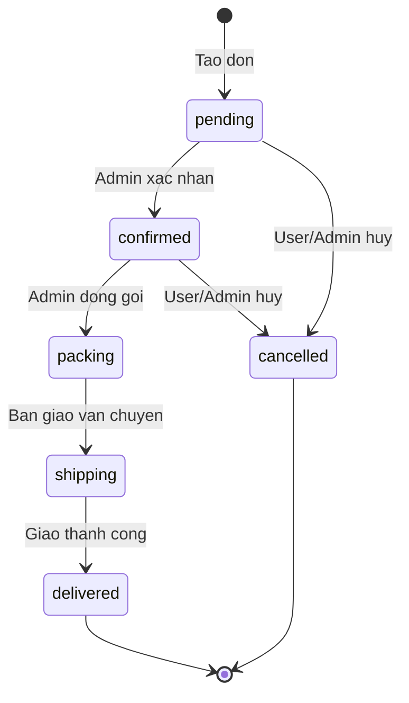

# Nghiệp vụ hệ thống — Web Mỹ phẩm

Tài liệu này mô tả chi tiết các nghiệp vụ, vai trò người dùng, quy tắc nghiệp vụ quan trọng, kịch bản demo và thứ tự ưu tiên triển khai của hệ thống bán mỹ phẩm `cosme-shop`.

## 1. Tổng quan nghiệp vụ

Website thương mại điện tử bán mỹ phẩm, phục vụ 3 nhóm người dùng:

- **Khách (Guest)** — xem sản phẩm, tìm kiếm, dùng AI tư vấn.
- **Khách hàng (User)** — đặt hàng, quản lý đơn, wishlist.
- **Quản trị viên (Admin)** — quản lý sản phẩm, đơn hàng, người dùng.

**Đặc thù ngành mỹ phẩm:**

- Khách mua dựa trên loại da và vấn đề da.
- Cần tư vấn routine (quy trình skincare).
- Sản phẩm có metadata phức tạp (thành phần, công dụng).

### User journey tổng quan



## 2. Nghiệp vụ theo vai trò

### 2.1 Khách (Guest)

**Có thể làm:**

- Xem trang chủ (sản phẩm nổi bật, bán chạy, mới về).
- Xem danh sách sản phẩm, filter theo danh mục/thương hiệu/giá.
- Tìm kiếm sản phẩm theo tên.
- Xem chi tiết sản phẩm.
- Xem sản phẩm tương tự.
- Dùng Routine Builder Quiz (không cần đăng nhập).
- Thêm sản phẩm vào giỏ (lưu `localStorage`).
- Đăng ký / đăng nhập.

**Không thể làm:**

- Đặt hàng (phải đăng nhập).
- Xem wishlist (phải đăng nhập).

### 2.2 Khách hàng (User)

Kế thừa từ Guest, cộng thêm:

- Đặt hàng (COD hoặc SePay).
- Xem danh sách đơn hàng của mình.
- Xem chi tiết đơn + timeline trạng thái.
- Hủy đơn khi còn `pending` hoặc `confirmed`.
- Quản lý wishlist (thêm/xóa/xem).
- Cập nhật profile (tên, SĐT, địa chỉ).
- Đổi mật khẩu.

### 2.3 Quản trị viên (Admin)

Kế thừa từ User, cộng thêm:

- CRUD sản phẩm (bao gồm variants).
- CRUD danh mục, thương hiệu.
- Upload ảnh sản phẩm.
- Xem tất cả đơn hàng.
- Cập nhật trạng thái đơn.
- Ghi chú trạng thái (VD: "Đã lấy hàng tại kho HN").
- Quản lý user (xem, khóa/mở khóa).
- Xem dashboard thống kê cơ bản.

## 3. Nghiệp vụ chi tiết theo module

### 3.1 Module Auth

**Đăng ký**

- **Input:** `email`, `password`, `full_name`.
- **Validate:**
  - Email đúng format, chưa tồn tại trong DB.
  - Password tối thiểu 6 ký tự.
  - `full_name` không rỗng.
- **Xử lý:**
  1. Hash password bằng bcrypt.
  2. Tạo user với `role = "user"`, `is_active = true`.
  3. Sinh JWT token.
  4. Trả về token + thông tin user.
- **Edge cases:**
  - Email trùng → 400 `"Email đã được sử dụng"`.
  - Password yếu → 400 `"Mật khẩu tối thiểu 6 ký tự"`.

**Đăng nhập**

- **Input:** `email`, `password`.
- **Xử lý:**
  1. Tìm user theo email.
  2. Verify password bằng bcrypt.
  3. Kiểm tra `is_active = true`.
  4. Sinh JWT.
  5. Trả token + user.
- **Edge cases:**
  - Sai email/password → 401 `"Email hoặc mật khẩu không đúng"`.
  - Tài khoản bị khóa → 403 `"Tài khoản đã bị khóa"`.

**Đổi mật khẩu**

- **Input:** `old_password`, `new_password`.
- **Xử lý:**
  1. Verify `old_password`.
  2. Hash `new_password`.
  3. Update DB.
- **Edge cases:**
  - Old password sai → 400.
  - New password giống old → 400.

### 3.2 Module Sản phẩm

**Tạo sản phẩm (Admin)**

- **Input:** `name`, `price`, `stock`, `category_id`, `brand_id`, `description`, `image`, attributes, `variants` (optional).
- **Validate:**
  - `name` không rỗng, unique slug.
  - `price > 0`.
  - `stock >= 0`.
  - `category_id`, `brand_id` tồn tại.
  - Nếu có variants: mỗi variant có `name`, `price > 0`, `stock >= 0`.
- **Xử lý:**
  1. Generate slug từ name (VD: `"Serum Vitamin C"` → `"serum-vitamin-c"`).
  2. Lưu ảnh, lấy URL.
  3. Insert product.
  4. Nếu có variants → lưu JSON.

**Xem danh sách sản phẩm (Public)**

- **Filter:**
  - `category_id`, `brand_id`.
  - `min_price`, `max_price`.
  - `skin_types` (nhiều giá trị, OR).
  - `concerns` (nhiều giá trị, OR).
  - `search` (tìm theo tên).
  - `sort`: `price_asc`, `price_desc`, `newest`, `best_seller`.
- **Pagination:** `page` (default 1), `size` (default 20, max 100).
- Chỉ trả sản phẩm `is_active = true`.

**Xem chi tiết sản phẩm**

Bao gồm:

- Thông tin sản phẩm đầy đủ.
- Variants (nếu có).
- Category, brand.
- Sản phẩm tương tự (query theo category + concerns).
- Đánh giá (nếu làm).

**Sản phẩm tương tự (cho AI recommend)**

- **Logic đơn giản:**
  1. Lấy `category_id` của sản phẩm hiện tại.
  2. Tìm sản phẩm cùng category, loại trừ chính nó.
  3. Ưu tiên sản phẩm có `concerns` overlap.
  4. Limit 8 sản phẩm.

### 3.3 Module Giỏ hàng

- **Lưu trữ:** Zustand + `localStorage` (FE).

**Thêm vào giỏ**

- **Input:** `product_id` (hoặc `variant_id`), `qty`.
- **Xử lý:**
  - Nếu đã có trong giỏ → tăng `qty`.
  - Nếu chưa có → thêm mới với `qty`.
  - Không cần check stock ở FE (check khi checkout).

**Cập nhật/Xóa**

- Update `qty` → cập nhật state.
- Remove → filter ra khỏi mảng.

**Tính tổng tiền**

```text
subtotal = SUM (variant.price || product.price) * qty
```

### 3.4 Module Checkout & Order

**Checkout**

- **Input:**

```json
{
  "items": [
    { "product_id": 1, "variant_id": "v1", "qty": 2 }
  ],
  "shipping_name": "...",
  "shipping_phone": "...",
  "shipping_address": "...",
  "payment_method": "cod | sepay",
  "note": "..."
}
```

- **Validate:**
  - Items không rỗng.
  - Mỗi item: product tồn tại, `is_active`.
  - Nếu có `variant_id`: variant tồn tại trong product.
  - Stock đủ.
  - Phone đúng format VN.
  - Address không rỗng.
- **Xử lý:**
  1. Với mỗi item:
     - Lấy product + variant (nếu có).
     - Check stock.
     - Trừ stock (product hoặc variant).
     - Snapshot: `product_name`, `product_price`, `variant_info`.
  2. Tạo order:
     - `order_code`: `ORD` + timestamp + random.
     - `status = "pending"`.
     - `payment_status = "unpaid"`.
     - Tính `subtotal`, `shipping_fee`, `total`.
  3. Tạo `order_items`.
  4. Insert `order_status_history` (`pending`).
  5. Nếu `sepay` → tạo QR + mã CK.
  6. Trả về order.
- **Shipping fee:** mặc định `30.000đ`, miễn phí nếu `subtotal > 500.000đ`.
- **Edge cases:**
  - Stock không đủ → 400 `OUT_OF_STOCK`.
  - Product inactive → 400.
  - Transaction rollback nếu lỗi giữa chừng.

**Xem đơn**

- User chỉ xem được đơn của mình.
- Admin xem được tất cả.
- Response bao gồm `order_items` + history.

**Hủy đơn (User)**

- **Điều kiện:** `status IN ("pending", "confirmed")`.
- **Xử lý:**
  1. Update `status = cancelled`.
  2. Hoàn lại stock cho product/variant.
  3. Insert history.
- **Edge cases:**
  - Đơn đã shipping → 400 `"Không thể hủy đơn đang giao"`.

### 3.5 Module Tracking

**Cập nhật trạng thái (Admin)**

- **Input:** `status`, `note` (optional).
- **Validate:** status hợp lệ và chuyển tiếp hợp lý (xem state diagram).
- **Xử lý:**
  1. Update `order.status`.
  2. Insert `order_status_history`.
  3. Nếu `status = shipping` và chưa có `tracking_code` → sinh mã giả.
  4. Nếu `status = delivered` và `payment_method = cod` → `payment_status = paid`.

**Xem timeline (User)**

Hiển thị theo thứ tự thời gian ngược (mới nhất trên cùng).

### 3.6 Module Payment

**COD**

- `payment_method = "cod"`, `payment_status = "unpaid"`.
- Admin đánh dấu `paid` khi giao hàng thành công.

**SePay**

- **Tạo đơn:**
  1. Sinh `order_code` (VD: `DH123456` hoặc `ORD20260919XXXX`).
  2. Trả về URL QR:
     ```
     https://qr.sepay.vn/img?acc=...&bank=...&amount=...&des=ORDER_CODE
     ```
  3. User chuyển khoản với nội dung chứa order code.
- **Webhook:**
  1. Verify `Authorization: Apikey <SEPAY_KEY>`.
  2. Parse payload: `content`, `amount_in`, `transaction_id`.
  3. Extract `order_code` từ `content` (regex `ORD\d+` hoặc `DH\d+`).
  4. Tìm order → check idempotent (đã paid → skip).
  5. Update `payment_status = paid`, `paid_at`, `transaction_id`.
  6. Trả `{success: true}` cho SePay.
- **Edge cases:**
  - Order không tồn tại → vẫn trả success (để SePay không retry).
  - Đã paid → idempotent, skip update.
  - Amount không khớp → log warning, vẫn update.

### 3.7 Module AI

**Routine Builder Quiz**

- **Input:**

```json
{
  "skin_type": "oily",
  "concerns": ["acne", "dark_spots"],
  "budget": 1500000,
  "age": 25,
  "allergies": ["alcohol"]
}
```

- **Xử lý:**
  1. Query DB: lấy sản phẩm match:
     - `skin_types` chứa `skin_type`.
     - `concerns` overlap với input concerns.
     - `price <= budget / 4` (mỗi bước tối đa 1/4 ngân sách).
     - `free_from` không chứa `allergies`.
  2. Gọi AI service `/routine`.
  3. AI gọi Gemini → sinh routine 4–5 bước.
  4. Trả về FE.
- **Output:**

```json
{
  "steps": [
    { "step": 1, "product_id": 5, "reason": "..." },
    { "step": 2, "product_id": 12, "reason": "..." }
  ],
  "note": "Loi khuyen them"
}
```

## 4. Quy tắc nghiệp vụ quan trọng

| Quy tắc | Chi tiết |
|---|---|
| Snapshot giá | `order_items.product_price` là giá tại thời điểm mua, không đổi |
| Không xóa cứng | Xóa sản phẩm = `is_active = false`, không DELETE |
| Stock âm | Không cho phép, rollback transaction |
| Order code | Unique, format `ORD` + timestamp + random |
| Free shipping | `subtotal >= 500.000đ` |
| Cancel order | Chỉ khi `pending` hoặc `confirmed`, hoàn stock |
| Idempotent webhook | SePay có thể gọi nhiều lần, chỉ update 1 lần |
| JWT expire | 1 ngày, không refresh |
| Giỏ hàng guest | Lưu `localStorage`, merge khi login (tùy chọn) |

## 5. Trạng thái đơn hàng



**Chuyển tiếp hợp lệ:**

- `pending → confirmed | cancelled`
- `confirmed → packing | cancelled`
- `packing → shipping`
- `shipping → delivered`
- `delivered, cancelled` = final, không đổi được.

## 6. Phân quyền theo endpoint

| Endpoint | Guest | User | Admin |
|---|---|---|---|
| `GET /api/products` | OK | OK | OK |
| `POST /api/products` | -- | -- | OK |
| `GET /api/auth/me` | -- | OK | OK |
| `POST /api/orders` | -- | OK | OK |
| `PATCH /api/admin/orders/{id}/status` | -- | -- | OK |
| `GET /api/wishlist` | -- | OK | OK |
| `POST /api/ai/routine` | OK | OK | OK |

## 7. Kịch bản demo chính

### Kịch bản 1 — Khách xem + tư vấn AI

1. Vào trang chủ → thấy sản phẩm bán chạy.
2. Filter "chăm sóc da dầu" → danh sách sản phẩm.
3. Click vào serum → xem chi tiết.
4. Dùng Routine Builder → trả lời quiz → nhận routine.
5. Thêm routine vào giỏ.
6. Đăng ký tài khoản mới.
7. Checkout COD.

### Kịch bản 2 — Thanh toán SePay

1. User thêm sản phẩm → checkout.
2. Chọn SePay → hiện QR.
3. Chuyển khoản test (dùng app ngân hàng sandbox).
4. Đơn tự động chuyển `paid`.
5. Admin xem đơn → cập nhật shipping.
6. User thấy timeline cập nhật.

### Kịch bản 3 — Admin quản lý

1. Đăng nhập admin.
2. Tạo sản phẩm mới có 3 variants (màu son).
3. Xem danh sách đơn → filter đơn chưa xác nhận.
4. Cập nhật trạng thái → ghi chú.
5. Khóa 1 user vi phạm.

## 8. Xử lý lỗi

| Mã lỗi | HTTP | Mô tả |
|---|---|---|
| `AUTH_INVALID` | 401 | Sai email/password |
| `TOKEN_EXPIRED` | 401 | Token hết hạn |
| `FORBIDDEN` | 403 | Không có quyền |
| `NOT_FOUND` | 404 | Không tìm thấy |
| `VALIDATION_ERROR` | 400 | Dữ liệu sai |
| `OUT_OF_STOCK` | 400 | Hết hàng |
| `INVALID_STATUS_TRANSITION` | 400 | Chuyển trạng thái sai |
| `PAYMENT_FAILED` | 400 | Thanh toán lỗi |
| `EMAIL_EXISTS` | 400 | Email đã tồn tại |
| `ACCOUNT_LOCKED` | 403 | Tài khoản bị khóa |

## 9. Ưu tiên triển khai

| Module | Ưu tiên | Tuần |
|---|---|---|
| Auth | P0 | 1 |
| Product + Category + Brand | P0 | 1 |
| Cart (FE) | P0 | 2 |
| Order + Checkout | P0 | 2 |
| Tracking | P0 | 3 |
| Admin panel | P0 | 3 |
| COD | P0 | 2 |
| SePay | P1 | 3 |
| AI Routine Builder | P1 | 4 |
| AI Recommend (similar) | P1 | 4 |
| Wishlist | P2 | 4 |

## 10. Cắt giảm khi hết thời gian

Theo thứ tự (cắt từ dưới lên):

1. Wishlist.
2. SePay (chỉ giữ COD).
3. Routine Builder (chỉ giữ recommend similar).
4. Admin quản lý user (chỉ giữ CRUD sản phẩm + đơn hàng).

**Không bao giờ cắt:**

- Auth.
- CRUD sản phẩm.
- Giỏ hàng.
- Checkout + Order.
- Tracking.
- 1 tính năng AI (Routine Builder Quiz).
