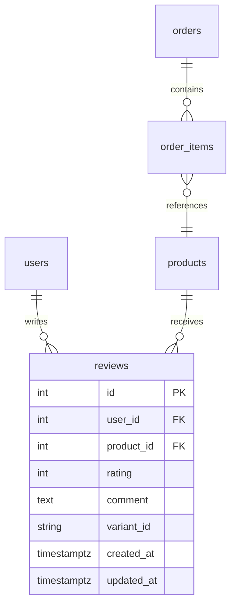

# Phase 01 — BE: model `reviews` + migration + đăng ký session

**Trạng thái:** ⬜ Chưa làm
**Ưu tiên:** P1 (cao nhất — chặn P2/P3)

## Context Links

- Cột aggregate đã có sẵn: `backend/app/model/product.py:41-42`
  (`rating_avg` NUMERIC(3,2), `rating_count` INT) — chưa có bảng gốc sinh ra chúng.
- Migration head hiện tại: `backend/alembic/versions/20261107_0920_f4a5b6c7d8e9_ensure_payment_uniqueness.py`
  (`revision = "f4a5b6c7d8e9"`).
- Mẫu migration idempotent để copy: `backend/alembic/versions/20261107_0920_f4a5b6c7d8e9_ensure_payment_uniqueness.py`
  (dùng `CREATE UNIQUE INDEX IF NOT EXISTS`).
- Đăng ký model: `backend/app/db/session.py:32-42` (danh sách `from app.model.X import X`).
- Test DB dùng `Base.metadata.create_all` → `backend/tests/conftest.py:181,186`.
- Quy tắc FK cascade hiện dùng: `backend/app/model/wishlist.py:13-14`, `backend/app/model/order_item.py:19`.

## Overview

**Priority:** P1 — mọi phase sau đều phụ thuộc bảng `reviews` tồn tại.

**Current status:** Chưa làm.

**Description:** Tạo model SQLAlchemy `Review` (bảng `reviews`), migration Alembic tương ứng, và
đăng ký model vào `app.db.session` để `create_all` trong test + Alembic autogenerate nhìn thấy bảng.

## Key Insights

- **`CheckConstraint` cho rating 1..5**: đặt ở DB để chặn dữ liệu sai kể cả khi bypass tầng app
  (script seed, admin SQL). Tầng app vẫn validate `ge=1, le=5` (P2).
- **`ondelete="CASCADE"`** trên `user_id`/`product_id` → xoá user hoặc xoá product (hard delete)
  tự dọn review. Khớp pattern `wishlist.py`.
- **Quên import trong `db/session.py` là lỗi âm thầm**: `Base.metadata` không có `reviews` →
  `create_all` không tạo bảng → test lỗi SQL khó hiểu. Bắt buộc import + verify.
- **`rating_avg` là derived cache** → không cần backfill dữ liệu cũ (đang là số giả, sẽ xoá ở P6).

## Requirements

**Functional**
- F1. Bảng `reviews` lưu: user, product, rating (1..5), comment, variant_id (snapshot phân loại đã mua), timestamps.
- F2. 1 user chỉ có 1 review cho 1 sản phẩm (unique constraint ở DB).
- F3. Xoá user → xoá review; xoá product (hard delete) → xoá review.
- F4. Migration chạy được trên DB đã có dữ liệu (không phá schema cũ).

**Non-functional**
- N1. File model < 200 dòng; dùng `kebab-case` tên file.
- N2. Migration idempotent (`IF NOT EXISTS`) để chạy lại không lỗi.
- N3. Index theo `product_id` (query list review theo sản phẩm là hot path).

## Architecture



Luồng: `Review` (nguồn sự thật) → `products.rating_avg` / `rating_count` (cache, recompute ở P2).

## Related Code Files

**Sửa:**
- `backend/app/db/session.py` — thêm `from app.model.review import Review  # noqa: F401, E402`.

**Tạo:**
- `backend/app/model/review.py`
- `backend/alembic/versions/20261107_<hhmm>_a1b2c3d4e5f6_add_reviews.py`

**Xoá:** không.

## Implementation Steps

1. **Tạo `backend/app/model/review.py`**:
   ```python
   from sqlalchemy import CheckConstraint, ForeignKey, Index, Integer, String, Text, UniqueConstraint
   from sqlalchemy.orm import Mapped, mapped_column, relationship

   from app.db.base import Base, IdMixin, TimestampMixin


   class Review(Base, IdMixin, TimestampMixin):
       """Danh gia san pham - chi nguoi da mua va don da giao moi duoc viet."""

       __tablename__ = "reviews"

       user_id: Mapped[int] = mapped_column(
           ForeignKey("users.id", ondelete="CASCADE"), nullable=False
       )
       product_id: Mapped[int] = mapped_column(
           ForeignKey("products.id", ondelete="CASCADE"), nullable=False
       )

       # So sao 1..5
       rating: Mapped[int] = mapped_column(Integer, nullable=False)

       # Noi dung danh gia (optional)
       comment: Mapped[str | None] = mapped_column(Text, nullable=True)

       # Snapshot phan loai da mua (JSONB variants -> id cua variant)
       variant_id: Mapped[str | None] = mapped_column(String(64), nullable=True)

       # Relationships
       user: Mapped["User"] = relationship("User", backref="reviews")
       product: Mapped["Product"] = relationship("Product", backref="reviews")

       __table_args__ = (
           UniqueConstraint("user_id", "product_id", name="uq_reviews_user_product"),
           CheckConstraint("rating >= 1 AND rating <= 5", name="ck_reviews_rating_range"),
           Index("ix_reviews_product_id", "product_id"),
       )
   ```
   Lưu ý: cần `if TYPE_CHECKING: from app.model.user import User` + `from app.model.product import Product`
   nếu dùng forward ref dạng chuỗi (pattern hiện có ở `order.py`).

2. **Đăng ký model** trong `backend/app/db/session.py` (cùng khối với các import model khác).

3. **Verify model đã được register**:
   ```bash
   cd backend && python -c "
   from app.db.base import Base
   import app.db.session
   print([t.name for t in Base.metadata.sorted_tables])
   "
   ```
   → phải thấy `reviews` trong danh sách.

4. **Tạo migration** `backend/alembic/versions/20261107_1010_a1b2c3d4e5f6_add_reviews.py`:
   - `revision = "a1b2c3d4e5f6"`, `down_revision = "f4a5b6c7d8e9"`.
   - `upgrade()`: `op.create_table("reviews", ...)` + `op.create_index(...)`.
   - Nếu DB có thể đã tạo bảng qua `create_all` → dùng guard:
     ```python
     inspector = sa.inspect(op.get_bind())
     if "reviews" not in inspector.get_table_names():
         op.create_table(...)
     ```
   - `downgrade()`: `op.drop_table("reviews")`.

5. **Kiểm tra head không trùng**:
   ```bash
   cd backend && alembic heads
   ```
   → phải hiện đúng 1 head là revision mới.

6. **Apply migration lên DB dev** (nếu env có `DATABASE_URL`):
   ```bash
   cd backend && alembic upgrade head
   ```

## Todo

- [ ] T1. Tạo `backend/app/model/review.py` (model + constraint + index)
- [ ] T2. Import model trong `backend/app/db/session.py`
- [ ] T3. Verify `reviews` xuất hiện trong `Base.metadata.sorted_tables`
- [ ] T4. Tạo migration `a1b2c3d4e5f6` với `down_revision = "f4a5b6c7d8e9"`
- [ ] T5. `alembic heads` → 1 head duy nhất
- [ ] T6. `alembic upgrade head` chạy OK trên DB dev
- [ ] T7. Verify bảng tồn tại: `\d reviews` / `SELECT COUNT(*) FROM reviews`

## Success Criteria

- [ ] `reviews` có trong `Base.metadata.sorted_tables`
- [ ] `alembic heads` trả về đúng 1 revision
- [ ] Bảng `reviews` tồn tại trong DB dev với unique constraint `uq_reviews_user_product`
- [ ] `pytest backend/tests` vẫn pass (không test nào bị ảnh hưởng)

## Risk Assessment

| Rủi ro | Mức | Giảm thiểu |
|---|---|---|
| `down_revision` sai → nhiều head, `alembic upgrade` lỗi | Cao | Chạy `alembic heads` + `alembic history` trước khi commit |
| Bảng đã tồn tại từ `create_all` → migration lỗi "already exists" | Trung bình | Guard bằng `sa.inspect(op.get_bind()).get_table_names()` |
| Quên import trong `db/session.py` | Cao | Todo T2 + T3 verify tường minh |
| `NUMERIC(3,2)` không đủ cho avg 5.00? | Không | 5.00 = 3 chữ số, 2 thập phân → vừa đúng |

## Security Considerations

- `comment` là input người dùng → khi render FE phải escape (React mặc định escape ✅).
- Giới hạn độ dài `comment` (max 2000) ở schema P2 + `CHECK char_length(comment) <= 2000` ở DB.
- Review không chứa PII ngoài `user_id`; API list chỉ trả `user.full_name` (không trả email).

## Next Steps

- P2: schema + service (`review_service.py`) — cần bảng `reviews` đã tồn tại.
