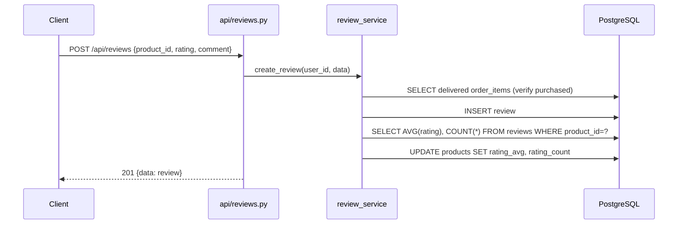

# Phase 02 — BE: schema + service đánh giá (verify purchased + recompute aggregate)

**Trạng thái:** ⬜ Chưa làm
**Ưu tiên:** P1 (chặn P3)

## Context Links

- Phase 01: `backend/app/model/review.py` (bảng `reviews`).
- Điều kiện "đã mua": `orders.status == 'delivered'` — khớp quy tắc tăng `sold_count`
  tại `backend/app/service/order_service.py:381`.
- Mẫu service: `backend/app/service/wishlist_service.py`, `backend/app/service/product_service.py`.
- Mẫu schema: `backend/app/schemas/wishlist.py`, `backend/app/schemas/product.py`.
- Pattern raise `ValueError` → API map 400: `backend/app/api/wishlist.py:88-92`.
- `product_service.py` có `NULLABLE_FIELDS` — không liên quan (không update qua service này).

## Overview

**Priority:** P1.

**Current status:** Chưa làm.

**Description:** Tạo Pydantic schemas cho review và service chứa toàn bộ business logic:
kiểm tra quyền đánh giá (đã mua & đơn đã giao), CRUD review, và recompute aggregate
`products.rating_avg` / `products.rating_count` từ bảng `reviews`.

## Key Insights

- **Aggregate là derived cache, không phải nguồn sự thật.** Mọi thao tác ghi đều phải gọi
  `recompute_product_rating()` trong cùng transaction → không bao giờ lệch.
- **Race 2 request đánh giá đồng thời**: check ở tầng app không đủ (TOCTOU). Phải bắt
  `IntegrityError` từ `UniqueConstraint` → map 400 "Bạn đã đánh giá sản phẩm này".
- **Verify "đã mua"**: query join `orders` + `order_items`. `order_items` không có index theo
  `product_id` → tạm chấp nhận, ghi follow-up.
- **`variant_id`**: snapshot phân loại user đã mua (từ `order_items.variant_info.id`).
  Lưu để hiển thị "Đánh giá cho phân loại X". Không bắt buộc.
- **Quyền sở hữu**: `update`/`delete` chỉ owner được. Admin có thể xoá review vi phạm ở phase sau
  (YAGNI — chưa làm).

## Requirements

**Functional**
- F1. Tạo review: rating 1..5, chỉ khi user có đơn `delivered` chứa sản phẩm.
- F2. 1 user 1 sản phẩm 1 review.
- F3. Sửa/xoá: chỉ owner.
- F4. Sau mọi thao tác ghi → `products.rating_avg` + `rating_count` cập nhật đúng.
- F5. List review theo sản phẩm (mới nhất trước), có tổng hợp phân bố 1..5.
- F6. Lấy review của user hiện tại cho 1 sản phẩm (để FE biết đã đánh giá chưa).

**Non-functional**
- N1. Service file < 200 dòng.
- N2. Mọi lỗi nghiệp vụ raise `ValueError` với message tiếng Việt rõ ràng (API map sang 400).
- N3. Tính `rating_avg` làm tròn 2 chữ số, dùng `Decimal`.

## Architecture



Luồng aggregate:

```
reviews (nguồn sự thật)
   │  recompute_product_rating()
   ▼
products.rating_avg / rating_count  (cache, luôn gọi sau mỗi write)
```

## Related Code Files

**Sửa:** không (phase này chỉ tạo file mới).

**Tạo:**
- `backend/app/schemas/review.py`
- `backend/app/service/review_service.py`

**Xoá:** không.

## Implementation Steps

1. **Tạo `backend/app/schemas/review.py`**:
   ```python
   """Pydantic schemas cho danh gia san pham."""

   from pydantic import BaseModel, ConfigDict, Field


   class ReviewCreate(BaseModel):
       """Schema tao danh gia."""

       product_id: int = Field(..., gt=0)
       rating: int = Field(..., ge=1, le=5)
       comment: str | None = Field(None, max_length=2000)
       variant_id: str | None = Field(None, max_length=64)


   class ReviewUpdate(BaseModel):
       """Schema sua danh gia."""

       rating: int | None = Field(None, ge=1, le=5)
       comment: str | None = Field(None, max_length=2000)


   class ReviewRead(BaseModel):
       """Schema response 1 danh gia."""

       model_config = ConfigDict(from_attributes=True)

       id: int
       product_id: int
       user_id: int
       rating: int
       comment: str | None
       variant_id: str | None
       user_name: str | None = None
       created_at: str
       updated_at: str | None = None


   class RatingSummary(BaseModel):
       """Tong hop diem danh gia cua 1 san pham."""

       rating_avg: float = 0
       rating_count: int = 0
       # Key 1..5 -> so luot danh gia tuong ung
       distribution: dict[int, int] = {}


   class ReviewListResponse(BaseModel):
       data: list[ReviewRead] = []
       total: int = 0
       page: int = 1
       size: int = 20
       summary: RatingSummary = RatingSummary()
       message: str = "OK"
   ```

2. **Tạo `backend/app/service/review_service.py`** — các hàm chính:
   - `async def has_purchased_delivered(db, user_id: int, product_id: int) -> bool`
     ```python
     result = await db.execute(
         select(func.count(OrderItem.id))
         .join(Order, Order.id == OrderItem.order_id)
         .where(
             Order.user_id == user_id,
             Order.status == "delivered",
             OrderItem.product_id == product_id,
         )
     )
     return (result.scalar_one() or 0) > 0
     ```
   - `async def recompute_product_rating(db, product_id: int) -> tuple[Decimal, int]`
     ```python
     result = await db.execute(
         select(func.avg(Review.rating), func.count(Review.id)).where(Review.product_id == product_id)
     )
     avg, count = result.one()
     avg_value = Decimal(str(avg)).quantize(Decimal("0.01")) if avg is not None else Decimal("0")
     await db.execute(
         update(Product).where(Product.id == product_id).values(
             rating_avg=avg_value, rating_count=count or 0
         )
     )
     return avg_value, count or 0
     ```
   - `async def create_review(db, user_id, data: ReviewCreate) -> Review`
     - Product phải tồn tại và `is_active` → nếu không raise `ValueError("Sản phẩm không tồn tại")`.
     - `has_purchased_delivered` → nếu False raise `ValueError("Bạn chỉ có thể đánh giá sản phẩm đã giao hàng thành công")`.
     - Check đã tồn tại review → raise `ValueError("Bạn đã đánh giá sản phẩm này rồi")`.
     - Insert → `await db.flush()` → `recompute_product_rating` → `await db.commit()`.
     - Bắt `IntegrityError` (race) → rollback + raise `ValueError("Bạn đã đánh giá sản phẩm này rồi")`.
   - `async def update_review(db, user_id, review_id, data: ReviewUpdate) -> Review`
     - Lấy review; `None` → `ValueError("Không tìm thấy đánh giá")`; `user_id` khác → `ValueError("Không có quyền sửa đánh giá này")`.
     - Apply field, recompute, commit.
   - `async def delete_review(db, user_id, review_id) -> None`
     - Tương tự update (quyền owner), recompute, commit.
   - `async def list_product_reviews(db, product_id, page=1, size=20) -> tuple[list[Review], int]`
     - Join `User` để lấy `full_name`; order `created_at.desc()`; offset/limit.
   - `async def get_rating_summary(db, product_id) -> RatingSummary`
     - `SELECT rating, COUNT(*) FROM reviews WHERE product_id=? GROUP BY rating` → dựng `distribution` (1..5, thiếu → 0).
   - `async def get_user_review(db, user_id, product_id) -> Review | None`

3. **Lưu ý transaction**: mọi hàm write phải `commit` 1 lần ở cuối (ghi review + recompute cùng transaction).

4. **Compile check**:
   ```bash
   cd backend && python -m compileall -q app/schemas/review.py app/service/review_service.py
   ```

## Todo

- [ ] T1. Tạo `backend/app/schemas/review.py`
- [ ] T2. Tạo `backend/app/service/review_service.py` với `has_purchased_delivered`
- [ ] T3. `recompute_product_rating` (AVG + COUNT → update Product)
- [ ] T4. `create_review` (verify mua + trùng + bắt IntegrityError)
- [ ] T5. `update_review` / `delete_review` (owner only + recompute)
- [ ] T6. `list_product_reviews` / `get_rating_summary` / `get_user_review`
- [ ] T7. `python -m compileall` pass

## Success Criteria

- [ ] `create_review` ném `ValueError` đúng message khi chưa mua / đã đánh giá
- [ ] `recompute_product_rating` trả về `(Decimal, int)` và cập nhật đúng `products`
- [ ] `get_rating_summary` trả `distribution` đủ khoá 1..5
- [ ] File < 200 dòng, không circular import

## Risk Assessment

| Rủi ro | Mức | Giảm thiểu |
|---|---|---|
| Quên `db.commit()` → aggregate không lưu | Trung bình | Mọi hàm write luôn commit ở cuối |
| `func.avg` trả `Decimal` hay `float` tuỳ driver | Trung bình | Ép qua `Decimal(str(avg))` rồi `quantize` |
| Tính `AVG` sai khi count = 0 | Thấp | `avg is None` → `Decimal("0")` |
| `OrderItem`/`Order` import gây circular | Thấp | `review_service` chỉ import model, không import `order_service` |

## Security Considerations

- Kiểm tra quyền sở hữu ở **mọi** endpoint write (không chỉ ẩn UI ở FE).
- `comment` giới hạn 2000 ký tự (schema + DB check) để chống payload phình to.
- Không trả `user.email` ra API list — chỉ `full_name`.
- Không cho sửa/xoá review của người khác dù đã đăng nhập.

## Next Steps

- P3: API `/api/reviews` + router + sort `rating_desc`.
