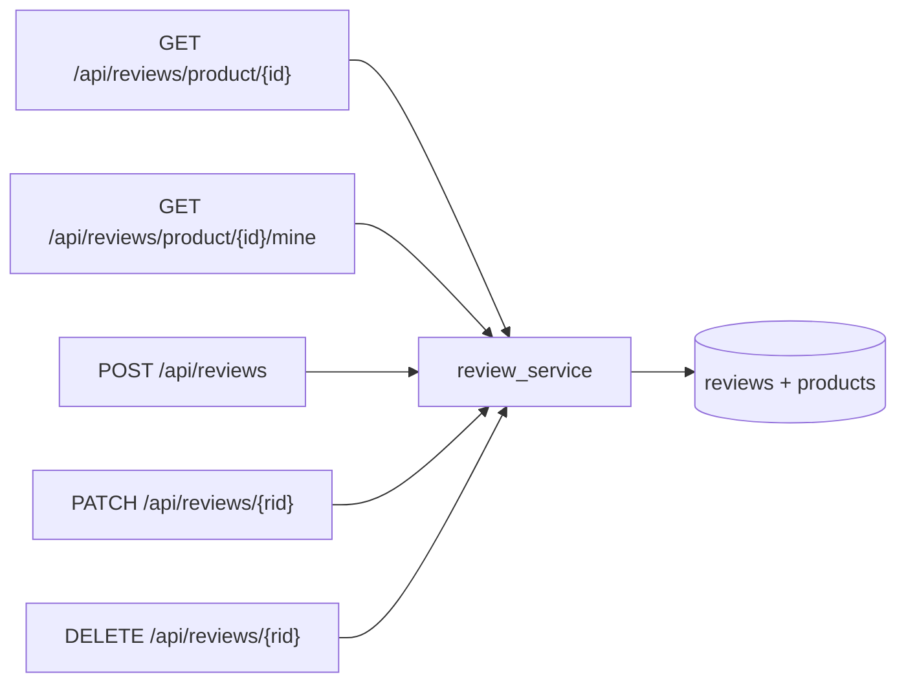
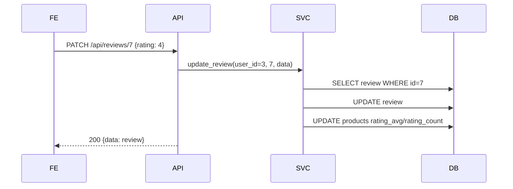

# Phase 03 — BE: API `/api/reviews` + include router + sort `rating_desc`

**Trạng thái:** ⬜ Chưa làm
**Ưu tiên:** P1

## Context Links

- Phase 02: `backend/app/service/review_service.py`, `backend/app/schemas/review.py`.
- Mẫu router: `backend/app/api/wishlist.py` (prefix, auth dependency, map `ValueError` → 400).
- Đăng ký router: `backend/app/main.py:165-187`.
- Sort hiện có: `backend/app/service/product_service.py:140-150` (`price_asc`, `price_desc`,
  `newest`, `best_seller`).
- FE hook sẽ gọi: `frontend/src/hooks/useReviews.ts` (P4).

## Overview

**Priority:** P1.

**Current status:** Chưa làm.

**Description:** Tạo router `backend/app/api/reviews.py` với 5 endpoint (list công khai, mine,
create, update, delete), đăng ký vào `main.py`, và thêm option sort `rating_desc` cho
`GET /api/products`.

## Key Insights

- **Endpoint list là public** (không cần token) — vì `rating_avg` đã public trong product API.
  Endpoint `mine`/`POST`/`PATCH`/`DELETE` cần `get_current_user`.
- **`ValueError` → 400** theo pattern sẵn có: `detail={"message": str(e), "code": "VALIDATION_ERROR"}`.
  Client FE đọc qua `getErrorMessage` (`frontend/src/types/api.ts`).
- **`sort=rating_desc`** không cần đổi API `products.py` vì `sort` là query param pass-through
  → chỉ thêm nhánh trong `product_service.get_products`.
- **Cân nhắc sort ổn định**: `rating_avg DESC, rating_count DESC, id DESC` — tránh thứ tự ngẫu nhiên
  giữa 2 lần gọi có cùng avg.

## Requirements

**Functional**
- F1. `GET /api/reviews/product/{product_id}` — public, phân trang, trả `data` + `total` + `summary`.
- F2. `GET /api/reviews/product/{product_id}/mine` — auth, trả review của user hoặc `null`.
- F3. `POST /api/reviews` — auth, tạo review, 201.
- F4. `PATCH /api/reviews/{review_id}` — auth owner, sửa.
- F5. `DELETE /api/reviews/{review_id}` — auth owner, 204.
- F6. `GET /api/products?sort=rating_desc` — sắp xếp theo điểm đánh giá.

**Non-functional**
- N1. File API < 200 dòng.
- N2. Response shape nhất quán với các router khác: `{data, message}`.
- N3. Không lộ thông tin nhạy cảm (không trả email user).

## Architecture





## Related Code Files

**Sửa:**
- `backend/app/main.py` — import + `app.include_router(reviews_router)`.
- `backend/app/service/product_service.py` — thêm nhánh sort `rating_desc`.

**Tạo:**
- `backend/app/api/reviews.py`

**Xoá:** không.

## Implementation Steps

1. **Tạo `backend/app/api/reviews.py`**:
   ```python
   """Review API endpoints - danh gia san pham (chi sau khi don da giao)."""

   from fastapi import APIRouter, Depends, HTTPException, Query, status
   from sqlalchemy.ext.asyncio import AsyncSession

   from app.api.deps import get_current_user
   from app.db.session import get_db
   from app.model.user import User
   from app.schemas.review import (
       ReviewCreate,
       ReviewListResponse,
       ReviewRead,
       ReviewUpdate,
   )
   from app.service import review_service

   router = APIRouter(prefix="/api/reviews", tags=["reviews"])


   def _to_read(review, user_name: str | None = None) -> dict:
       return {
           "id": review.id,
           "product_id": review.product_id,
           "user_id": review.user_id,
           "rating": review.rating,
           "comment": review.comment,
           "variant_id": review.variant_id,
           "user_name": user_name or (review.user.full_name if review.user else None),
           "created_at": review.created_at.isoformat() if review.created_at else None,
           "updated_at": review.updated_at.isoformat() if review.updated_at else None,
       }
   ```

   Endpoint list (public):
   ```python
   @router.get("/product/{product_id}", response_model=ReviewListResponse)
   async def list_product_reviews(
       product_id: int,
       page: int = Query(1, ge=1),
       size: int = Query(20, ge=1, le=100),
       db: AsyncSession = Depends(get_db),
   ):
       reviews, total = await review_service.list_product_reviews(db, product_id, page, size)
       summary = await review_service.get_rating_summary(db, product_id)
       return ReviewListResponse(
           data=[_to_read(r) for r in reviews],
           total=total,
           page=page,
           size=size,
           summary=summary,
       )
   ```

   Endpoint mine (auth):
   ```python
   @router.get("/product/{product_id}/mine", response_model=dict)
   async def get_my_review(
       product_id: int,
       current_user: User = Depends(get_current_user),
       db: AsyncSession = Depends(get_db),
   ):
       review = await review_service.get_user_review(db, current_user.id, product_id)
       return {"data": _to_read(review) if review else None, "message": "OK"}
   ```

   Endpoint create:
   ```python
   @router.post("", response_model=dict, status_code=status.HTTP_201_CREATED)
   async def create_review(
       data: ReviewCreate,
       current_user: User = Depends(get_current_user),
       db: AsyncSession = Depends(get_db),
   ):
       try:
           review = await review_service.create_review(db, current_user.id, data)
           return {"data": _to_read(review), "message": "Đã gửi đánh giá"}
       except ValueError as e:
           raise HTTPException(
               status_code=status.HTTP_400_BAD_REQUEST,
               detail={"message": str(e), "code": "VALIDATION_ERROR"},
           )
   ```

   Endpoint update/delete: tương tự, map `ValueError` → 400, delete trả 204.

2. **Đăng ký router** trong `backend/app/main.py`:
   ```python
   from app.api.reviews import router as reviews_router
   ...
   app.include_router(reviews_router)
   ```

3. **Thêm sort `rating_desc`** trong `backend/app/service/product_service.py`:
   ```python
   elif sort == "rating_desc":
       query = query.order_by(
           Product.rating_avg.desc(), Product.rating_count.desc(), Product.id.desc()
       )
   ```

4. **Compile + smoke check**:
   ```bash
   cd backend && python -m compileall -q app/api/reviews.py app/service/product_service.py
   ```

## Todo

- [ ] T1. Tạo `backend/app/api/reviews.py` (5 endpoint + `_to_read`)
- [ ] T2. Đăng ký router trong `backend/app/main.py`
- [ ] T3. Thêm sort `rating_desc` trong `product_service.get_products`
- [ ] T4. `python -m compileall` pass
- [ ] T5. Smoke: `GET /api/reviews/product/1` trả 200 + `summary`
- [ ] T6. Smoke: `POST /api/reviews` không token → 401; sai nghiệp vụ → 400

## Success Criteria

- [ ] `GET /api/products?sort=rating_desc` hoạt động, order đúng
- [ ] Tất cả endpoint trả shape `{data, message}` hoặc `{data, total, page, size, summary}`
- [ ] `ValueError` nghiệp vụ → HTTP 400 với `detail.code = "VALIDATION_ERROR"`
- [ ] Router xuất hiện trong OpenAPI dưới tag `reviews`

## Risk Assessment

| Rủi ro | Mức | Giảm thiểu |
|---|---|---|
| Route conflict với `products.py` | Thấp | Prefix riêng `/api/reviews` |
| `created_at` là `str` (như `OrderStatusHistory`) vs `datetime` | Trung bình | `_to_read` dùng `.isoformat()` nếu là datetime, `str()` nếu là str — xử lý cả 2 |
| `review.user` chưa load → lazy load trong async session → `MissingGreenlet` | Trung bình | Dùng `selectinload(Review.user)` trong `list_product_reviews` |
| FE gọi `sort=rating_desc` nhưng BE chưa có → sort rơi về default | Thấp | P3 phải làm trước P5 |

## Security Considerations

- Endpoint write bắt buộc `get_current_user` (401 nếu không token).
- `update`/`delete` kiểm tra owner **ở service** (không chỉ API) → defense in depth.
- Public list chỉ trả `full_name` + `rating` + `comment`; không trả email, không trả `user_id` của
  người khác trong payload công khai (nếu cần, có thể ẩn `user_id` khỏi response public).

## Next Steps

- P4: FE component sao + hook `useReviews`.
