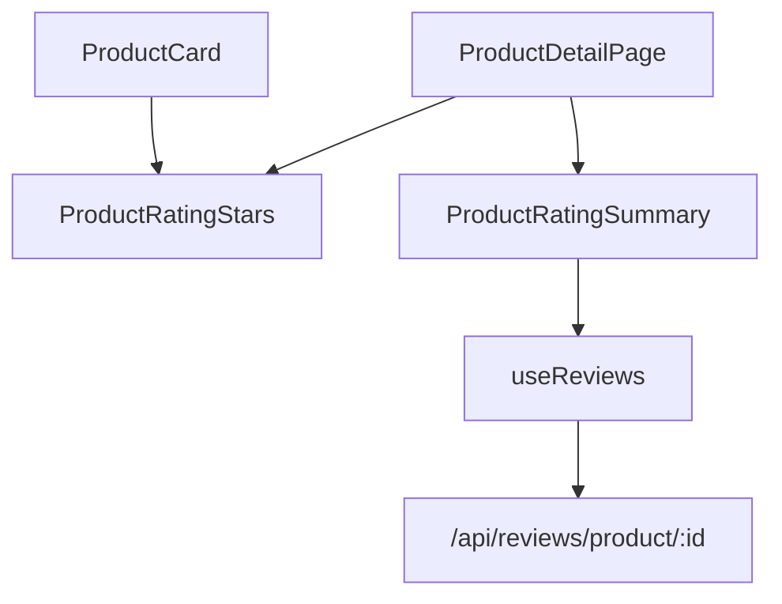

# Phase 04 — FE: component sao + hook + types

**Trạng thái:** ⬜ Chưa làm
**Ưu tiên:** P2 (song song được với P3 sau P1/P2)

## Context Links

- Theme màu: `frontend/src/theme/colors.ts`, `frontend/src/theme/index.ts` (dùng `colors.primary`).
- Icons sẵn có: `@ant-design/icons` (`StarFilled`, `StarOutlined`) — đã dùng ở
  `frontend/src/components/admin/ProductImageManager.tsx:19-20`.
- Pattern hook react-query: `frontend/src/hooks/useProducts.ts`.
- Pattern mutation + invalidate: `frontend/src/pages/user/OrderDetailPage.tsx:68-79`.
- Xử lý lỗi: `frontend/src/types/api.ts` → `getErrorMessage(error, fallback)`.
- Types hiện có: `frontend/src/types/product.ts` (`rating_avg`, `rating_count`).

## Overview

**Priority:** P2.

**Current status:** Chưa làm.

**Description:** Tạo component `ProductRatingStars` (read-only) dùng chung, component
`ProductRatingSummary` (điểm trung bình + thanh phân bố 1..5), types `review.ts`, và hook
`useReviews.ts` bọc các endpoint P3.

## Key Insights

- **antd `Rate` component** đã có sẵn → tiết kiệm code nhưng style mặc định có thể lệch theme.
  Dùng `Rate` với `disabled` + `allowHalf` cho read-only, `style={{color: colors.primary}}`.
  Bọc trong component riêng để sau này đổi cũng 1 chỗ (DRY).
- **`rating_avg` là `number` trong TS** nhưng BE trả `float` (đã ép ở `_product_to_dict`) →
  an toàn. Nhưng nếu BE đổi → dùng `Number(...)` khi so sánh.
- **Query key phải nhất quán**: `['reviews', productId]` để invalidate đúng (P5 dùng).
- **Invalidate 2 key sau khi ghi**: `['reviews', productId]` + `['product', productId]` (aggregate
  đổi → sao ở header/product card cũng phải refresh).

## Requirements

**Functional**
- F1. `ProductRatingStars`: hiển thị sao theo `value` (0..5), hỗ trợ nửa sao, size `small|default`,
  tuỳ chọn hiện số lượt đánh giá.
- F2. `ProductRatingSummary`: điểm trung bình lớn + 5 thanh phân bố (1..5) + tổng lượt.
- F3. Hook: `useProductReviews(productId, page)`, `useMyReview(productId)`,
   `useCreateReview()`, `useUpdateReview()`, `useDeleteReview()`.
- F4. Mutation thành công → invalidate `['reviews', id]` + `['product', id]`.

**Non-functional**
- N1. Component dùng chung, không lặp logic vẽ sao ở nhiều nơi.
- N2. File < 200 dòng; tên file kebab-case (`ProductRatingStars.tsx` — theo convention hiện có
  của `frontend/src/components/` dùng PascalCase, giữ nguyên convention).
- N3. Xử lý trạng thái `rating_count === 0` (chưa có đánh giá) → hiển thị "Chưa có đánh giá".

## Architecture



## Related Code Files

**Sửa:** không (phase này chỉ tạo file mới).

**Tạo:**
- `frontend/src/components/ProductRatingStars.tsx`
- `frontend/src/components/ProductRatingSummary.tsx`
- `frontend/src/types/review.ts`
- `frontend/src/hooks/useReviews.ts`

**Xoá:** không.

## Implementation Steps

1. **Tạo `frontend/src/types/review.ts`**:
   ```typescript
   /** Types cho danh gia san pham. */

   export interface Review {
     id: number;
     product_id: number;
     user_id: number;
     rating: number;
     comment: string | null;
     variant_id: string | null;
     user_name: string | null;
     created_at: string | null;
     updated_at?: string | null;
   }

   export interface RatingSummary {
     rating_avg: number;
     rating_count: number;
     /** Key 1..5 -> so luot danh gia tuong ung. */
     distribution: Record<string, number>;
   }

   export interface ReviewListResponse {
     data: Review[];
     total: number;
     page: number;
     size: number;
     summary: RatingSummary;
     message?: string;
   }

   export interface ReviewPayload {
     product_id: number;
     rating: number;
     comment?: string | null;
     variant_id?: string | null;
   }
   ```

2. **Tạo `frontend/src/components/ProductRatingStars.tsx`**:
   ```tsx
   import { Rate, Typography } from 'antd';
   import { colors } from '../theme';

   const { Text } = Typography;

   interface ProductRatingStarsProps {
     /** Diem 0..5 */
     value: number;
     /** So luot danh gia (hien thi tu chon) */
     count?: number;
     size?: 'small' | 'default';
     showCount?: boolean;
   }

   /** Hien thi sao danh gia doc (dung chung card + trang chi tiet). */
   export default function ProductRatingStars({
     value,
     count,
     size = 'small',
     showCount = false,
   }: ProductRatingStarsProps) {
     const rating = Math.max(0, Math.min(5, Number(value) || 0));

     if ((count ?? 0) === 0 && rating === 0) {
       return <Text type="secondary" style={{ fontSize: 12 }}>Chưa có đánh giá</Text>;
     }

     return (
       <span style={{ display: 'inline-flex', alignItems: 'center', gap: 6 }}>
         <Rate
           allowHalf
           disabled
           value={rating}
           style={{ color: colors.primary, fontSize: size === 'small' ? 14 : 16 }}
         />
         {showCount && (
           <Text type="secondary" style={{ fontSize: 12 }}>
             {rating.toFixed(1)} ({count ?? 0} đánh giá)
           </Text>
         )}
       </span>
     );
   }
   ```
   Kiểm tra API `Rate`: `value` kiểu `number`, `allowHalf` cho phép nửa sao, `disabled` = read-only.

3. **Tạo `frontend/src/components/ProductRatingSummary.tsx`**:
   ```tsx
   import { Progress, Row, Col, Typography } from 'antd';
   import { colors } from '../theme';
   import type { RatingSummary as RatingSummaryType } from '../types/review';

   const { Text } = Typography;

   interface Props {
     summary: RatingSummaryType;
   }

   /** Tong hop diem: diem trung binh + thanh phan bo 1..5. */
   export default function ProductRatingSummary({ summary }: Props) {
     const total = summary.rating_count || 0;
     if (total === 0) {
       return <Text type="secondary">Chưa có đánh giá nào cho sản phẩm này.</Text>;
     }

     return (
       <Row gutter={24}>
         <Col xs={24} sm={8} style={{ textAlign: 'center' }}>
           <div style={{ fontSize: 40, fontWeight: 700, color: colors.primary }}>
             {Number(summary.rating_avg).toFixed(1)}
           </div>
           <Text type="secondary">{total} lượt đánh giá</Text>
         </Col>
         <Col xs={24} sm={16}>
           {[5, 4, 3, 2, 1].map((star) => {
             const count = summary.distribution?.[String(star)] ?? summary.distribution?.[star] ?? 0;
             const percent = total > 0 ? Math.round((count / total) * 100) : 0;
             return (
               <div key={star} style={{ display: 'flex', alignItems: 'center', gap: 8, marginBottom: 4 }}>
                 <Text style={{ width: 28 }}>{star} sao</Text>
                 <Progress percent={percent} showInfo={false} size="small" style={{ flex: 1 }} />
                 <Text type="secondary" style={{ width: 32, textAlign: 'right' }}>{count}</Text>
               </div>
             );
           })}
         </Col>
       </Row>
     );
   }
   ```
   Lưu ý: `distribution` có thể là object với key number → JSON stringifies thành `"5"`. Dùng
   `summary.distribution?.[String(star)] ?? summary.distribution?.[star]` cho an toàn cả 2.

4. **Tạo `frontend/src/hooks/useReviews.ts`**:
   ```typescript
   import { useMutation, useQuery, useQueryClient } from '@tanstack/react-query';
   import api from '../api/axios';
   import type { Review, ReviewListResponse, ReviewPayload } from '../types/review';

   /** Lay danh sach danh gia + tong hop diem cua 1 san pham. */
   export function useProductReviews(productId: number | undefined, page = 1, size = 20) {
     return useQuery({
       queryKey: ['reviews', productId, page],
       queryFn: async () => {
         const res = await api.get(`/api/reviews/product/${productId}?page=${page}&size=${size}`);
         return res.data as ReviewListResponse;
       },
       enabled: Boolean(productId),
     });
   }

   /** Review cua user hien tai voi san pham (null neu chua danh gia). */
   export function useMyReview(productId: number | undefined) {
     return useQuery({
       queryKey: ['reviews', productId, 'mine'],
       queryFn: async () => {
         const res = await api.get(`/api/reviews/product/${productId}/mine`);
         return res.data.data as Review | null;
       },
       enabled: Boolean(productId),
     });
   }

   function useInvalidate(productId?: number) {
     const queryClient = useQueryClient();
     return () => {
       queryClient.invalidateQueries({ queryKey: ['reviews', productId] });
       queryClient.invalidateQueries({ queryKey: ['product', productId] });
       queryClient.invalidateQueries({ queryKey: ['products'] });
     };
   }

   export function useCreateReview() {
     const invalidate = useInvalidate();
     return useMutation({
       mutationFn: async (payload: ReviewPayload) => {
         const res = await api.post('/api/reviews', payload);
         return res.data.data as Review;
       },
       onSuccess: (_data, payload) => invalidate(payload.product_id),
     });
   }

   export function useUpdateReview(productId?: number) {
     const invalidate = useInvalidate(productId);
     return useMutation({
       mutationFn: async ({ id, ...payload }: { id: number } & Partial<ReviewPayload>) => {
         const res = await api.patch(`/api/reviews/${id}`, payload);
         return res.data.data as Review;
       },
       onSuccess: () => invalidate(),
     });
   }

   export function useDeleteReview(productId?: number) {
     const invalidate = useInvalidate(productId);
     return useMutation({
       mutationFn: async (id: number) => {
         await api.delete(`/api/reviews/${id}`);
       },
       onSuccess: () => invalidate(),
     });
   }
   ```

5. **Compile check**:
   ```bash
   cd frontend && npx tsc -b
   ```

## Todo

- [ ] T1. Tạo `frontend/src/types/review.ts`
- [ ] T2. Tạo `frontend/src/components/ProductRatingStars.tsx`
- [ ] T3. Tạo `frontend/src/components/ProductRatingSummary.tsx`
- [ ] T4. Tạo `frontend/src/hooks/useReviews.ts` (5 hook + invalidate)
- [ ] T5. `npx tsc -b` exit 0

## Success Criteria

- [ ] Component sao hiển thị đúng nửa sao (vd 4.5 → 4.5 sao)
- [ ] `rating_count = 0` → hiện "Chưa có đánh giá" thay vì 0 sao trống
- [ ] Mutation invalidate đúng cả `reviews` + `product` + `products`
- [ ] `npx tsc -b` không lỗi type

## Risk Assessment

| Rủi ro | Mức | Giảm thiểu |
|---|---|---|
| `Rate` disabled vẫn tốn layout lớn ở card nhỏ | Trung bình | `size="small"` + `fontSize` nhỏ; kiểm tra trên `ProductCard` |
| `distribution` key number vs string | Trung bình | Truy cập cả 2 dạng |
| `created_at` null từ BE → format date lỗi | Thấp | Guard `created_at ? ... : ''` khi render |
| API chưa có (P3 chưa xong) → hook lỗi 404 khi dev | Thấp | Làm P3 trước P5 khi chạy thật |

## Security Considerations

- Comment người dùng render bằng React → escape mặc định ✅. Không dùng `dangerouslySetInnerHTML`.
- Không hiển thị `user_id` của người khác nếu BE đã ẩn.

## Next Steps

- P5: tích hợp UI vào ProductCard / ProductDetailPage / OrderDetailPage / ProductsPage.
