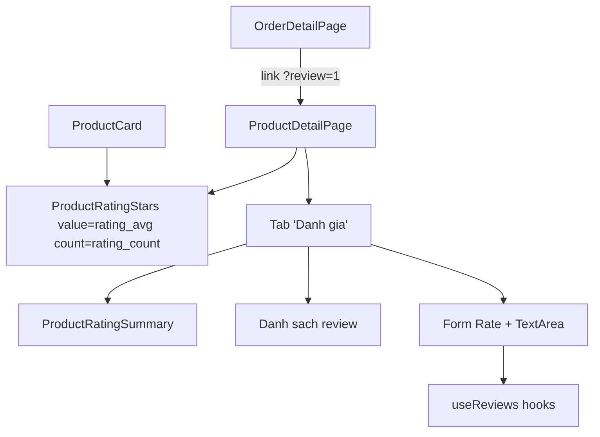

# Phase 05 — FE: tích hợp UI sao vào các trang

**Trạng thái:** ⬜ Chưa làm
**Ưu tiên:** P2

## Context Links

- Phase 04: `frontend/src/components/ProductRatingStars.tsx`,
  `frontend/src/components/ProductRatingSummary.tsx`, `frontend/src/hooks/useReviews.ts`.
- Sửa dòng số thô: `frontend/src/pages/ProductDetailPage.tsx:149-151` (tab "Thông tin").
- `ProductCard.tsx` — dòng giá ở khoảng dòng 90-105.
- `OrderDetailPage.tsx` — bảng sản phẩm (dòng 88-99), có `status` đơn hàng.
- `ProductsPage.tsx` — select sort ở dòng ~242.
- `frontend/src/store/authStore.ts` — `user` để kiểm tra đã đăng nhập.
- `frontend/src/pages/user/OrderDetailPage.tsx:120` — pattern `status` check.

## Overview

**Priority:** P2.

**Current status:** Chưa làm.

**Description:** Đưa UI sao vào 4 nơi: card sản phẩm, trang chi tiết (header + tab "Đánh giá"
+ form viết), trang chi tiết đơn hàng (nút đánh giá), và option sort theo đánh giá ở trang danh sách.

## Key Insights

- **Tab "Đánh giá"** dùng `Tabs` của antd đã có sẵn ở `ProductDetailPage` → thêm 1 item, không
  phá layout.
- **Form viết đánh giá**: dùng `Rate` (input) + `Input.TextArea` + `Button`. Cần trạng thái:
  chưa đăng nhập → nút "Đăng nhập để đánh giá"; đã đánh giá → hiện review + nút Sửa/Xoá.
- **Optimistic UI không cần** — invalidate query đủ nhanh và an toàn hơn.
- **`?review=1` query param**: `OrderDetailPage` link tới `/products/{id}?review=1` → `ProductDetailPage`
  đọc `useSearchParams` để mở tab "Đánh giá" ngay.
- **Số liệu seed hiện tại là giả** → sau P6 sẽ có dữ liệu thật. Trước P6, card sẽ hiện
  "Chưa có đánh giá" cho các sản phẩm không có review — chấp nhận tạm.

## Requirements

**Functional**
- F1. `ProductCard` hiển thị sao + số lượt (dưới giá); ẩn nếu chưa có đánh giá.
- F2. `ProductDetailPage` hiển thị sao lớn dưới tên/giá + link tới tab Đánh giá.
- F3. Tab "Đánh giá": summary (điểm TB + phân bố) + danh sách review + form viết/sửa/xoá.
- F4. Tab "Thông tin": thay dòng `{rating_avg} ({rating_count} lượt)` bằng component sao.
- F5. `OrderDetailPage`: đơn `delivered` → nút "Đánh giá" → `/products/{product_id}?review=1`.
- F6. `ProductsPage`: option sort "Đánh giá cao nhất" → `rating_desc`.
- F7. `?review=1` → mở tab Đánh giá khi vào trang chi tiết.

**Non-functional**
- N1. Không lặp logic vẽ sao (dùng `ProductRatingStars`).
- N2. `tsc -b` exit 0; không lỗi ESLint mới.
- N3. Layout không vỡ ở mobile (xs=24).

## Architecture



## Related Code Files

**Sửa:**
- `frontend/src/components/ProductCard.tsx`
- `frontend/src/pages/ProductDetailPage.tsx`
- `frontend/src/pages/user/OrderDetailPage.tsx`
- `frontend/src/pages/ProductsPage.tsx`

**Tạo:** không (dùng component/hook đã tạo ở P4).

**Xoá:** không.

## Implementation Steps

1. **`ProductCard.tsx`** — thêm sau block giá (khoảng dòng 106):
   ```tsx
   {product.rating_count > 0 && (
     <div style={{ marginTop: 6 }}>
       <ProductRatingStars value={product.rating_avg} count={product.rating_count} />
     </div>
   )}
   ```
   + import `ProductRatingStars`.

2. **`ProductDetailPage.tsx`**:
   - Import `useSearchParams` từ `react-router-dom`; `ProductRatingStars`, `ProductRatingSummary`,
     `Rate`, `Input`, `Popconfirm`, hooks `useReviews`.
   - Thêm state:
     ```tsx
     const [searchParams] = useSearchParams();
     const [activeTab, setActiveTab] = useState(searchParams.get('review') ? 'reviews' : 'description');
     const [rating, setRating] = useState(5);
     const [comment, setComment] = useState('');
     const [editing, setEditing] = useState(false);
     ```
   - Query:
     ```tsx
     const { data: reviewsData } = useProductReviews(product?.id);
     const { data: myReview } = useMyReview(product?.id);
     const createReview = useCreateReview();
     const updateReview = useUpdateReview(product?.id);
     const deleteReview = useDeleteReview(product?.id);
     ```
   - Header dưới giá (trước block "Phân loại"):
     ```tsx
     <div style={{ marginTop: 12 }}>
       <ProductRatingStars
         value={product.rating_avg}
         count={product.rating_count}
         size="default"
         showCount
       />
     </div>
     ```
   - Tab "Đánh giá" — children là 1 fragment:
     - `ProductRatingSummary summary={reviewsData?.summary}`.
     - Danh sách review: map `reviewsData.data` → tên, sao, ngày, comment.
     - Form:
       - Chưa đăng nhập (`!user`) → `<Button onClick={() => navigate('/login')}>Đăng nhập để đánh giá</Button>`.
       - Đã đánh giá (`myReview`) → hiện review + nút "Sửa" / "Xoá" (Popconfirm).
       - Chưa đánh giá → `<Rate value={rating} onChange={setRating} />` + `<Input.TextArea rows={4}
         maxLength={2000} value={comment} onChange={e => setComment(e.target.value)} />` + Button
         "Gửi đánh giá" → `createReview.mutate({product_id: product.id, rating, comment},
         {onSuccess: () => message.success('Cảm ơn bạn đã đánh giá!')})`.
   - Sửa `Tabs.items`: thêm `{ key: 'reviews', label: `Đánh giá (${product.rating_count})`, children: reviewsTab }`
     + prop `activeKey={activeTab}` `onChange={setActiveTab}`.
   - Thay tab "Thông tin" dòng 149-151:
     ```tsx
     <Descriptions.Item label="Đánh giá">
       <ProductRatingStars value={product.rating_avg} count={product.rating_count} showCount />
     </Descriptions.Item>
     ```

3. **`OrderDetailPage.tsx`** — trong `itemColumns`, thêm cột:
   ```tsx
   {
     title: '',
     key: 'review',
     width: 110,
     render: (_: unknown, row: OrderItem) =>
       order.status === 'delivered' ? (
         <Button size="small" onClick={() => navigate(`/products/${row.product_id}?review=1`)}>
           Đánh giá
         </Button>
       ) : null,
   }
   ```
   + thêm `product_id` vào interface `OrderItem`.

4. **`ProductsPage.tsx`** — thêm option sort:
   ```tsx
   { value: 'rating_desc', label: 'Đánh giá cao nhất' },
   ```
   (kiểm tra đúng cấu trúc `options` của `Select` sort hiện có ở khoảng dòng 242).

5. **Compile + lint**:
   ```bash
   cd frontend && npx tsc -b && npm run lint
   ```

## Todo

- [ ] T1. `ProductCard.tsx` — dòng sao dưới giá
- [ ] T2. `ProductDetailPage.tsx` — `useSearchParams` + state tab + `?review=1`
- [ ] T3. `ProductDetailPage.tsx` — header sao + tab "Đánh giá" (summary + list + form)
- [ ] T4. `ProductDetailPage.tsx` — thay dòng số thô ở tab "Thông tin"
- [ ] T5. `OrderDetailPage.tsx` — cột "Đánh giá" cho đơn `delivered`
- [ ] T6. `ProductsPage.tsx` — option sort `rating_desc`
- [ ] T7. `npx tsc -b` exit 0 + lint không lỗi mới

## Success Criteria

- [ ] Card sản phẩm có sao (khi có rating) — click vẫn vào trang chi tiết (không chặn link)
- [ ] Tab "Đánh giá" hiện summary + danh sách + form
- [ ] User chưa mua nhận message lỗi từ BE (400) hiển thị qua `getErrorMessage`
- [ ] User chưa đăng nhập thấy nút "Đăng nhập để đánh giá"
- [ ] Đơn `delivered` → nút "Đánh giá" → mở đúng tab Đánh giá trên trang sản phẩm

## Risk Assessment

| Rủi ro | Mức | Giảm thiểu |
|---|---|---|
| `ProductCard` bị link `<Link>` bao toàn bộ → click vào sao điều hướng | Thấp | Sao chỉ hiển thị, không có handler → hành vi mặc định giữ nguyên |
| `ProductDetailPage.tsx` đã ~314 dòng → vượt 200 sau P5 | Trung bình | Tách phần form + list review ra file riêng `frontend/src/components/ProductReviewsTab.tsx` |
| Query `useMyReview` gọi 401 khi chưa đăng nhập | Trung bình | `enabled: Boolean(productId) && Boolean(user)` |
| `navigate` chưa có trong scope của `OrderDetailPage` | Thấp | Đã có `const navigate = useNavigate()` sẵn |

## Security Considerations

- Nút "Đánh giá" hiển thị theo `order.status === 'delivered'` chỉ là UX — **BE vẫn phải validate**
  (đã làm ở P2 `has_purchased_delivered`).
- Không render comment bằng `dangerouslySetInnerHTML`.
- Comment gửi lên server phải được escape khi lưu? Lưu raw là chấp nhận được (render escape ở FE),
  nhưng không được dùng comment để gửi email/notification.

## Next Steps

- P6: seed review thật + test + docs + verify toàn bộ.
