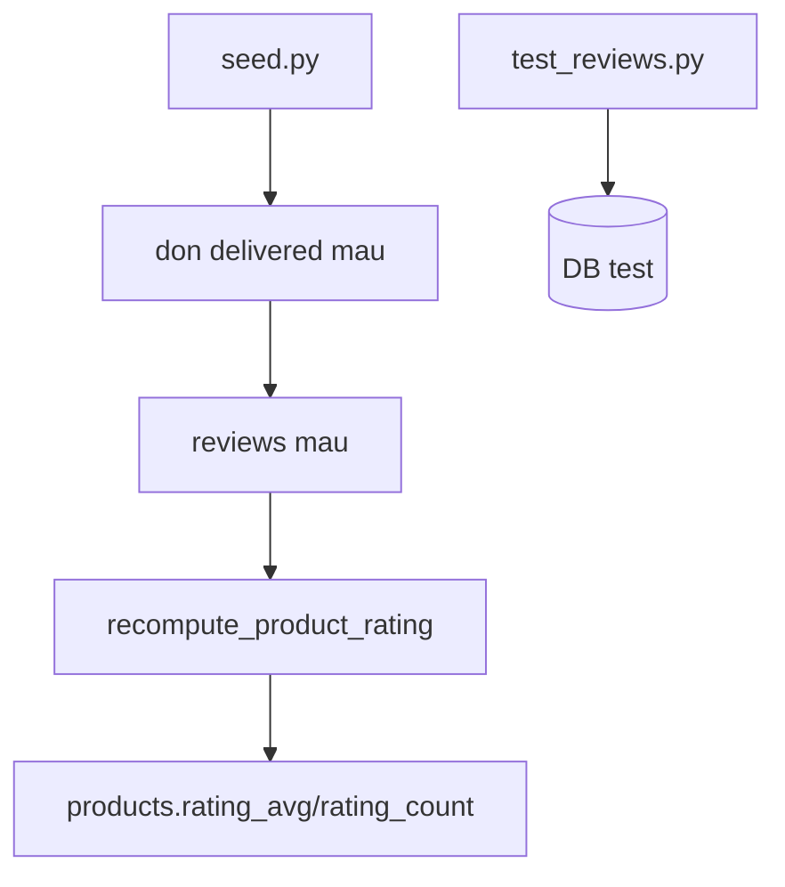

# Phase 06 — Seed + test + docs + verify

**Trạng thái:** ⬜ Chưa làm
**Ưu tiên:** P1 (verify + chốt tính năng)

## Context Links

- Seed hiện tại: `backend/app/scripts/seed.py` — 25+ sản phẩm có `rating_avg`/`rating_count` giả
  (vd dòng 155-156: `rating_avg=Decimal("4.5"), rating_count=89`).
- Test hiện có: `backend/tests/` — baseline 102 pass (sau phase variants).
- Fixture: `backend/tests/factories.py` (`normal_user`, `admin_user`, `category`, `brand`, `product`).
- Docs cần cập nhật: `docs/04-database.md` (schema bảng), `docs/01-system-design.md` (ERD dòng ~156-190),
  `docs/02-business-requirement.md` (dòng 179 "- Đánh giá (nếu làm)").
- Docs rule: `docs/rules.md` (dòng 400 liệt kê cột `products` — không cần sửa vì không đổi bảng products).

## Overview

**Priority:** P1.

**Current status:** Chưa làm.

**Description:** Bỏ số rating giả khỏi seed, thêm dữ liệu review thật gắn đơn `delivered`, viết test
đầy đủ cho nhánh nghiệp vụ, cập nhật docs, và verify toàn hệ thống.

## Key Insights

- **Số rating giả phải bị xoá** — đây là lý do user phát hiện "có thông tin rating" nhưng không
  có ngôi sao. Giữ sẽ tiếp tục hiển thị dữ liệu bịa.
- **Seed review cần đơn `delivered`** — vì `has_purchased_delivered` yêu cầu đúng điều kiện này.
  Phải tạo user + order + order_items + set `status='delivered'` + `payment_status='paid'`.
- **Test cần fixture đơn hàng** — chưa có trong `factories.py` → thêm fixture
  `delivered_order_item` gắn `normal_user` + `product`.
- **`sold_count` tăng khi delivered** — nếu seed tạo đơn `delivered` qua `update_order_status`,
  `sold_count` sẽ tăng. Cân nhắc set thủ công cho đúng thực tế.

## Requirements

**Functional**
- F1. Seed không còn `rating_avg`/`rating_count` giả.
- F2. Seed có ít nhất 3-5 sản phẩm có review thật + 1 đơn `delivered`.
- F3. Test đầy đủ các nhánh: chưa mua, chưa giao, đã đánh giá, sửa, xoá, quyền sở hữu, list public.
- F4. Docs đồng bộ.

**Non-functional**
- N1. `pytest backend/tests` → pass, **không giảm** số test hiện có (102).
- N2. `npx tsc -b` exit 0.
- N3. Không dùng mock/fake để ép pass — test dùng DB thật (TEST_DATABASE_URL).

## Architecture



## Related Code Files

**Sửa:**
- `backend/app/scripts/seed.py` — bỏ rating giả, thêm đơn + review mẫu.
- `backend/tests/factories.py` — thêm fixture đơn hàng `delivered`.
- `docs/04-database.md` — bảng `reviews`.
- `docs/01-system-design.md` — ERD.
- `docs/02-business-requirement.md` — bỏ "(nếu làm)".

**Tạo:**
- `backend/tests/test_reviews.py`

**Xoá:** không.

## Implementation Steps

1. **Sửa `backend/app/scripts/seed.py`**:
   - Xoá `rating_avg=...` / `rating_count=...` khỏi các khối tạo product (đặt mặc định 0).
     Dùng `replace_all` với pattern dạng:
     ```python
                 rating_avg=Decimal("4.5"),
                 rating_count=89,
     ```
     → cần xử lý từng giá trị (25 sản phẩm) hoặc dùng script nhỏ để bỏ hết 2 dòng liên tiếp.
   - Thêm phần cuối seed: tạo user demo, tạo 1 đơn `delivered` chứa 3 sản phẩm, tạo review cho
     các sản phẩm đó, rồi gọi `review_service.recompute_product_rating` cho từng sản phẩm.
     ```python
     from app.service import review_service
     ...
     for review_row in demo_reviews:
         db.add(Review(**review_row))
     await db.commit()
     for pid in {r["product_id"] for r in demo_reviews}:
         await review_service.recompute_product_rating(db, pid)
     await db.commit()
     ```
   - Lưu ý: seed script hiện dùng style sync/async? Kiểm tra đầu file trước khi sửa.

2. **Thêm fixture vào `backend/tests/factories.py`**:
   ```python
   @pytest_asyncio.fixture
   async def delivered_order(db_session, normal_user, product):
       """Don hang da giao chua thanh cong - dieu kien de duoc danh gia san pham."""
       from app.model.order import Order
       from app.model.order_item import OrderItem
       from decimal import Decimal

       order = Order(
           user_id=normal_user.id,
           order_code="ORD-DELIVERED-TEST",
           status="delivered",
           payment_method="cod",
           payment_status="paid",
           subtotal=Decimal("500000"),
           shipping_fee=Decimal("30000"),
           discount=Decimal("0"),
           total=Decimal("530000"),
           shipping_name="User Test",
           shipping_phone="0900123456",
           shipping_address="123 Test Street",
       )
       db_session.add(order)
       await db_session.flush()

       item = OrderItem(
           order_id=order.id,
           product_id=product.id,
           product_name=product.name,
           product_price=product.price,
           product_image=None,
           variant_info=None,
           qty=1,
           subtotal=product.price,
       )
       db_session.add(item)
       await db_session.commit()
       return order
   ```
   Cần kiểm tra `Order` có field bắt buộc nào khác (vd `created_at` kiểu str) → xem
   `backend/app/model/order.py` + cách seed tạo order.

3. **Tạo `backend/tests/test_reviews.py`** — các case:
   | # | Case | Expect |
   |---|---|---|
   | 1 | Chưa mua gì → POST review | 400, message "đã giao hàng" |
   | 2 | Đơn `confirmed` (chưa delivered) → POST review | 400 |
   | 3 | Đơn `delivered` → POST review | 201, `rating_avg`=rating, `rating_count`=1 |
   | 4 | Đánh giá lần 2 cùng sản phẩm | 400 "đã đánh giá" |
   | 5 | Rating ngoài 1..5 | 422 (pydantic) |
   | 6 | PATCH review của user khác | 400/403 |
   | 7 | PATCH review của chính mình | 200, aggregate recompute |
   | 8 | DELETE review → aggregate về 0 | 204, `rating_count`=0 |
   | 9 | DELETE review của user khác | 400/403 |
   | 10 | GET list public (không token) | 200, có `data` + `summary.distribution` |
   | 11 | GET `/mine` chưa đánh giá | 200, `data` = null |
   | 12 | Sửa rating → `rating_avg` đúng | vd 5 rồi 1 → avg 1 |
   | 13 | `GET /api/products?sort=rating_desc` | thứ tự đúng |

4. **Cập nhật docs**:
   - `docs/04-database.md` — thêm mục bảng `reviews` cạnh `products`.
   - `docs/01-system-design.md` — thêm `reviews` vào ERD (sau block `products`).
   - `docs/02-business-requirement.md:179` — `- Đánh giá (nếu làm).` → `- Đánh giá (chỉ sau khi đơn đã giao thành công).`

5. **Verify toàn bộ**:
   ```bash
   cd backend && pytest tests -q
   cd ../frontend && npx tsc -b
   ```

6. **Smoke test thủ công** (dev server):
   - `GET /api/products/1` → `rating_avg` khớp `AVG(reviews.rating)` (query DB).
   - `GET /api/reviews/product/1` → list + summary.
   - Login user có đơn delivered → POST review → 201 → reload product → sao cập nhật.

## Todo

- [ ] T1. Xoá `rating_avg`/`rating_count` giả khỏi `seed.py`
- [ ] T2. Thêm user demo + đơn `delivered` + reviews mẫu vào `seed.py` + recompute
- [ ] T3. Thêm fixture `delivered_order` vào `backend/tests/factories.py`
- [ ] T4. Tạo `backend/tests/test_reviews.py` (13 case)
- [ ] T5. Cập nhật `docs/04-database.md`
- [ ] T6. Cập nhật `docs/01-system-design.md` (ERD)
- [ ] T7. Cập nhật `docs/02-business-requirement.md`
- [ ] T8. `pytest backend/tests -q` → pass, số test ≥ 102 + 13
- [ ] T9. `npx tsc -b` → exit 0
- [ ] T10. Smoke test dev server (3 luồng ở trên)

## Success Criteria

- [ ] Không còn số rating giả trong DB (mọi sản phẩm có rating đều từ `reviews`)
- [ ] `rating_avg` luôn khớp `AVG(reviews.rating)` cho mọi sản phẩm
- [ ] Tất cả test pass
- [ ] Docs đồng bộ, không còn "(nếu làm)"

## Risk Assessment

| Rủi ro | Mức | Giảm thiểu |
|---|---|---|
| Xoá rating giả → UI trống nếu seed review lỗi | Trung bình | Verify seed chạy OK + smoke test sau seed |
| Fixture `delivered_order` thiếu field bắt buộc của `Order` | Trung bình | Đọc `backend/app/model/order.py` + `seed.py` để copy đúng field |
| `pytest` skip toàn bộ nếu thiếu `TEST_DATABASE_URL` | Cao | Kiểm tra env trước; nếu skip → báo user, không coi là pass |
| Test race: 2 test cùng đụng bảng `products` | Thấp | Fixture truncate giữa test (đã có trong `conftest.py`) |

## Security Considerations

- Seed không tạo dữ liệu nhạy cảm thật (email demo, tên giả).
- Test không dùng email/password thật.
- Đảm bảo API list không trả email user (đã chốt ở P3).

## Next Steps

- Sau khi xong: cập nhật `docs/development-roadmap.md` + `docs/project-changelog.md` nếu tồn tại.
- Follow-up đã ghi nhận:
  - Index `order_items.product_id` để tối ưu query verify "đã mua".
  - Admin duyệt/xoá review vi phạm (moderation).
  - Phân trang "load more" cho danh sách review dài.
