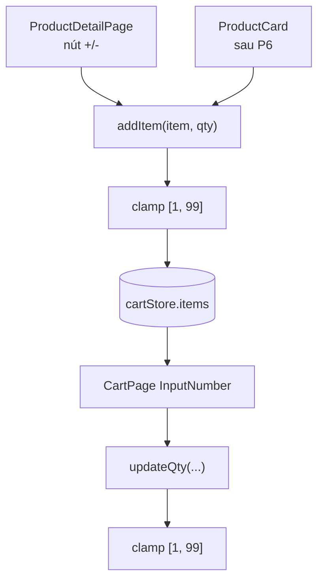

# Phase 02 — FE: giới hạn số lượng mỗi dòng giỏ

**Trạng thái:** ✅ Đã làm
**Ưu tiên:** P0

## Context Links

- Store: `frontend/src/store/cartStore.ts` (`addItem` dòng 33-50, `updateQty` dòng 60-73).
- Trang giỏ: `frontend/src/pages/user/CartPage.tsx` (`InputNumber` dòng 46-53).
- **Nguồn giới hạn**: `backend/app/schemas/order.py:14` → `qty: int = Field(..., gt=0, le=99)`.
- Thêm vào giỏ: `frontend/src/pages/ProductDetailPage.tsx:106-118`.

## Overview

**Priority:** P0.

**Current status:** Chưa làm.

**Description:** Chặn số lượng mỗi dòng giỏ nằm trong `[1, 99]` ngay ở tầng store, khớp với
validation của backend, để user không tạo ra payload bị 422 với message không dễ hiểu.

## Key Insights

- Backend giới hạn cứng `le=99` ở **Pydantic schema** → khi vượt sẽ ra **422 Unprocessable Entity**
  với body dạng validation error (tiếng Anh, không phải format `detail.message` mà FE đang parse).
  Contrast với lỗi nghiệp vụ trong `order_service` (`ValueError`) → **400** + message tiếng Việt.
  ⇒ Đây là lý do cần chặn ở FE.
- Giới hạn phải nằm ở **tầng store**, không chỉ ở UI: `addItem` được gọi từ
  `ProductDetailPage` (nút +/- ở đó cũng cần clamp) và sau P6 sẽ được gọi từ `ProductCard`.
- `addItem` có **2 nhánh**: thêm mới (qty = item.qty) và cộng dồn (`i.qty + qty`). Cả 2 phải clamp.
- `updateQty` hiện chỉ check `qty <= 0` → gọi `removeItem`. Giữ nguyên hành vi này (qty = 0 nghĩa
  là xoá dòng) và thêm clamp trên đầu.
- **Nguồn duy nhất** cho hằng số: export `MAX_QTY_PER_ITEM` từ `cartStore.ts`.
  Không đặt ở `utils/constants.ts` để tránh 2 nơi phải đồng bộ (DRY) — `constants.ts` hiện chỉ chứa
  bộ lọc/format, không chứa ràng buộc nghiệp vụ.
- Cần chú ý `ProductDetailPage` có nút `+` giới hạn theo `maxQty` (stock) — clamp 99 ở store vẫn
  cần thiết vì stock có thể > 99.

## Requirements

**Functional**
- F1. Export `MAX_QTY_PER_ITEM = 99` từ `cartStore.ts`.
- F2. `addItem(item, qty)`: clamp `qty` về `[1, 99]` trước khi dùng (cả nhánh thêm mới lẫn cộng dồn).
- F3. `updateQty(product_id, variant_id, qty)`: `qty <= 0` → `removeItem` (giữ nguyên);
  `qty > 99` → clamp về 99.
- F4. `CartPage`: `<InputNumber min={1} max={MAX_QTY_PER_ITEM}>` + clamp trong `onChange`.
- F5. Thông báo cho user khi bị clamp (nếu đơn giản): message "Tối đa 99 sản phẩm cho mỗi mã".

**Non-functional**
- N1. Một nguồn sự thật duy nhất cho giới hạn (`MAX_QTY_PER_ITEM`).
- N2. Clamp ở tầng store → mọi nơi gọi `addItem` đều được bảo vệ.
- N3. Không thay đổi backend.

## Architecture



## Related Code Files

**Sửa:**
- `frontend/src/store/cartStore.ts`
- `frontend/src/pages/user/CartPage.tsx`

**Tạo:** không.

**Xoá:** không.

## Implementation Steps

1. **Sửa `frontend/src/store/cartStore.ts`** — thêm hằng số export ở đầu file:
   ```typescript
   /**
    * Số lượng tối đa cho 1 dòng giỏ.
    * Khớp với validation backend: `qty: int = Field(..., gt=0, le=99)`
    * trong `backend/app/schemas/order.py` (vượt sẽ bị API trả 422).
    */
   export const MAX_QTY_PER_ITEM = 99;
   ```

2. **Thêm helper clamp** (private, trong cùng file):
   ```typescript
   /** Clamp so luong ve [1, MAX_QTY_PER_ITEM]. */
   function clampQty(qty: number): number {
     if (!Number.isFinite(qty)) return 1;
     return Math.min(MAX_QTY_PER_ITEM, Math.max(1, Math.trunc(qty)));
   }
   ```

3. **Sửa `addItem`** — clamp ở cả 2 nhánh:
   ```typescript
       addItem: (item, qty = 1) => {
         const safeQty = clampQty(qty);
         set((state) => {
           const existingIndex = state.items.findIndex(
             (i) => i.product_id === item.product_id && i.variant_id === item.variant_id
           );

           if (existingIndex >= 0) {
             // Update qty - create new array with updated item
             const newItems = state.items.map((i, idx) =>
               idx === existingIndex ? { ...i, qty: clampQty(i.qty + safeQty) } : i
             );
             return { items: newItems };
           }

           // Add new item
           return { items: [...state.items, { ...item, qty: safeQty }] };
         });
       },
   ```

4. **Sửa `updateQty`** — thêm clamp trên, giữ nguyên nhánh `qty <= 0`:
   ```typescript
       updateQty: (product_id, variant_id, qty) => {
         if (qty <= 0) {
           get().removeItem(product_id, variant_id);
           return;
         }

         const safeQty = clampQty(qty);
         set((state) => {
           const newItems = state.items.map((item) => {
             if (item.product_id === product_id && item.variant_id === variant_id) {
               return { ...item, qty: safeQty };
             }
             return item;
           });
           return { items: newItems };
         });
       },
   ```

5. **Sửa `frontend/src/pages/user/CartPage.tsx`**:
   ```typescript
   import { useCartStore, MAX_QTY_PER_ITEM, type CartItem } from '../../store/cartStore';
   ```
   ```typescript
       title: 'Số lượng',
       dataIndex: 'qty',
       render: (_: unknown, record: CartItem) => (
         <InputNumber
           min={1}
           max={MAX_QTY_PER_ITEM}
           value={record.qty}
           onChange={(value) =>
             updateQty(record.product_id, record.variant_id, value || 1)
           }
         />
       ),
   ```
   > `max` trên `InputNumber` của antd đã tự chặn input, nhưng vẫn cần clamp ở store vì
   > `onChange` có thể được gọi với giá trị ngoài khoảng (ví dụ paste).

6. **Compile check:**
   ```bash
   cd frontend && npx tsc -b
   ```

## Todo

- [ ] T1. Export `MAX_QTY_PER_ITEM = 99` trong `cartStore.ts`
- [ ] T2. Thêm helper `clampQty`
- [ ] T3. Clamp trong `addItem` (cả 2 nhánh)
- [ ] T4. Clamp trong `updateQty` (giữ nhánh `qty <= 0` → remove)
- [ ] T5. `CartPage`: thêm `max={MAX_QTY_PER_ITEM}` + import
- [ ] T6. `npx tsc -b` exit 0

## Success Criteria

- [ ] `addItem(item, 150)` → item lưu `qty = 99`
- [ ] Thêm 2 lần `qty = 60` cho cùng 1 key → `qty = 99` (không phải 120)
- [ ] `updateQty(id, variant, 200)` → `qty = 99`
- [ ] `updateQty(id, variant, 0)` → dòng bị xoá (giữ nguyên hành vi cũ)
- [ ] `InputNumber` ở `CartPage` không cho nhập > 99
- [ ] `npx tsc -b` không lỗi type

## Risk Assessment

| Rủi ro | Mức | Giảm thiểu |
|---|---|---|
| Clamp ở `addItem` làm qty cộng dồn "bị mất" giá trị | Thấp | Đây là hành vi mong muốn (giới hạn server). Có thể thêm message báo "đã đạt giới hạn". |
| Quên clamp nhánh cộng dồn | Trung bình | Todo T3 tách riêng cho cả 2 nhánh; review checklist |
| `clampQty` dùng `Math.trunc` → qty 2.7 → 2 | Thấp | `InputNumber` mặc định `precision=0` → không có số thập. OK. |
| Khác giới hạn với backend sau này | Thấp | Comment trong file trỏ về `backend/app/schemas/order.py` |

## Security Considerations

- Không nới lỏng bất kỳ validation nào của backend — chỉ chặn sớm hơn.
- Không gửi giá từ client (giá vẫn do server tính ở `order_service.create_order`).

## Next Steps

- P5: revalidate giá/tồn kho — cần `stock` trong `CartItem` (thêm field sau P2 cho đỡ đụng file).
