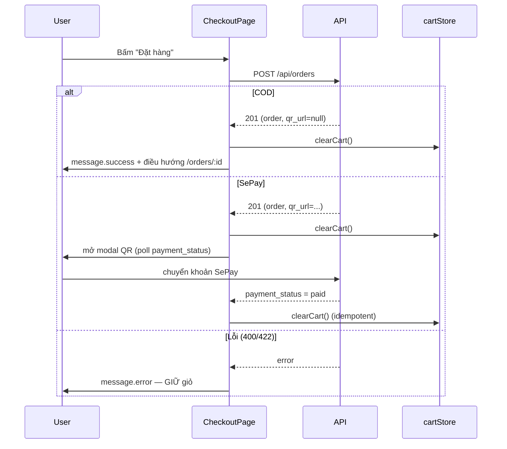

# Phase 03 — FE: xoá giỏ ngay khi đơn hàng được tạo

**Trạng thái:** ✅ Đã làm
**Ưu tiên:** P0

## Context Links

- Trang checkout: `frontend/src/pages/user/CheckoutPage.tsx` (`handleCheckoutSuccess` dòng 68-86).
- Modal QR: `frontend/src/components/QrPaymentModal.tsx` (poll `payment_status` mỗi 4s).
- Tạo đơn: `backend/app/service/order_service.py` → `create_order` (đã trừ kho + commit).
- Xác nhận thanh toán: `backend/app/service/order_service.py` → `update_payment_status`.

## Overview

**Priority:** P0.

**Current status:** Chưa làm.

**Description:** Xoá giỏ hàng **ngay khi đơn đã được tạo thành công**, áp dụng cho cả COD và
SePay — thay vì chỉ xoá ở nhánh COD như hiện tại.

## Key Insights

- Vấn đề hiện tại: nhánh SePay **giữ giỏ** cho tới khi webhook báo `paid`. Nhưng nếu user đóng
  modal (nút X / `onCancel` → `onClose`) mà chưa thanh toán → đơn **đã tạo**, kho **đã trừ**,
  giỏ **vẫn còn** → bấm "Đặt hàng" lần nữa tạo đơn thứ 2 và trừ kho lần 2.
- Đơn đã lưu đủ snapshot (`order_items.product_name`, `product_price`, `subtotal`,
  `variant_info`) nên **giữ giỏ không mang lại giá trị gì** — chỉ tạo rủi ro tạo đơn trùng.
- `clearCart()` là idempotent → gọi ở cả 2 nhánh (COD + SePay) và cả trong `onPaid` cũng vô hại.
- `QrPaymentModal.onPaid` hiện gọi `clearCart()` → giữ nguyên (phòng trường hợp flow khác gọi tới).
- Luồng COD: `clearCart()` → `message.success` → `navigate('/orders/:id')`. Thứ tự này giữ nguyên.
- Luồng SePay sau khi clear: mở modal QR, user thanh toán → poll thấy `paid` → `onPaid` → thông báo.
  Nếu user đóng modal → đơn vẫn nằm trong `/orders` với trạng thái `unpaid` → có thể thanh toán lại
  từ trang đơn hàng (xem P5 của plan thanh toán SePay trước đó).

## Requirements

**Functional**
- F1. Trong `handleCheckoutSuccess`: gọi `clearCart()` **một lần**, trước khi rẽ nhánh COD/SePay.
- F2. Nhánh COD: bỏ lời gọi `clearCart()` cũ (đã gọi chung ở F1), giữ `message.success` + `navigate`.
- F3. Nhánh SePay: giữ `setQrUrl` / `setOrderId` / `setShowQrModal(true)`.
- F4. `QrPaymentModal.onPaid` giữ nguyên lời gọi `clearCart()` (idempotent).
- F5. Nếu `create_order` **thất bại** (lỗi 400/422) → giỏ **giữ nguyên** (đã đúng vì `clearCart`
  nằm trong `onSuccess`).

**Non-functional**
- N1. `clearCart()` gọi đúng 1 lần trên happy path → không xoá oan.
- N2. Không đổi cấu trúc payload gửi server.

## Architecture



## Related Code Files

**Sửa:**
- `frontend/src/pages/user/CheckoutPage.tsx`

**Tạo:** không.

**Xoá:** không.

## Implementation Steps

1. **Sửa `handleCheckoutSuccess`** trong `frontend/src/pages/user/CheckoutPage.tsx`:
   ```typescript
     const handleCheckoutSuccess = (data: { data?: { order?: { id: number }; qr_url?: string | null } }) => {
       const createdOrderId = data.data?.order?.id;
       const createdQrUrl = data.data?.qr_url ?? null;

       // Don da tao thanh cong -> don da luu du snapshot `order_items`,
       // giu gio khong con gia tri va co the gay tao don trung.
       // Xoa ngay cho ca COD va SePay.
       clearCart();

       // COD: thanh toan khi nhan hang -> xoa gio ngay
       if (paymentMethod === 'cod') {
         message.success('Đặt hàng thành công!');
         navigate(createdOrderId ? `/orders/${createdOrderId}` : '/orders');
         return;
       }

       // SePay: mo modal QR de nguoi dung chuyen khoan
       setQrUrl(createdQrUrl);
       setOrderId(createdOrderId);
       setShowQrModal(true);
     };
   ```
   > Comment cũ "COD: thanh toan khi nhan hang -> xoa gio ngay" phải sửa lại vì giờ xoá giỏ ở
   > trên cho mọi phương thức thanh toán.

2. **Giữ nguyên `onPaid` trong JSX** (`QrPaymentModal`):
   ```tsx
           onPaid={() => {
             clearCart();
             message.success('Thanh toán thành công!');
           }}
   ```

3. **Compile check:**
   ```bash
   cd frontend && npx tsc -b
   ```

## Todo

- [ ] T1. Gọi `clearCart()` ở đầu `handleCheckoutSuccess`
- [ ] T2. Xoá lời gọi `clearCart()` cũ trong nhánh COD
- [ ] T3. Cập nhật comment trong nhánh COD cho đúng
- [ ] T4. Giữ nguyên nhánh SePay (setQrUrl / setOrderId / setShowQrModal)
- [ ] T5. Giữ nguyên `onPaid` → `clearCart()`
- [ ] T6. `npx tsc -b` exit 0

## Success Criteria

- [ ] COD đặt hàng thành công → giỏ trống ngay, badge = 0
- [ ] SePay đặt hàng thành công → giỏ **đã trống** ngay (trước khi thanh toán)
- [ ] SePay: đóng modal chưa thanh toán → giỏ trống → bấm lại "Đặt hàng" → không tạo đơn thứ 2
- [ ] API trả lỗi 400 (không đủ stock) → giỏ **còn nguyên** để user sửa
- [ ] `npx tsc -b` không lỗi type

## Risk Assessment

| Rủi ro | Mức | Giảm thiểu |
|---|---|---|
| User đóng modal SePay → mất giỏ nhưng đơn chưa thanh toán | Trung bình | Đơn đã tồn tại trong `/orders` với trạng thái `unpaid` → user có thể mở lại và thanh toán. Đây là hành vi đúng (đơn đã chốt). |
| `clearCart()` xoá cả khi order tạo lỗi | Thấp | `clearCart` nằm trong `onSuccess` của mutation → lỗi không đi qua nhánh này. |
| Gọi `clearCart()` 2 lần (1 lần ở đây, 1 lần ở `onPaid`) | Thấp | `clearCart` idempotent (set items = []). |

## Security Considerations

- Không thay đổi logic server. Việc xoá giỏ phía client không ảnh hưởng quyền truy cập đơn hàng
  (`get_order` đã kiểm tra `order.user_id != current_user` → 403).
- Server vẫn là nguồn sự thật về giá và tồn kho.

## Next Steps

- P7: cập nhật docs mô tả hành vi giỏ sau khi đặt hàng.
