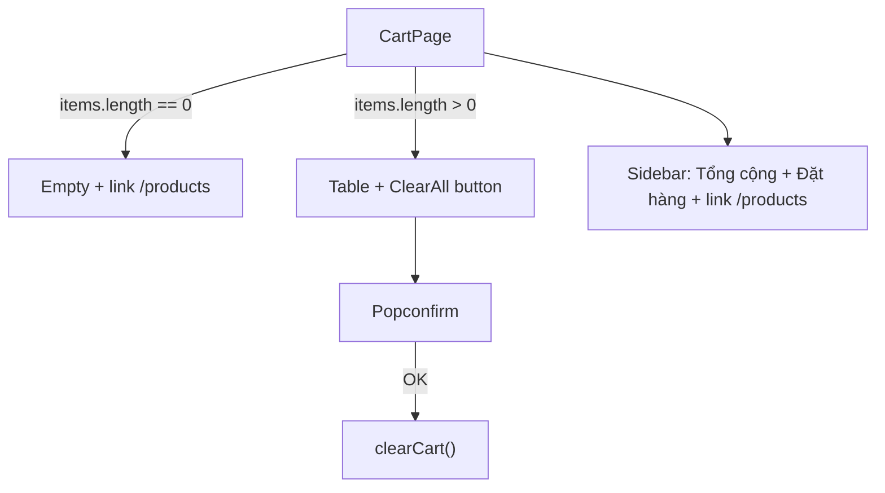

# Phase 04 — FE: nút "Xoá tất cả" + link "Tiếp tục mua sắm" ở trang giỏ

**Trạng thái:** ✅ Đã làm
**Ưu tiên:** P1

## Context Links

- Trang giỏ: `frontend/src/pages/user/CartPage.tsx` (140 dòng).
- Pattern `Popconfirm` xoá dòng: `frontend/src/pages/user/CartPage.tsx:60-69`.
- Pattern `Empty` + link: `frontend/src/pages/user/CartPage.tsx:74-87`.
- Màu/typography: `frontend/src/theme` (`colors.dividerDefault`, `colors.primary`).

## Overview

**Priority:** P1.

**Current status:** Chưa làm.

**Description:** Bổ sung 2 thao tác còn thiếu trên trang giỏ: xoá toàn bộ giỏ (1 thao tác thay vì
xoá từng dòng) và link "Tiếp tục mua sắm" trong sidebar (hiện chỉ có khi giỏ trống).

## Key Insights

- Hiện tại chỉ xoá được **từng dòng** (`removeItem`) → user có 8 dòng phải bấm xoá 8 lần.
- `clearCart()` đã có sẵn trong store → không cần logic mới.
- `Popconfirm` đã dùng sẵn cho xoá dòng → dùng lại cho "Xoá tất cả" để nhất quán.
- Link "Tiếp tục mua sắm" chỉ hiện khi giỏ trống; nên đưa vào sidebar cho trường hợp giỏ có hàng
  → UX tốt hơn, đồng thời tránh trường hợp user không tìm được nút quay lại danh sách sản phẩm.
- File hiện 140 dòng → thêm ~25 dòng vẫn dưới ngưỡng 200 dòng của `docs/rules.md`.
- Sidebar hiện có 1 khối "Tổng cộng" + nút "Tiến hành đặt hàng". Thêm link phụ bên dưới nút.

## Requirements

**Functional**
- F1. Nút "Xoá tất cả" (danger, type="text") trên tiêu đề Card giỏ, kèm `Popconfirm` xác nhận.
- F2. Bấm xác nhận → `clearCart()` → giỏ trống → render nhánh `Empty` hiện có.
- F3. Sidebar: link "Tiếp tục mua sắm" → `/products`, hiển thị dưới nút "Tiến hành đặt hàng".
- F4. Nút "Xoá tất cả" chỉ hiện khi `items.length > 0`.

**Non-functional**
- N1. Tái sử dụng `clearCart` có sẵn → không thêm action mới vào store.
- N2. Giữ nguyên layout 2 cột (16/8) hiện tại.
- N3. File vẫn < 200 dòng.

## Architecture



## Related Code Files

**Sửa:**
- `frontend/src/pages/user/CartPage.tsx`

**Tạo:** không.

**Xoá:** không.

## Implementation Steps

1. **Sửa `frontend/src/pages/user/CartPage.tsx`** — import `clearCart`:
   ```typescript
   import { useCartStore, MAX_QTY_PER_ITEM, type CartItem } from '../../store/cartStore';
   ```
   ```typescript
     const { items, updateQty, removeItem, clearCart, getTotal } = useCartStore();
   ```

2. **Thêm nút "Xoá tất cả"** — đặt trong `title` của `Card` giỏ (cột trái):
   ```tsx
         <Col xs={24} lg={16}>
           <Card
             title={
               <div style={{ display: 'flex', justifyContent: 'space-between', alignItems: 'center' }}>
                 <span>Sản phẩm ({items.length})</span>
                 <Popconfirm
                   title="Xoá toàn bộ giỏ hàng?"
                   onConfirm={clearCart}
                   okText="Xoá tất cả"
                   cancelText="Hủy"
                 >
                   <Button type="text" danger size="small">
                     Xoá tất cả
                   </Button>
                 </Popconfirm>
               </div>
             }
           >
   ```

3. **Thêm link "Tiếp tục mua sắm"** trong sidebar, dưới nút "Tiến hành đặt hàng":
   ```tsx
             <Button
               type="primary"
               size="large"
               block
               onClick={() => navigate('/checkout')}
             >
               Tiến hành đặt hàng
             </Button>

             <div style={{ textAlign: 'center', marginTop: 12 }}>
               <Link to="/products">
                 <Button type="link" icon={<ShoppingOutlined />}>
                   Tiếp tục mua sắm
                 </Button>
               </Link>
             </div>
   ```
   > `ShoppingOutlined` đã được import sẵn ở đầu file (dùng cho nút trong nhánh Empty).

4. **Compile check:**
   ```bash
   cd frontend && npx tsc -b
   ```

## Todo

- [ ] T1. Import `clearCart` từ store
- [ ] T2. Thêm nút "Xoá tất cả" + `Popconfirm` trong `title` của Card giỏ
- [ ] T3. Hiển thị số lượng dòng trong title ("Sản phẩm (N)")
- [ ] T4. Thêm link "Tiếp tục mua sắm" trong sidebar
- [ ] T5. `npx tsc -b` exit 0

## Success Criteria

- [ ] Bấm "Xoá tất cả" → hiện `Popconfirm` → xác nhận → giỏ trống, hiện màn `Empty`
- [ ] Bấm "Hủy" trong `Popconfirm` → giỏ giữ nguyên
- [ ] Sidebar có link "Tiếp tục mua sắm" → click → sang `/products`
- [ ] File vẫn < 200 dòng
- [ ] `npx tsc -b` không lỗi type

## Risk Assessment

| Rủi ro | Mức | Giảm thiểu |
|---|---|---|
| Bấm nhầm "Xoá tất cả" | Thấp | Đã có `Popconfirm` xác nhận (giống xoá dòng) |
| `Card` có `title` dạng string trước đó → đổi sang ReactNode | Thấp | antd `title` nhận `ReactNode` → hợp lệ |
| Xoá hết giỏ rồi không có đường quay lại | Thấp | Nhánh `Empty` đã có link `/products`; thêm cả link trong sidebar (T4) |

## Security Considerations

- Không liên quan auth/data nhạy cảm. `clearCart` chỉ xoá state client.

## Next Steps

- P5: revalidate giá & tồn kho của giỏ (cùng file `CartPage.tsx`).
