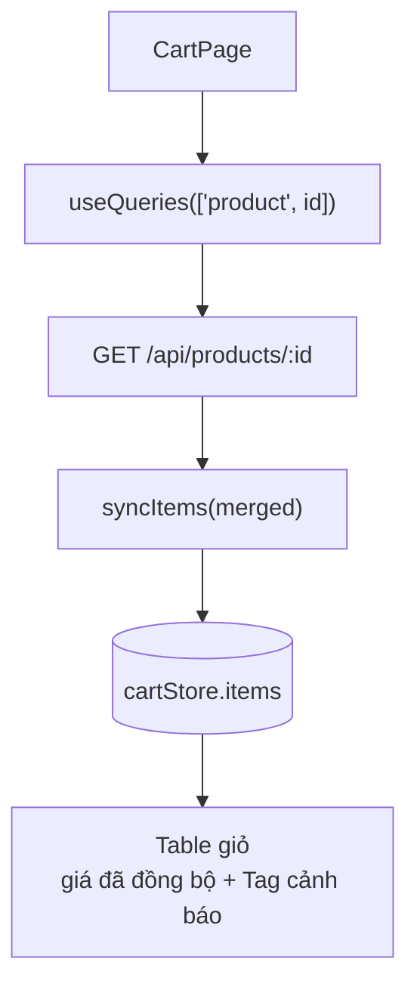

# Phase 05 — FE: đồng bộ giá & tồn kho của giỏ từ API

**Trạng thái:** ✅ Đã làm
**Ưu tiên:** P1 · **Phụ thuộc:** P2 (cùng sửa `cartStore.ts`)

## Context Links

- Trang giỏ: `frontend/src/pages/user/CartPage.tsx`.
- Store: `frontend/src/store/cartStore.ts` (`CartItem` interface dòng 4-11).
- Endpoint dùng: `backend/app/api/products.py` → `GET /api/products/{product_id}` (public, không cần auth).
  Trả `price`, `sale_price`, `stock` (= tổng stock variants, xem `service/product_stock.py`),
  `variants[]` (mỗi variant có `id`, `name`, `price`, `stock`), `is_active`, `image_urls`.
- Chuẩn hook react-query: `frontend/src/hooks/useProducts.ts`, `frontend/src/hooks/useProductImages.ts`.
- Type sản phẩm: `frontend/src/types/product.ts` (`Product`, `ProductVariant`).
- Server tính lại giá: `backend/app/service/order_service.py:246-254`.

## Overview

**Priority:** P1.

**Current status:** Chưa làm.

**Description:** Giỏ hàng đang lưu **snapshot giá** tại thời điểm thêm vào giỏ. Nếu admin đổi giá
sau đó, tổng hiển thị ở checkout ≠ tổng server thực tính. Phase này đồng bộ lại giá / tồn kho /
tên / ảnh của các dòng giỏ từ API khi mở trang giỏ, và cảnh báo khi sản phẩm hết hàng,
ngừng bán, hoặc số lượng trong giỏ vượt tồn kho.

## Key Insights

- Backend **không** gửi giá từ FE — `order_service.create_order` tự tính lại `item_price` từ DB
  (`variant.price` → `product.price`/`sale_price`). ⇒ Giá trong giỏ chỉ là **preview**, nhưng
  preview sai thì user thấy tổng lệch với hoá đơn thật → mất niềm tin.
- `GET /api/products/{id}` đã trả sẵn mọi thứ cần: `variants[]` (kèm `price`/`stock`),
  `stock` tổng, `is_active`, `sale_price`, `image_urls`. Không cần endpoint mới.
- `stock` của sản phẩm có variants là **tổng** stock các variant (`product_stock.effective_stock`)
  → cần stock **của variant** để cảnh báo chính xác → lấy `variants.find(v => v.id === variant_id)?.stock`.
- Với sản phẩm **không có** variant → stock = `product.stock`.
- `useQueries` của TanStack Query v5 hỗ trợ gọi song song nhiều query — dùng thay vì `useEffect`
  + `useState` thủ công. Query key `['product', id]` **trùng** với `ProductDetailPage` → được
  chia sẻ cache, không tốn request thêm nếu đã xem trang chi tiết.
- `syncItems` phải **chỉ merge metadata**, không đụng `qty` (user có thể đang sửa số lượng).
- Rủi ro "user sửa qty đúng lúc revalidate trả về": vì `syncItems` không chạm `qty` → an toàn.
- `persist` middleware sẽ serialize `stock`/`is_active` xuống `localStorage` → tăng nhẹ dung lượng,
  không sao. Nhưng nên cân nhắc `partialize` để **không** persist các field tạm → phức tạp hoá,
  bỏ qua (YAGNI).

## Requirements

**Functional**
- F1. Thêm field `stock?: number` và `is_active?: boolean` vào `CartItem` (`cartStore.ts`).
- F2. Thêm action `syncItems(items: CartItem[])` vào store — thay thế `items` bằng danh sách mới
  nhưng **giữ nguyên `qty`** của dòng cũ (match theo `product_id` + `variant_id`).
- F3. `CartPage` dùng `useQueries` gọi `GET /api/products/{id}` cho từng dòng giỏ.
- F4. Khi data về → tính lại `price` (variant price → `sale_price ?? price`), `name`,
  `image_url`, `stock` (variant stock → product stock), `is_active` → `syncItems`.
- F5. Hiển thị cảnh báo trên dòng giỏ:
  - `is_active === false` → Tag "Ngừng bán" (màu `default`).
  - `stock === 0` → Tag "Hết hàng" (màu `default`).
  - `qty > stock` → Tag "Chỉ còn N" (màu `warning`).
- F6. Không chặn nút "Tiến hành đặt hàng" — để server trả 400 với message rõ ràng
  (nhất quán với nguyên tắc "server là nguồn sự thật").

**Non-functional**
- N1. Không tạo endpoint BE mới.
- N2. Query dùng chung cache với `ProductDetailPage` (key `['product', id]`).
- N3. `syncItems` không bao giờ ghi đè `qty`.
- N4. File `CartPage.tsx` vẫn < 200 dòng → **tách hook ra file riêng** nếu vượt.

## Architecture



## Related Code Files

**Sửa:**
- `frontend/src/store/cartStore.ts` (thêm field + action `syncItems`)
- `frontend/src/pages/user/CartPage.tsx` (fetch + merge + cảnh báo)

**Tạo:**
- `frontend/src/hooks/useCartItemsSync.ts` (hook `useQueries` + logic merge, để `CartPage.tsx` không phình)

**Xoá:** không.

## Implementation Steps

1. **Sửa `frontend/src/store/cartStore.ts`** — mở rộng `CartItem`:
   ```typescript
   export interface CartItem {
     product_id: number;
     variant_id?: string;
     qty: number;
     name: string;
     price: number;
     image_url?: string;
     variant_name?: string;
     /** Ton kho hien tai tu server (null = chua fetch). */
     stock?: number;
     /** San pham con ban hay khong (null = chua fetch). */
     is_active?: boolean;
   }
   ```

2. **Thêm action `syncItems`** vào `CartState`:
   ```typescript
     /**
      * Dong bo metadata (gia, ten, anh, ton kho) tu server cho cac dong trong gio.
      * KHONG thay doi `qty` - so luong do user tu chinh.
      */
     syncItems: (items: CartItem[]) => void;
   ```
   ```typescript
       syncItems: (newItems) => {
         set((state) => {
           const qtyMap = new Map(
             state.items.map((i) => [`${i.product_id}-${i.variant_id ?? ''}`, i.qty]),
           );
           return {
             items: newItems.map((i) => ({
               ...i,
               qty: qtyMap.get(`${i.product_id}-${i.variant_id ?? ''}`) ?? i.qty,
             })),
           };
         });
       },
   ```

3. **Tạo `frontend/src/hooks/useCartItemsSync.ts`**:
   ```typescript
   import { useEffect } from 'react';
   import { useQueries } from '@tanstack/react-query';
   import api from '../api/axios';
   import { useCartStore, type CartItem } from '../store/cartStore';
   import type { Product } from '../types/product';

   /** Lay metadata san pham cho tung dong gio de dong bo gia + ton kho. */
   function fetchProduct(productId: number) {
     return api.get(`/api/products/${productId}`).then((res) => res.data.data as Product);
   }

   /**
    * Dong bo gia/ton kho cua cac dong gio tu server.
    * - Gia: variant price -> sale_price -> price (giong logic server `order_service`).
    * - Stock: variant stock -> product stock (tong stock variants).
    * - KHONG thay doi qty (do user tu chinh).
    */
   export function useCartItemsSync(items: CartItem[]) {
     const syncItems = useCartStore((state) => state.syncItems);

     const results = useQueries({
       queries: items.map((item) => ({
         queryKey: ['product', item.product_id],
         queryFn: () => fetchProduct(item.product_id),
         enabled: item.product_id > 0,
       })),
     });

     useEffect(() => {
       if (results.length === 0) return;
       // Chi merge khi moi dong co duoc du lieu server.
       const merged = items.map((item, index) => {
         const product = results[index]?.data;
         if (!product) return item;

         const variant = item.variant_id
           ? product.variants?.find((v) => v.id === item.variant_id)
           : undefined;

         const price = variant
           ? Number(variant.price ?? product.price)
           : Number(product.sale_price ?? product.price);

         const stock = variant
           ? Number(variant.stock ?? 0)
           : Number(product.stock ?? 0);

         return {
           ...item,
           name: product.name,
           price,
           image_url: product.image_urls?.thumb ?? product.image_url ?? item.image_url,
           stock,
           is_active: product.is_active,
           variant_name: variant?.name ?? item.variant_name,
         };
       });

       // Khong goi syncItems neu khong co dong nao thay doi (tranh render loop).
       const changed = merged.some((m, i) => {
         const prev = items[i];
         return prev.price !== m.price || prev.stock !== m.stock || prev.is_active !== m.is_active;
       });
       if (changed) syncItems(merged);
     }, [results, items, syncItems]);

     return results;
   }
   ```
   > `useEffect` phụ thuộc `items` — `items` là array mới mỗi lần store set → có thể loop.
   > Chốt bằng cờ `changed` (chỉ gọi `syncItems` khi thực sự khác) **và** so sánh giá trị
   > đã merge với `items` hiện tại. Nếu vẫn lo loop → thêm `useRef` giữ snapshot lần trước.

4. **Sửa `frontend/src/pages/user/CartPage.tsx`**:
   ```typescript
   import { useCartItemsSync } from '../../hooks/useCartItemsSync';
   ```
   ```typescript
     const { items, updateQty, removeItem, clearCart, getTotal } = useCartStore();
     useCartItemsSync(items);
   ```
   Thêm cột/cảnh báo trong render của dòng giỏ (ví dụ cột "Sản phẩm" hoặc thêm Tag cạnh tên):
   ```tsx
   {record.is_active === false && <Tag color="default">Ngừng bán</Tag>}
   {record.stock === 0 && <Tag color="default">Hết hàng</Tag>}
   {record.stock !== undefined && record.qty > record.stock && (
     <Tag color="warning">Chỉ còn {record.stock}</Tag>
   )}
   ```

5. **Compile check:**
   ```bash
   cd frontend && npx tsc -b
   ```

6. **Verify thủ công** (quan trọng): thêm 1 sản phẩm vào giỏ → admin đổi giá → reload `/cart`
   → giá hiển thị phải khớp giá mới.

## Todo

- [ ] T1. Thêm `stock?`, `is_active?` vào `CartItem`
- [ ] T2. Thêm action `syncItems` (giữ nguyên `qty`)
- [ ] T3. Tạo hook `frontend/src/hooks/useCartItemsSync.ts`
- [ ] T4. Dùng hook trong `CartPage`
- [ ] T5. Render Tag cảnh báo (ngừng bán / hết hàng / chỉ còn N)
- [ ] T6. Kiểm tra loop render (`useEffect` + `items` dependency)
- [ ] T7. `npx tsc -b` exit 0
- [ ] T8. Verify tay: đổi giá admin → giỏ cập nhật

## Success Criteria

- [ ] Admin đổi giá → mở lại `/cart` → giá hiển thị khớp server (đồng bộ cả dòng có variant)
- [ ] Sản phẩm hết hàng → dòng giỏ hiện Tag "Hết hàng"
- [ ] Sản phẩm bị admin ngừng bán → dòng giỏ hiện Tag "Ngừng bán"
- [ ] Số lượng trong giỏ > tồn kho → hiện Tag "Chỉ còn N"
- [ ] `qty` user đã sửa **không bị** reset khi revalidate
- [ ] Không có render loop (CPU không tăng / console không báo warning)
- [ ] `npx tsc -b` không lỗi type

## Risk Assessment

| Rủi ro | Mức | Giảm thiểu |
|---|---|---|
| Render loop do `useEffect` phụ thuộc `items` (array mới mỗi lần set) | Cao | Cờ `changed` + so sánh giá trị; nếu vẫn loop → dùng `useRef` snapshot |
| Ghi đè `qty` user vừa sửa | Trung bình | `syncItems` merge `qty` từ map cũ, không lấy từ dữ liệu server |
| N request khi giỏ lớn | Thấp | Chấp nhận (giỏ < 20 item thường). Endpoint bulk = follow-up |
| Cache `['product', id]` dùng chung với `ProductDetailPage` nhưng shape khác | Thấp | Cùng endpoint, cùng shape `res.data.data` → an toàn |
| `variant.price` null → dùng `product.price` nhưng server dùng `product.price` (không sale_price) | Trung bình | Server: variant → `variant.price ?? product.price`; **không** dùng `sale_price` cho variant. Code ở T3 phải mirror đúng logic này (đã làm) |
| Tồn kho variant null → 0 (đúng theo `docs/04-database.md`) | Thấp | `Number(variant.stock ?? 0)` |

## Security Considerations

- Không gửi giá lên server — server vẫn tự tính (`order_service.create_order`). Thay đổi này chỉ
  cải thiện **preview** phía client.
- Không lộ dữ liệu user nào.

## Next Steps

- P7: cập nhật docs §9.3 mô tả việc giỏ đồng bộ giá/tồn kho từ server.
