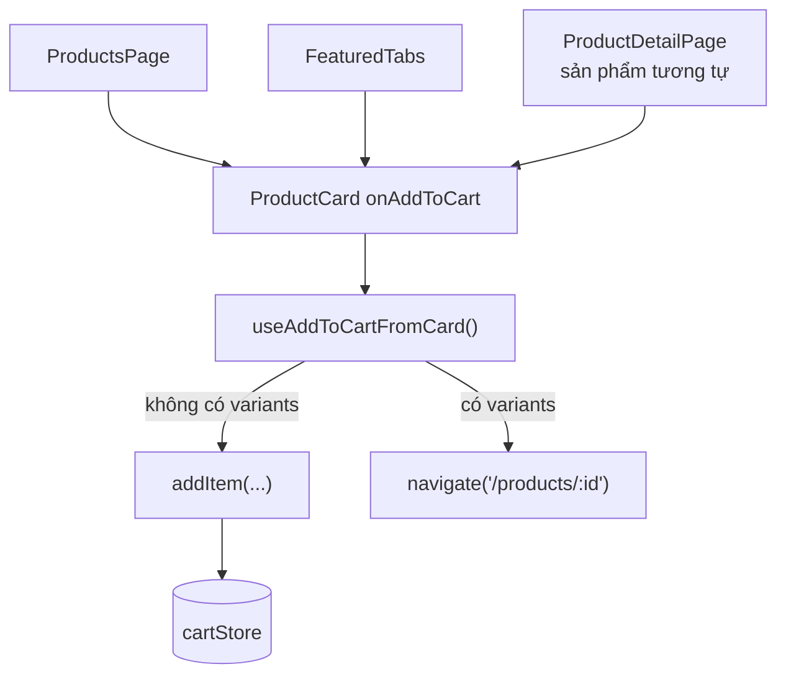

# Phase 06 — FE: bật nút "Thêm vào giỏ" trên ProductCard

**Trạng thái:** ✅ Đã làm
**Ưu tiên:** P1

## Context Links

- Component: `frontend/src/components/ProductCard.tsx` (prop `onAddToCart` dòng 10-13, nút dòng 107-121).
- Nơi dùng `ProductCard` (3 chỗ):
  - `frontend/src/pages/ProductsPage.tsx:257`
  - `frontend/src/components/home/FeaturedTabs.tsx:28`
  - `frontend/src/pages/ProductDetailPage.tsx:308` (sản phẩm tương tự)
- Thêm vào giỏ hiện có: `frontend/src/pages/ProductDetailPage.tsx:96-119` (`handleAddToCart`).
- Store: `frontend/src/store/cartStore.ts` (`addItem`).
- Pattern hook + message: `frontend/src/hooks/useCheckoutOrder.ts` (dùng `App.useApp()` để lấy `message`).
- Điều hướng: `frontend/src/pages/ProductDetailPage.tsx` dùng `useNavigate`.

## Overview

**Priority:** P1.

**Current status:** Chưa làm.

**Description:** `ProductCard` đã có sẵn prop `onAddToCart` và nút "Thêm vào giỏ", nhưng **không nơi
nào truyền prop này** (đã grep toàn repo) → nút không bao giờ hiển thị. Phase này bật nút này ở
trang danh sách sản phẩm, tab sản phẩm nổi bật ở trang chủ, và mục sản phẩm tương tự.

## Key Insights

- `ProductCard` được bọc trong `<Link to={...}>` — `<button>` lồng trong `<a>` là HTML **không hợp lệ**
  (invalid nesting). Nút hiện đã có `e.preventDefault(); e.stopPropagation();` nên **click hoạt động
  đúng** (không điều hướng), nhưng vẫn là vấn đề semantic/accessibility.
  → Đề xuất: chuyển wrapper `<Link>` thành `<div>` + bọc `<Link>` chỉ quanh phần ảnh + tên.
  Làm trong phase này vì đang đụng `ProductCard` anyway. **Không bắt buộc** — có thể tách phase.
- Sản phẩm **có variants** không thể thêm vào giỏ từ card (chưa chọn phân loại) → server cũng
  chặn: `order_service.create_order` raise nếu sản phẩm có variants mà không gửi `variant_id`
  ("Sản phẩm ... có nhiều phân loại, vui lòng chọn phân loại").
  → Với sản phẩm có variants: điều hướng tới trang chi tiết + thông báo cho user.
- Giá thêm vào giỏ phải **mirror** logic của `ProductDetailPage.handleAddToCart`:
  - có variant → `variant.price ?? product.price`
  - không variant → `product.sale_price ?? product.price`
- `ProductCard` dùng `product.stock === 0` để disable nút → đã đúng, giữ nguyên.
- Logic "thêm vào giỏ" dùng ở 3 nơi → **tách hook dùng chung** `useAddToCartFromCard` (DRY),
  tránh copy-paste 3 lần.

## Requirements

**Functional**
- F1. Tạo hook `useAddToCartFromCard()` trả về hàm `(product: Product) => void`.
- F2. Sản phẩm **không** có variants → thêm vào giỏ (`qty = 1`, `variant_id = undefined`) + message.
- F3. Sản phẩm **có** variants → thông báo + điều hướng `/products/{id}` để chọn phân loại.
- F4. `ProductsPage`, `FeaturedTabs`, `ProductDetailPage` (sản phẩm tương tự) truyền `onAddToCart`.
- F5. Giữ nguyên prop `onAddToCart` optional trong `ProductCard` (không bắt buộc).

**Non-functional**
- N1. Một nguồn logic thêm giỏ dùng chung (hook) — không copy-paste 3 nơi.
- N2. Giá thêm vào giỏ khớp logic server (`order_service`).
- N3. Không đụng backend.

## Architecture



## Related Code Files

**Sửa:**
- `frontend/src/components/ProductCard.tsx`
- `frontend/src/pages/ProductsPage.tsx`
- `frontend/src/components/home/FeaturedTabs.tsx`
- `frontend/src/pages/ProductDetailPage.tsx`

**Tạo:**
- `frontend/src/hooks/useAddToCartFromCard.ts`

**Xoá:** không.

## Implementation Steps

1. **Tạo `frontend/src/hooks/useAddToCartFromCard.ts`**:
   ```typescript
   import { useNavigate } from 'react-router-dom';
   import { App } from 'antd';
   import { useCartStore } from '../store/cartStore';
   import type { Product } from '../types/product';

   /**
    * Them san pham vao gio hang tu card (trang danh sach / trang chu / san pham tuong tu).
    * - San pham co phan loai: phai chon variant o trang chi tiet (BE cung chan khi
    *   tao don ma thieu `variant_id`).
    * - Gia lay theo cung logic voi trang chi tiet + server (`order_service.create_order`).
    */
   export function useAddToCartFromCard() {
     const { addItem } = useCartStore();
     const { message } = App.useApp();
     const navigate = useNavigate();

     return (product: Product) => {
       if (product.variants && product.variants.length > 0) {
         message.info('Vui lòng chọn phân loại ở trang chi tiết sản phẩm');
         navigate(`/products/${product.id}`);
         return;
       }

       const price = Number(product.sale_price ?? product.price);
       addItem(
         {
           product_id: product.id,
           variant_id: undefined,
           name: product.name,
           price,
           image_url: product.image_urls?.thumb ?? product.image_url ?? undefined,
         },
         1,
       );
       message.success('Đã thêm vào giỏ hàng');
     };
   }
   ```

2. **Sửa `frontend/src/pages/ProductsPage.tsx`**:
   ```typescript
   import { useAddToCartFromCard } from '../hooks/useAddToCartFromCard';
   ```
   ```typescript
     const handleAddToCart = useAddToCartFromCard();
   ```
   ```tsx
                     <ProductCard product={product} onAddToCart={handleAddToCart} />
   ```

3. **Sửa `frontend/src/components/home/FeaturedTabs.tsx`**: tương tự T2.

4. **Sửa `frontend/src/pages/ProductDetailPage.tsx`** (mục sản phẩm tương tự, dòng 308):
   ```tsx
                 <ProductCard product={item} onAddToCart={handleAddToCartFromCard} />
   ```
   > Trang này **đã có** `handleAddToCart` riêng (có variant) → đặt tên biến khác để tránh đè:
   > `const handleAddToCard = useAddToCartFromCard();`

5. **Sửa `frontend/src/components/ProductCard.tsx`** — chuyển wrapper `<Link>` thành `<div>`:
   ```tsx
     return (
       <div style={{ display: 'block', height: '100%' }}>
         <Card ...>
           <Link to={`/products/${product.id}`} style={{ display: 'block' }}>
             {/* phần ảnh + tên + giá bọc trong Link */}
           </Link>
           {onAddToCart && (
             <Button ... onClick={(e) => { e.preventDefault(); e.stopPropagation(); onAddToCart(product); }}>
               Thêm vào giỏ
             </Button>
           )}
         </Card>
       </div>
     );
   ```
   > Nếu refactor này làm rối layout → giữ nguyên `<Link>` bao ngoài (nút vẫn hoạt động do
   > `preventDefault`/`stopPropagation`). Ghi rõ là **tuỳ chọn**.

6. **Compile check:**
   ```bash
   cd frontend && npx tsc -b
   ```

## Todo

- [ ] T1. Tạo hook `useAddToCartFromCard.ts`
- [ ] T2. `ProductsPage`: truyền `onAddToCart`
- [ ] T3. `FeaturedTabs`: truyền `onAddToCart`
- [ ] T4. `ProductDetailPage`: truyền `onAddToCart` cho sản phẩm tương tự (tên biến riêng)
- [ ] T5. `ProductCard`: refactor wrapper `<Link>` → `<div>` (tuỳ chọn)
- [ ] T6. `npx tsc -b` exit 0

## Success Criteria

- [ ] Trang `/products` → bấm "Thêm vào giỏ" trên card → badge header tăng, giỏ có sản phẩm
- [ ] Trang chủ (tab nổi bật) → nút hoạt động tương tự
- [ ] Sản phẩm **có** phân loại → bấm "Thêm vào giỏ" → thông báo + điều hướng tới trang chi tiết
- [ ] Sản phẩm hết hàng → nút bị disable (đã có sẵn)
- [ ] Giá trong giỏ khớp giá hiển thị trên card (có `sale_price` → dùng `sale_price`)
- [ ] `npx tsc -b` không lỗi type

## Risk Assessment

| Rủi ro | Mức | Giảm thiểu |
|---|---|---|
| Thêm nhầm sản phẩm có variants vào giỏ → BE trả 400 lúc checkout | Cao | Hook kiểm tra `product.variants?.length` → điều hướng trang chi tiết (đã thiết kế) |
| Refactor wrapper `ProductCard` làm vỡ layout ở 3 trang | Trung bình | Làm sau cùng, kiểm tra 3 trang; nếu vỡ → revert giữ `<Link>` (nút vẫn chạy) |
| `sale_price` là `string` → cộng sai | Trung bình | `Number(product.sale_price ?? product.price)` (đã có trong code) |
| Message info khi có variants gây phiền | Thấp | Chỉ hiện 1 lần mỗi click, không phải toast lặp |

## Security Considerations

- Client gửi giá là "preview" — server vẫn tính lại. Không nới lỏng gì.
- Không gửi `variant_id` giả (undefined) cho sản phẩm có variants → tránh tạo đơn thiếu phân loại.

## Next Steps

- P7: cập nhật docs §9.3 (nút thêm giỏ từ trang danh sách).
