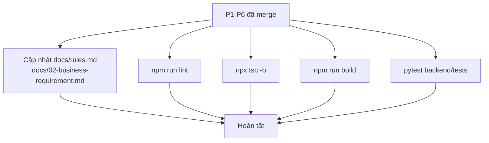

# Phase 07 — Docs + verify

**Trạng thái:** ✅ Đã làm
**Ưu tiên:** P1 · **Chạy sau cùng**

## Context Links

- `docs/rules.md` §9.3 (Cart — FE only), dòng 504-509.
- `docs/02-business-requirement.md` §3.3 (Module Giỏ hàng), dòng 189-191.
- `docs/02-business-requirement.md` dòng 399 (bảng "Edge case": giỏ hàng guest).
- `docs/01-system-design.md` dòng 647 (bảng quyết định: giỏ hàng ở FE).
- Lint/build: `frontend/package.json` → `lint`, `build` (`tsc -b && vite build`).

## Overview

**Priority:** P1.

**Current status:** Chưa làm.

**Description:** Cập nhật tài liệu cho khớp hành vi mới + chạy lint/typecheck/build để đảm bảo
không vỡ gì.

## Key Insights

- `docs/rules.md` §9.3 hiện chỉ nói 3 dòng về cart. Cần bổ sung hành vi xoá giỏ khi logout.
- `docs/02-business-requirement.md:399` ghi "merge khi login (tùy chọn)" — sau khi xác nhận giỏ
  **đã tự tồn tại** qua localStorage (mua trước → đăng nhập sau vẫn còn giỏ), nên ghi rõ hành vi
  thực tế thay vì để "tùy chọn" gây hiểu nhầm là còn thiếu.
- **Docs impact: minor** — không có API/DB nào đổi, chỉ mô tả hành vi FE.
- Backend **không** bị ảnh hưởng → không cần chạy test BE, nhưng chạy `pytest` để chắc chắn
  không vỡ gì (rẻ, và repo yêu cầu "run tests before push").
- `frontend/package.json` **chưa có** vitest → không có test FE để chạy (đã ghi nhận ở plan.md
  "câu hỏi còn mở").

## Requirements

**Functional**
- F1. `docs/rules.md` §9.3: bổ sung hành vi xoá giỏ khi chủ động đăng xuất + giữ giỏ khi token hết hạn.
- F2. `docs/02-business-requirement.md` §3.3: mô tả đầy đủ luồng giỏ (thêm / sửa qty / xoá / đồng bộ giá).
- F3. `docs/02-business-requirement.md` dòng 399: sửa dòng edge case về giỏ guest.
- F4. Chạy `npm run lint` + `npx tsc -b` + `npm run build` → tất cả exit 0.

**Non-functional**
- N1. Docs khớp 100% với code sau khi sửa (không mô tả tính năng chưa làm).
- N2. Không thêm mục docs mới — cập nhật file hiện có.

## Architecture



## Related Code Files

**Sửa:**
- `docs/rules.md`
- `docs/02-business-requirement.md`

**Tạo:** không.

**Xoá:** không.

## Implementation Steps

1. **Cập nhật `docs/rules.md` §9.3** (hiện tại, dòng 504-509):
   ```markdown
   ### 9.3 Cart (FE only)

   - Zustand + `localStorage` (key `cart-storage`).
   - KHÔNG có endpoint BE cho cart.
   - Check stock khi checkout (BE mới kiểm tra).
   - Key của 1 dòng giỏ = `product_id` + `variant_id` (cùng sản phẩm khác phân loại là 2 dòng).
   - Số lượng 1 dòng giới hạn `[1, 99]` — khớp `backend/app/schemas/order.py` (`le=99`).
   - **Xoá giỏ khi user chủ động đăng xuất** (`logout({ clearCart: true })`).
     Khi token hết hạn (401) **giữ nguyên** giỏ — không mất giỏ chỉ vì hết phiên.
   - Giỏ được **đồng bộ giá & tồn kho** từ `GET /api/products/{id}` khi mở trang giỏ
     (giá trong giỏ chỉ là preview; server luôn tính lại lúc tạo đơn).
   - Giỏ được xoá **ngay khi đơn đã tạo thành công** (cả COD lẫn SePay) — đơn đã lưu đủ
     snapshot `order_items`, giữ giỏ chỉ gây rủi ro tạo đơn trùng.
   ```

2. **Cập nhật `docs/02-business-requirement.md` §3.3** (dòng 189-191):
   ```markdown
   ### 3.3 Module Giỏ hàng

   - **Lưu trữ:** Zustand + `localStorage` (FE), key `cart-storage`.
   - **Khóa dòng giỏ:** `product_id` + `variant_id`.
   - **Thao tác:** thêm (cộng dồn nếu trùng key) · sửa số lượng (1–99) · xoá dòng · xoá tất cả.
   - **Đồng bộ giá & tồn kho** từ server khi mở trang giỏ; hiển thị cảnh báo khi hết hàng /
     ngừng bán / số lượng vượt tồn kho.
   - **Xoá giỏ khi đăng xuất** (chủ động). Token hết hạn → giữ giỏ.
   - Giỏ guest và giỏ đã đăng nhập dùng chung key `localStorage` → hành vi "mua trước,
     đăng nhập sau" hoạt động sẵn, **không cần** bước merge riêng.
   ```

3. **Cập nhật `docs/02-business-requirement.md` dòng 399** (bảng edge case):
   ```markdown
   | Giỏ hàng guest | Lưu `localStorage` dùng chung key `cart-storage` → đăng nhập sau vẫn giữ giỏ (không cần merge). Xoá giỏ khi chủ động đăng xuất. |
   ```

4. **Verify FE:**
   ```bash
   cd frontend
   npm run lint
   npx tsc -b
   npm run build
   ```

5. **Verify BE (không đổi, nhưng chạy cho chắc):**
   ```bash
   cd backend && pytest
   ```

6. **Verify thủ công trên trình duyệt:**
   - Đăng nhập → thêm 2 sản phẩm vào giỏ → đăng xuất → badge = 0, localStorage `cart-storage` rỗng.
   - Thêm vào giỏ → thêm lại cùng sản phẩm → qty cộng dồn.
   - Thêm sản phẩm có phân loại từ `/products` → thông báo + chuyển trang chi tiết.
   - Sửa qty > 99 → bị chặn.
   - Đổi giá sản phẩm (admin) → mở lại `/cart` → giá cập nhật.

## Todo

- [ ] T1. `docs/rules.md` §9.3 — bổ sung hành vi logout / giới hạn qty / đồng bộ giá
- [ ] T2. `docs/02-business-requirement.md` §3.3 — mô tả đầy đủ luồng giỏ
- [ ] T3. `docs/02-business-requirement.md` dòng 399 — sửa edge case giỏ guest
- [ ] T4. `npm run lint` exit 0
- [ ] T5. `npx tsc -b` exit 0
- [ ] T6. `npm run build` exit 0
- [ ] T7. `pytest` backend pass (baseline không giảm)
- [ ] T8. Verify thủ công 5 flow trên trình duyệt

## Success Criteria

- [ ] `npm run lint` → exit 0, không warning mới
- [ ] `npx tsc -b` → exit 0
- [ ] `npm run build` → exit 0
- [ ] `pytest` backend → pass, số test không giảm
- [ ] Docs mô tả **đúng** hành vi đã implement (đọc lại sau khi code xong)
- [ ] 5 flow verify thủ công đều đúng

## Risk Assessment

| Rủi ro | Mức | Giảm thiểu |
|---|---|---|
| Docs mô tả tính năng chưa implement (nếu làm T1-T3 trước P1-P6) | Trung bình | Chỉ cập nhật docs **sau khi** P1-P6 xong |
| `npm run build` fail vì lỗi type ẩn (vite build không typecheck hết) | Thấp | Chạy cả `npx tsc -b` riêng |
| `pytest` fail do môi trường DB không sẵn sàng | Trung bình | Nếu fail do hạ tầng (không phải code) → ghi rõ vào báo cáo, không sửa test để "cho pass" |

## Security Considerations

- Docs là tài liệu — không ảnh hưởng bảo mật.
- Không thay đổi cơ chế auth token khi mô tả hành vi logout.

## Next Steps

- Plan hoàn tất. Cân nhắc phase sau: setup `vitest` + test cho `cartStore`
  (theo yêu cầu `docs/rules.md` §13.2) — chưa nằm trong scope plan này.
